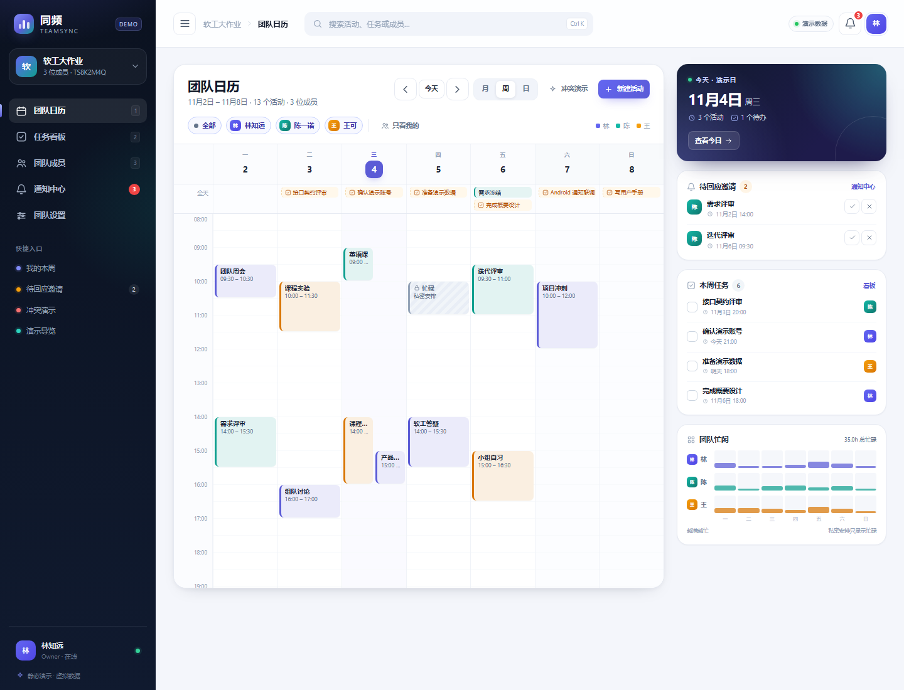
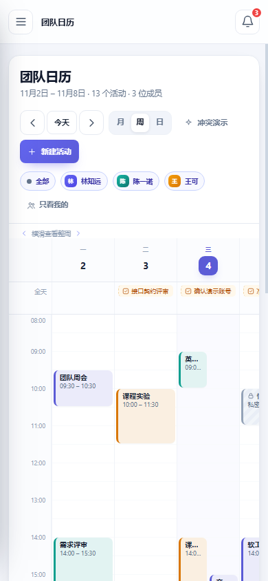

# TeamSync（同频）

> 把“队友什么时候有空、这件事谁负责、什么时候截止”放在同一张日历上。

TeamSync 是面向 **3–20 人小团队**的共享日程 + 轻量任务协作工具：用一张团队日历组织活动，用 RSVP 确认谁到场，用忙闲视图避开时间冲突，并把任务截止日直接放到日历上。

- **适合**：课程小组、社团项目组、小型创业团队，以及任何需要频繁约时间的 3–20 人团队。
- **不适合**：需要 IM、视频会议、复杂项目管理、排班考勤、企业级权限体系的组织。
- **形态**：Web（全功能）+ Windows 桌面（托盘、系统通知）+ Android（本地定时通知）。一套数据、三个入口。

## 当前状态

> 这是一个软件工程课程项目。仓库骨架于 2026-10-27 建立，**正式产品尚未上线**；下面的“产品功能”和“使用手册”描述的是已冻结的 P0 交付范围。

| 能力 | 状态 |
|---|---|
| 静态交互原型（完整界面 + 演示数据） | ✅ 现在可体验 |
| Web 注册/登录、团队选择/创建/邀请码加入、AppShell | ✅ 可运行（W1-07） |
| 账号与团队接口 | ✅ 已实现（W1-05/06） |
| 日历、活动、RSVP、忙闲、任务、通知 | 🚧 开发中（W2–W4） |
| Electron 桌面壳（加载登录页） | ✅ 可打开（W1-08，已冒烟） |
| Android 壳（加载登录页） | 🟡 已生成，待真机验证（W1-08） |
| 托盘 / 系统通知 / 本地通知 | 🚧 计划中（W4） |
| 部署、验收、答辩材料 | 🚧 计划中（W5–W6） |

**现在就想看界面？** 不用安装任何东西，直接打开 [静态交互原型](demo/index.html)（双击即可，纯前端虚拟数据）。
**想在本机跑起来？** 见 [共创者指南：从零搭建开发环境](docs/dev/02-共创者指南.md)。

## 产品功能

### 团队与成员

- 用 8 位邀请码加入团队；邀请码可随时轮换，旧码立即失效。
- 三种角色：**Owner**（创建者，唯一）、**Admin**（管理成员与邀请码）、**Member**（日常协作）。
- 一个账号可加入多个团队（≤ 20 个），团队之间数据完全隔离。
- 成员被移除后，其未完成任务自动变为“待重新指派”，避免任务悬空。

### 团队日历

- 月、周、日三种视图，支持“今天”、上一页/下一页。
- 按成员筛选：全部成员 / 指定成员 / 只看我的。
- 活动按创建者或自定义颜色显示；任务截止日出现在日历的“全天”行。
- 全天活动、跨天活动、23:30/00:00 等边界时间都能正确显示。
- 时间统一按团队时区（默认 `Asia/Shanghai`）展示，换设备不会错位。

### 活动与邀约

- 创建活动：标题、开始/结束时间、全天、地点、描述、颜色、可见性。
- 一次邀请多名团队成员；组织者自动“已接受”，其他人默认“待回应”。
- 保存时自动检测参与者时间冲突，列出冲突成员与时段；可改时间，也可二次确认后强制创建。
- 活动变更、取消会通知参与者；活动开始后锁定时间/地点，但仍可取消。
- 支持补录过去的活动（不会补发提醒）。

### 忙闲与冲突

- 周视图按成员展示忙碌块，快速看出“谁什么时候有空”。
- 私密活动在忙闲中只显示“忙碌”和时间段，不泄露标题、地点、描述。
- 冲突只提示、不阻止：确认后可以强制保存。
- 已拒绝邀请的成员不计入冲突；待定（tentative）计入冲突。

### 任务

- 每个任务一名负责人，负责人和截止时间必填；支持低/普通/高优先级。
- 状态流转：待办 → 进行中 → 已完成；完成后记录完成时间，可重新打开。
- 任务不占用时间网格，只出现在截止日；逾期任务红色标识并显示逾期天数。
- 支持“我的 / 全部 / 按状态 / 按负责人”筛选。

### 通知与提醒

- 事件的邀请、变更、取消，任务的指派、即将到期、逾期，都会生成站内通知。
- 同一提醒只生成一次，避免重复打扰。
- Web 端：未读角标、通知列表、单条/全部已读、点击跳转。
- 桌面端：关闭窗口后驻留托盘，事件前 15 分钟弹系统通知。
- Android：为未来 7 天的活动/任务安排本地定时通知，点击直接打开应用。

### 私密与权限

- 活动可见性分 `team`（团队可见）和 `private`（仅组织者与参与者可见）。
- 私密活动的标题、地点、描述不会出现在非参与者的任何响应里；知道 id 直接访问也返回 404。
- 所有权限在服务端校验，前端隐藏按钮只是体验优化。
- 非团队成员访问团队资源统一 404，不暴露团队是否存在。

### 三端

| 端 | 能做什么 | 明确不做 |
|---|---|---|
| Web | 全部功能，桌面与手机浏览器可用 | — |
| Windows 桌面 | 同一套 Web 界面 + 托盘 + 系统通知 | 离线写入、离线缓存 |
| Android | 同一套 Web 界面 + 本地定时通知 | 后台常驻推送、被杀死后仍实时同步 |

## 使用手册

> 以下按最终产品的 P0 行为编写。当前可先在[静态原型](demo/index.html)里体验同样的界面与交互；正式功能随 W1–W4 逐步上线。

### 1. 注册与登录

1. 打开 Web、桌面端或 Android 端，首次使用点击“注册”。
2. 填写**用户名**（全站唯一）、**显示名**、**密码**（至少 8 位），邮箱可选。
3. 注册成功即自动登录，进入“我的团队”。
4. 已注册用户输入用户名和密码登录；登录状态默认保留 7 天，重启应用无需重复登录。
5. 退出登录：头像菜单 → “退出登录”，本地登录状态会被清除。

> 当前版本不做邮箱验证、找回密码和第三方登录，请妥善保管密码；修改密码为 P1 功能。

### 2. 创建团队

1. 在“我的团队”页点击“创建团队”。
2. 填写团队名称（1–50 字）和描述（可选）。
3. 创建成功后你自动成为 **Owner**，系统生成一个 8 位邀请码。
4. 在团队卡片上可以看到成员数和你在该团队的角色；点卡片进入团队日历。
5. 一个账号可以加入多个团队，切换团队后看到的数据互相隔离。

> Owner 不能直接退出团队；当前版本需要先删除团队（转让所有权为 P1）。

### 3. 邀请成员加入

1. 进入团队 → “成员”页，复制邀请码，通过任意方式发给同学。
2. 对方注册/登录后，在“我的团队”页输入邀请码加入，成为 **Member**。
3. 重复输入同一个邀请码不会报错，会直接返回当前成员身份。
4. Owner/Admin 可随时“轮换邀请码”：旧码立即失效，已加入的成员不受影响。
5. Owner 可以把成员设为 **Admin**；Admin 能管理成员，但不能移除或降级 Owner。
6. 单个团队最多 50 人。

### 4. 浏览团队日历

1. 进入团队后默认打开周视图，可切换**月 / 周 / 日**。
2. 用“今天”回到当前日期，用左右箭头翻到上一页/下一页。
3. 顶部成员筛选支持“全部成员 / 指定成员 / 只看我的”，事件和忙闲会一起过滤。
4. 点击活动查看详情；点击空白时段可直接新建活动，并自动预填时间。
5. 任务截止日显示在日历的“全天”行，逾期任务标红。

### 5. 新建活动并邀请成员

1. 点击“新建活动”，或直接点击日历空白格。
2. 填写标题（必填，≤ 100 字）、开始/结束时间、地点、描述（≤ 2000 字）、颜色。
3. 需要整天安排时勾选“全天”；全天活动按日期计，结束日期不能早于开始日期。
4. 选择参与者：默认包含自己，可多选团队成员。
5. 选择可见性：`team`（团队可见）或 `private`（仅组织者和参与者可见）。
6. 保存时若有人时间冲突，会弹出冲突成员与时段：
   - 点“调整时间”返回修改；
   - 确认无误后点“仍然创建”，活动会强制保存。
7. 创建成功后，参与者会收到站内通知，团队日历和忙闲同步刷新。

> 活动开始后不能再修改时间与地点（取消仍允许）；补录过去的活动不会生成提醒。

### 6. 回应邀请（RSVP）

1. 从通知或活动详情进入邀请。
2. 选择**接受 / 待定 / 拒绝**，当前状态会高亮。
3. 在活动结束或取消前，可以反复修改；每次修改都会更新回应时间。
4. 组织者和其他参与者能看到每个人的最新状态；拒绝的人不再计入冲突。
5. 组织者不能拒绝自己创建的活动；不想继续时请“取消活动”。

### 7. 查看忙闲与处理冲突

1. 周视图右侧（移动端为独立区域）显示每位成员的忙碌程度。
2. 私密活动只显示为“忙碌”块，不显示任何标题或地点。
3. 保存活动时，系统检查新活动与每位参与者已有活动是否重叠。
4. 有冲突时不会静默忽略：弹窗列出冲突成员和时段，由你决定改时间还是强制保存。
5. 忙闲查询一次最多 31 天，日历查询一次最多 92 天。

### 8. 创建与完成任务

1. 进入团队 → “任务”页，点击“新建任务”。
2. 填写标题、描述、负责人（必须是团队活跃成员）、截止时间（必填）、优先级。
3. 新任务状态为“待办”；负责人可改为“进行中”，完成后改为“已完成”。
4. 任务完成后记录完成时间并变绿；误点可以“重新打开”。
5. 截止时间已过且未完成的任务显示红色和“逾期 N 天/小时”。
6. 任务出现在截止日的日历行，但不占用时间网格，也不参与活动冲突检测。
7. 负责人被移出团队时，任务变为“待重新指派”并通知 Admin。

### 9. 通知与提醒

1. 顶部铃铛显示未读数；打开后可看通知列表，支持单条已读和全部已读。
2. 点击通知直接跳到对应活动或任务；活动已取消时会提示，而不是白屏。
3. 在线时通过 WebSocket 实时收到新通知，其他端一般 2 秒内同步。
4. 断网后客户端会自动重连；重连成功会重新拉取当前视图和未读数。
5. 提醒时间：
   - 活动开始前 **15 分钟**；
   - 任务截止前 **1 小时**；
   - 逾期任务每天 **09:00** 提醒一次。
6. 桌面端关闭窗口后会最小化到托盘；要完全退出请使用托盘菜单的“退出”。
7. Android 首次使用需要允许通知权限；Android 12+ 可能还需要允许“闹钟和提醒”权限。

> 提醒依赖服务端进程运行，服务停止期间不会补发错过的站内通知、Web 与桌面提醒。Android 已安排的本地通知由系统调度，不受服务端在线状态影响；但服务端变更不会实时到达。

### 10. 私密活动：别人能看到什么

| 你的身份 | 活动列表/详情 | 忙闲视图 | 冲突结果 | 通知 |
|---|---|---|---|---|
| 组织者 | 完整标题、地点、描述 | 忙碌块 | 包含 | 收到 |
| 参与者 | 完整标题、地点、描述 | 忙碌块 | 包含 | 收到 |
| 其他团队成员 | 不出现 | 只有时间段 + “忙碌” | 不返回标题/活动 id | 不收到 |
| 非团队成员 | 404 | 不可访问 | 不可访问 | 不收到 |

### 11. 成员、角色与团队管理

| 操作 | Owner | Admin | Member |
|---|---|---|---|
| 查看日历 / 忙闲 | ✓ | ✓ | ✓ |
| 创建活动、邀请成员 | ✓ | ✓ | ✓ |
| 编辑/删除自己创建的活动 | ✓ | ✓ | ✓ |
| 编辑/删除他人创建的活动 | ✓ | ✓ | — |
| 创建任务、指派负责人 | ✓ | ✓ | ✓ |
| 管理成员、轮换邀请码 | ✓ | ✓（不能动 Owner） | — |
| 编辑团队资料（P1） | ✓ | ✓ | — |
| 删除团队 | ✓ | — | — |
| 退出团队 | 需先删除团队 | ✓ | ✓ |

> 移除成员、删除团队等破坏性操作都会二次确认。删除团队为软删除，成员立即失去访问，邀请码同时失效。

### 12. 三端差异

| 场景 | Web | Windows 桌面 | Android |
|---|---|---|---|
| 全部功能 | ✓ | ✓ | ✓ |
| 关闭窗口后继续提醒 | — | 托盘驻留 | 由系统调度 |
| 提醒方式 | 站内 toast（页面在线） | 系统通知（托盘驻留） | 系统通知（本地调度） |
| 离线写入 | — | — | — |
| 后台实时同步 | 页面在线时 | 应用运行时 | 应用被杀死后不保证 |

### 13. 使用限制

- 单团队 ≤ 50 人；单用户 ≤ 20 个团队；单团队 ≤ 10,000 个活动。
- 活动标题 ≤ 100 字；描述 ≤ 2000 字；团队名 ≤ 50 字。
- 日历查询跨度 ≤ 92 天；忙闲查询跨度 ≤ 31 天。
- 单个请求体 ≤ 1 MB；不支持附件上传。
- 不支持离线写入、服务端推送到已杀死的 Android 进程、Google/Outlook 双向同步。

## 常见问题

**为什么同事看不到我的活动？**
活动可见性可能设成了 `private`。私密活动只有组织者和参与者能看到详情，其他成员只能在忙闲里看到“忙碌”。

**明明有冲突，为什么还能创建？**
冲突是提醒而不是硬性禁止。弹窗确认后可以强制保存，适合“就是要在这个时间开个短会”的场景。

**为什么显示的时间和我手机不一致？**
TeamSync 按**团队时区**显示（默认 `Asia/Shanghai`），不支持个人时区设置。数据库存 UTC，换设备不会改变活动绝对时间。

**为什么没有收到提醒？**
Web 需要页面在线；桌面端需要应用在托盘运行；Android 需要通知权限和“闹钟和提醒”权限。服务端停止时也不会补发。

**能离线使用吗？**
不能。MVP 是服务端权威，不做离线写入；断网时只能查看已加载内容，恢复后自动刷新。

**能导出日历或同步 Google Calendar 吗？**
不能，明确在范围外。

**忘记密码怎么办？**
当前版本不提供自助找回密码（邮箱验证/找回密码在范围外）；这是课程项目，遇到此情况请与项目组确认处理方式。修改密码为 P1 功能。

**数据存在哪里？**
服务端 SQLite 数据库，每日备份保留 7 天；密码只存哈希，不存明文。私密活动在服务端脱敏后才返回。

**有 iOS / 小程序吗？**
没有。当前只交付 Web、Windows 桌面和 Android。

**这是免费产品吗？**
这是软件工程课程作业，不是商业产品，暂未声明开源许可证。

## 路线图

| 里程碑 | 时间 | 内容 |
|---|---|---|
| M0 | 10/27–11/01 | 需求、设计、文档基线 |
| M1 | 11/02–11/08 | 仓库骨架、账号、团队、邀请码、三端空壳 |
| M2 | 11/09–11/15 | 日历、活动、RSVP、种子数据 |
| M3 | 11/16–11/22 | 忙闲、冲突、任务闭环 |
| M4 | 11/23–11/29 | WebSocket、通知、桌面/Android 提醒 |
| M5 | 11/30–12/06 | 测试、部署、打磨 |
| M6 | 12/07–12/13 | 验收、文档、答辩 |

## 参与开发

- **第一次参与 / 从零搭环境**：[共创者指南](docs/dev/02-共创者指南.md)（Windows / WSL / macOS，含验证命令与常见故障）。
- **了解架构与改代码**：[开发者指南](docs/dev/01-开发者指南.md)（目录、分层、契约、测试、调试）。
- **与 AI 协作的规则**：[AGENTS.md](AGENTS.md)（命令、DoD、改动边界、提交与评审）。
- **开发文档索引**：[docs/dev/README.md](docs/dev/README.md)。

目标技术栈：FastAPI + SQLAlchemy 2.0 + Alembic + SQLite；React + Vite + TypeScript；Electron；Capacitor 7（Android）。其中 Electron / Capacitor 尚未接入，当前只有 Web 可运行。

## 文档

| 文档 | 给谁看 | 内容 |
|---|---|---|
| [需求规格说明书](docs/02-需求规格说明书.md) | 产品 / 验收 | 用例、94 条需求编号、业务规则、验收标准 |
| [概要设计说明书](docs/03-概要设计说明书.md) | 开发 | 架构、表结构、API 契约、算法、三端实现 |
| [六周项目计划](docs/01-六周项目计划.md) | 项目组 | 逐周任务、分工、门禁、风险 |
| [验收与演示脚本](docs/04-验收与演示脚本.md) | 答辩 | 8 分钟演示流程与兜底 |
| [静态交互原型说明](demo/README.md) | 所有人 | 原型能体验什么、边界在哪 |
| [开发者指南](docs/dev/01-开发者指南.md) | 开发 | 代码地图、分层约定、测试与调试 |
| [共创者指南](docs/dev/02-共创者指南.md) | 新成员 | 从零搭建环境、第一次提交、评审流程 |
| [代码审查报告（2026-10-28）](docs/dev/03-代码审查报告-2026-10-28.md) | 项目组 | 本次审查的发现、证据与修复建议 |

## 说明

- 演示数据中的团队“软工大作业”和成员林知远、陈一诺、王可均为虚构；项目组实际为 2 人 + AI 辅助。
- 静态原型不连接后端，刷新即重置；正式行为以需求规格和概要设计为准。
