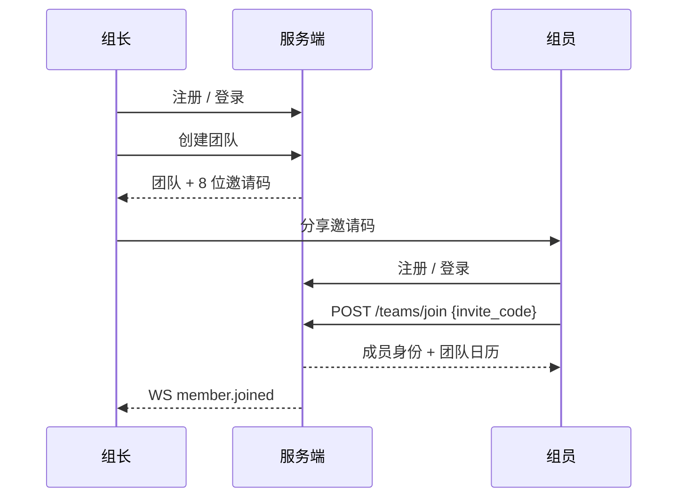
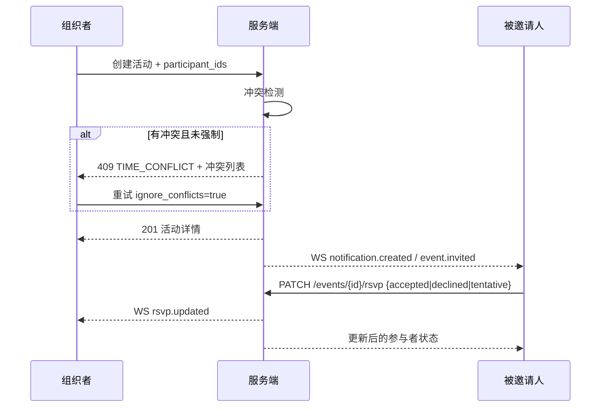
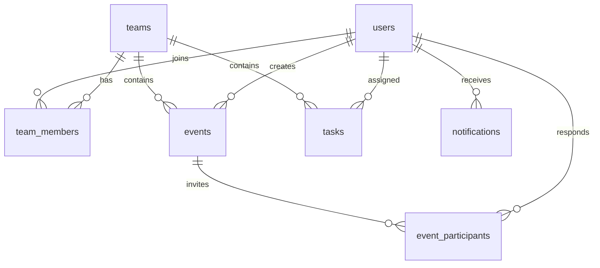

# TeamSync（同频）· 需求与设计框架 v1.0

版本：v1.0（已确认，冻结）  
日期：2026-10-27  
状态：已于 2026-10-27 由项目组确认，第 15 节 6 项均按推荐方案执行。后续变更走 CR/ADR。  
目标读者：课程指导教师、2 人项目组、AI 编码助手。

| 版本 | 日期 | 说明 |
|---|---|---|
| v1.0 | 2026-10-27 | 初版确认，Q1–Q6 冻结 |
| v1.0-r2 | 2026-10-27 | 团队固定为 2 人 + AI；新增 13.3 协作模式与 17 设计完备性；补成员移除、活动开始/结束、并发编辑边界 |

---

## 0. 这份文档怎么用

本文只回答四个问题：**给谁做、做什么、不做什么、大致怎么落地**。它不展开每个接口字段和页面像素，那些放在后续的 PRD 与概要设计里。

- 第 15 节是 6 个需要你拍板的决策。确认后，范围、角色、数据模型、API 风格、三端深度即冻结。
- 需求编号（如 `EVT-3`）会在 PRD、设计、测试、提交信息中复用，保证可追溯。
- 任何范围变更走后续的 `docs/ai/04-变更控制与追踪.md`，不在聊天里口头加需求。
- 本文的“推荐方案”按 6 周、**2 人 + AI 辅助**、三端交付设计；时间不是主要约束，**设计完备性和可验收性优先**。

---

## 1. 一句话定位

**TeamSync（同频）是面向 3–20 人小团队的共享日程与轻量任务协作工具：把“队友什么时候有空、这件事谁负责、什么时候截止”放在同一张日历上。**

它不是一个功能更多的个人待办，也不是一个完整的项目管理平台。它的差异化在“**团队时间可见 + 邀约闭环 + 任务截止日上日历**”。

---

## 2. 背景与目标

### 2.1 要解决的三个问题

| 问题 | 现状 | TeamSync 的回答 |
|---|---|---|
| 时间不透明 | 在群里反复问“周三下午有空吗”，回复慢且容易漏 | 团队忙闲视图：按成员看一周内的忙碌块，不用逐个问 |
| 邀约无状态 | 口头答应，临时变卦，没人知道谁去 | 活动邀约 + RSVP（接受/拒绝/待定），状态全员可见 |
| 任务与日程割裂 | 截止日只在任务软件里，日历上看不到 | 任务截止日进入日历，逾期高亮，指派有通知 |

### 2.2 产品目标

1. 一个团队空间内，成员能查看彼此**可共享**的日程与忙闲。
2. 活动从创建、邀请、RSVP 到变更通知形成闭环。
3. 任务有明确负责人和截止时间，并出现在日历上。
4. 三端可用：Web 全功能、桌面常驻提醒、Android 随身查看与本地提醒。
5. 所有变化通过实时通道同步，断线重连后自动刷新。

### 2.3 成功标准（答辩演示可验证）

- 3 个演示账号、1 个团队，5 分钟内完成“注册 → 建队 → 邀请码加入 → 建活动 → 邀请 → RSVP”。
- 周视图能看出谁在什么时间忙；给忙碌成员建活动时出现冲突提示，仍可强制保存。
- 任务指派后，被指派人在另一个浏览器/桌面端 2 秒内收到通知。
- 事件开始前 15 分钟，桌面端弹出系统通知；Android 端收到本地通知。
- 断网 30 秒再恢复，WebSocket 自动重连，日历数据自动刷新，不丢已保存数据。
- 非团队成员访问团队数据返回 404（角色不足才 403）；他人的私密活动只显示“忙碌”，不泄露标题。

### 2.4 明确不追求

- 不做 IM、视频会议、文件共享。
- 不做复杂组织架构、审批流、考勤/排班。
- 不做离线写入与冲突合并（MVP 服务器权威）。
- 不做 iOS、小程序、桌面桌宠。
- 不做 Google/Outlook 日历双向同步。

---

## 3. 用户与角色

### 3.1 角色定义

| 角色 | 说明 | 典型用户 |
|---|---|---|
| 游客 | 未登录，只能注册/登录 | 新成员 |
| 成员 Member | 团队普通成员，可查看团队日历、建活动、邀约、管理自己的任务 | 组员 |
| 管理员 Admin | 成员权限 + 管理团队资料、成员、邀请码 | 副组长 |
| 所有者 Owner | 团队创建者，拥有管理员权限 + 删除团队/转让所有权 | 组长 |
| 运维（非产品角色） | 课程项目组，负责部署、种子数据、备份 | 开发/答辩人 |

### 3.2 权限矩阵

| 操作 | Owner | Admin | Member |
|---|---|---|---|
| 查看团队日历/忙闲 | ✓ | ✓ | ✓ |
| 创建活动、邀请团队成员 | ✓ | ✓ | ✓ |
| 编辑/删除自己创建的活动 | ✓ | ✓ | ✓ |
| 编辑/删除他人创建的活动 | ✓ | ✓ | — |
| RSVP 自己收到的邀请 | ✓ | ✓ | ✓ |
| 查看活动参与者与 RSVP 状态 | ✓ | ✓ | ✓ |
| 创建任务、指派给团队成员 | ✓ | ✓ | ✓ |
| 编辑任务标题/截止时间/负责人 | ✓ | ✓ | 仅自己创建的任务 |
| 修改任务状态 | ✓ | ✓ | 仅自己负责或自己创建的任务 |
| 管理成员（移除、改角色） | ✓ | ✓（不能动 Owner） | — |
| 轮换邀请码 | ✓ | ✓ | — |
| 编辑团队资料 | ✓ | ✓ | — |
| 删除团队 | ✓ | — | — |
| 退出团队 | 需先转让/删除 | ✓ | ✓ |

> 设计原则：**协作优先，但不做审批**。成员可以给任何人派任务，被指派者可以改状态；破坏性操作（删团队、移除成员）收口到 Owner/Admin。

### 3.3 典型场景

**场景 A：组长建队，组员加入。**  
组长注册后创建“软工大作业”团队，把 8 位邀请码发到群里；组员注册后输入邀请码加入，看到同一张团队日历。

**场景 B：约一次小组会。**  
副组长在周视图看到周三 14:00–16:00 有两人忙碌，改约 16:30；创建活动，邀请 5 人，填写地点；被邀请人收到通知，分别选择接受/待定/拒绝；副组长在活动详情里看到 RSVP 汇总。

**场景 C：任务截止日不再漏。**  
组长创建“完成概要设计”任务，指派给组员，截止周五 18:00；任务出现在日历周五的“截止”行；周五 17:00 组员收到提醒，完成后勾选，任务变绿。

---

## 4. 范围

### 4.1 MVP（P0，6 周必须交付）

| 模块 | 范围 |
|---|---|
| 账号 | 注册、登录、登出、当前用户、修改昵称/密码、JWT 持久登录 |
| 团队 | 创建、邀请码加入、多团队切换、成员列表、角色、移除/退出、邀请码轮换 |
| 日历 | 月/周/日视图、成员筛选、今天跳转、事件颜色、响应式 |
| 活动 | 创建/编辑/取消、全天、地点、描述、可见性（团队/私密）、邀请成员、详情 |
| 邀约 | RSVP 四态（待回应/接受/拒绝/待定）、参与者状态、组织者视角汇总 |
| 忙闲 | 团队周忙闲视图、按成员筛选、冲突检测、私密事件脱敏 |
| 任务 | 创建/编辑/完成/删除、单负责人、截止时间、优先级、三态、日历截止行、逾期标识 |
| 通知 | 站内通知、未读数、已读、事件邀请/变更/取消、任务指派/到期提醒 |
| 实时 | WebSocket 鉴权、团队广播、断线重连、重连后刷新 |
| 提醒 | 事件前 15 分钟、任务截止前 1 小时、逾期每日 09:00；通知落库去重 |
| 三端 | Web 全功能；Electron 壳 + 托盘 + 系统通知；Capacitor Android 壳 + 本地通知 |
| 运维 | 健康检查、种子数据、结构化日志、SQLite 备份、部署文档、演示脚本 |

### 4.2 P1（有余力再做，不阻塞验收）

- 重复活动（每周/每双周）。
- 活动/任务评论。
- “找空闲时间”推荐。
- 任务多负责人。
- 成员在线状态（presence，基于 WS 心跳；P1 可选，不单列编号）。
- 邮件通知。
- `.ics` 导出。
- 桌面端离线只读缓存。
- 深色模式。
- 活动附件（不做上传，仅链接）。

### 4.3 明确不做

- 即时聊天、视频会议、文件存储。
- 排班/值班/考勤、薪资。
- 复杂组织架构、SSO、LDAP、企业微信/钉钉集成。
- iOS、微信小程序。
- 服务端推送到已被系统杀死的 Android 进程（改用本地定时通知）。
- 离线写入、CRDT/冲突合并。
- 第三方日历双向同步。
- 付费、订阅、发票。

---

## 5. 核心流程

### 5.1 建队与加入



### 5.2 建活动、邀约、RSVP



### 5.3 看忙闲与冲突

1. 成员打开团队周视图，默认显示“全部成员”。
2. 前端请求 `GET /teams/{id}/availability?from&to`，拿到每人每天的忙碌块。
3. 私密活动对非参与者只返回 `busy: true` 和时间段，不返回标题/地点/描述。
4. 点击空白格创建活动，预填时间与参与人。
5. 保存时服务端再次做冲突检测，前端展示冲突弹窗，可选择“仍然创建”。

### 5.4 任务

1. 成员创建任务，填写标题、负责人、截止时间、优先级。
2. 任务出现在团队任务列表和日历的“截止”行。
3. 被指派者收到通知；可把状态从“待办”改为“进行中/已完成”。
4. 截止时间已过且未完成 → 逾期高亮；每日 09:00 汇总提醒一次。

### 5.5 提醒

```text
APScheduler 每 60 秒扫描
  ├─ 事件 start_at - 15min 到期 → 生成 event.reminder 通知
  ├─ 任务 due_at - 1h 到期   → 生成 task.due_soon 通知
  └─ 任务逾期且当天未提醒     → 生成 task.overdue 通知（每日 09:00）
        ↓
notifications 落库（dedupe_key 唯一，防重复）
        ↓
WS 推给在线用户 → Web 站内 toast / Electron 系统通知
        ↓
Android 端不依赖服务端推送：同步数据后由客户端为未来 7 天安排本地通知
```

---

## 6. 功能地图与需求编号

> 优先级：P0 = 6 周必须；P1 = 有余力；P2 = 明确不做。详细验收标准在 PRD 中展开。

### 6.1 账号与认证

| 编号 | 需求 | 优先级 |
|---|---|---|
| AUTH-1 | 用户名 + 密码注册，用户名唯一，密码至少 8 位 | P0 |
| AUTH-2 | 登录返回 JWT，有效期 7 天 | P0 |
| AUTH-3 | 登出（客户端清除 token） | P0 |
| AUTH-4 | 获取/修改当前用户昵称、头像颜色 | P0 |
| AUTH-5 | 修改密码，需验证旧密码 | P1 |
| AUTH-6 | 三端登录态持久化，重启后免登录 | P0 |
| AUTH-7 | 登录失败限流（同一 IP + 用户名 5 次/分钟） | P1 |

### 6.2 团队

| 编号 | 需求 | 优先级 |
|---|---|---|
| TEAM-1 | 创建团队，创建者自动成为 Owner | P0 |
| TEAM-2 | 生成 8 位邀请码，可复制/分享 | P0 |
| TEAM-3 | 通过邀请码加入团队，重复加入幂等 | P0 |
| TEAM-4 | 成员列表：昵称、角色、加入时间 | P0 |
| TEAM-5 | Owner/Admin 可移除成员；成员可退出；移除按 17.3 处理任务/私密活动/通知 | P0 |
| TEAM-6 | Owner 可设置/取消 Admin；Owner 唯一 | P0 |
| TEAM-7 | Owner/Admin 可轮换邀请码，旧码立即失效 | P0 |
| TEAM-8 | 用户可属于多个团队，前端可切换 | P0 |
| TEAM-9 | 编辑团队名称、描述、时区 | P1 |
| TEAM-10 | Owner 删除团队，需二次确认 | P0 |

### 6.3 日历

| 编号 | 需求 | 优先级 |
|---|---|---|
| CAL-1 | 月视图：每天显示事件条与任务截止标记 | P0 |
| CAL-2 | 周视图：7 天 × 24 小时时间网格 | P0 |
| CAL-3 | 日视图：单日时间轴 | P0 |
| CAL-4 | 成员筛选：全部/指定成员/仅我 | P0 |
| CAL-5 | “今天”跳转、上一页/下一页 | P0 |
| CAL-6 | 事件按创建者或自定义颜色显示，附图例 | P0 |
| CAL-7 | 移动端响应式：月视图可读，周视图横向滚动/日程列表 | P0 |
| CAL-8 | 周视图可叠加“忙闲”层 | P0 |

### 6.4 活动

| 编号 | 需求 | 优先级 |
|---|---|---|
| EVT-1 | 创建活动：标题、开始/结束、全天、地点、描述、颜色 | P0 |
| EVT-2 | 编辑活动，仅组织者/Admin；开始后不可改时间/地点 | P0 |
| EVT-3 | 取消活动，通知所有参与者 | P0 |
| EVT-4 | 删除活动（软删除），仅组织者/Admin | P0 |
| EVT-5 | 开始时间必须早于结束时间；全天活动按日期语义 | P0 |
| EVT-6 | 可见性：团队可见 / 私密（仅组织者与参与者可见详情） | P0 |
| EVT-7 | 邀请团队成员，重复邀请幂等；活动结束后不可邀请 | P0 |
| EVT-8 | 活动详情：时间、地点、描述、组织者、参与者及 RSVP 状态 | P0 |
| EVT-9 | “我的活动”列表：我组织的 + 我参与的 | P0 |
| EVT-10 | 重复活动（每周/每双周，可设置结束日期） | P1 |
| EVT-11 | 创建/编辑时冲突检测，返回冲突成员与时间段 | P0 |
| EVT-12 | 冲突时允许“仍然创建/保存” | P0 |

### 6.5 邀约与 RSVP

| 编号 | 需求 | 优先级 |
|---|---|---|
| RSVP-1 | 被邀请人收到站内通知与实时消息 | P0 |
| RSVP-2 | 被邀请人可选择接受/拒绝/待定，可反复修改；活动结束后不可改 | P0 |
| RSVP-3 | 组织者与参与者能看到每个人的 RSVP 状态 | P0 |
| RSVP-4 | 组织者修改时间/地点后，已接受者收到变更通知 | P0 |
| RSVP-5 | 被邀请人可退出活动（视为拒绝） | P0 |
| RSVP-6 | 组织者修改时间后，要求参与者重新确认 | P1 |

### 6.6 忙闲与冲突

| 编号 | 需求 | 优先级 |
|---|---|---|
| AVAIL-1 | 团队周忙闲视图：按成员列显示忙碌块 | P0 |
| AVAIL-2 | 支持指定成员/日期范围查询，最大 31 天 | P0 |
| AVAIL-3 | 冲突检测覆盖：组织者 + 所有未拒绝的参与者 | P0 |
| AVAIL-4 | 私密活动对非参与者只显示“忙碌”，不泄露标题/地点/描述 | P0 |
| AVAIL-5 | 全天活动在忙闲中显示为全天忙碌 | P0 |
| AVAIL-6 | “找空闲时间”推荐（给定时长与成员，返回前 3 个时段） | P1 |

### 6.7 任务

| 编号 | 需求 | 优先级 |
|---|---|---|
| TASK-1 | 创建任务：标题、描述、负责人、截止时间（必填）、优先级 | P0 |
| TASK-2 | 负责人必须是当前团队活跃成员；成员被移除后任务可暂时无负责人 | P0 |
| TASK-3 | 状态三态：待办/进行中/已完成 | P0 |
| TASK-4 | 优先级：低/普通/高 | P0 |
| TASK-5 | 任务出现在日历截止行；有具体时间时显示时间 | P0 |
| TASK-6 | 任务列表支持“我的任务/全部/按状态/按负责人”筛选 | P0 |
| TASK-7 | 逾期任务高亮，逾期天数可见 | P0 |
| TASK-8 | 完成任务记录 completed_at；可重新打开 | P0 |
| TASK-9 | 子任务、评论、附件 | P1 |
| TASK-10 | 多负责人 | P1 |

### 6.8 通知与提醒

| 编号 | 需求 | 优先级 |
|---|---|---|
| NOTI-1 | 站内通知列表，按时间倒序，分页 | P0 |
| NOTI-2 | 未读数角标；支持单条/全部已读 | P0 |
| NOTI-3 | 事件邀请、变更、取消通知 | P0 |
| NOTI-4 | 任务指派、即将到期、逾期通知 | P0 |
| NOTI-5 | 事件开始前 15 分钟提醒 | P0 |
| NOTI-6 | 任务截止前 1 小时提醒；逾期每日 09:00 提醒一次 | P0 |
| NOTI-7 | 通知去重：同一用户 + 类型 + 对象 + 时间点只生成一次 | P0 |
| NOTI-8 | Web 站内 toast；桌面系统通知；Android 本地通知 | P0 |
| NOTI-9 | 邮件通知 | P1 |

### 6.9 实时同步

| 编号 | 需求 | 优先级 |
|---|---|---|
| RT-1 | WebSocket 使用 JWT 鉴权，失败关闭连接 | P0 |
| RT-2 | 团队成员变更广播：活动/任务/成员/日历变更 | P0 |
| RT-3 | 客户端断线指数退避重连（1s–30s） | P0 |
| RT-4 | 重连成功后自动刷新当前视图与未读数 | P0 |
| RT-5 | 通知落库，WS 仅加速；离线用户上线后能补看到 | P0 |
| RT-6 | 心跳 ping/pong，30 秒间隔 | P0 |

### 6.10 三端

| 编号 | 需求 | 优先级 |
|---|---|---|
| DESK-1 | Electron 壳加载同一套 Web 构建 | P0 |
| DESK-2 | 托盘图标、显示/隐藏主窗口、退出 | P0 |
| DESK-3 | 收到提醒时弹系统通知，点击聚焦并打开对应活动/任务 | P0 |
| DESK-4 | 关闭窗口最小化到托盘（可配置） | P0 |
| DESK-5 | 开机自启 | P1 |
| DESK-6 | 离线只读缓存 | P1 |
| AND-1 | Capacitor Android 壳加载同一套 Web 构建 | P0 |
| AND-2 | 登录态持久化 | P0 |
| AND-3 | 为未来 7 天的事件/任务安排本地通知 | P0 |
| AND-4 | 通知权限引导；未授权时提示 | P0 |
| AND-5 | 前台 WebSocket 实时刷新 | P0 |
| AND-6 | 后台常驻推送（前台服务） | P1 |

### 6.11 运维与质量

| 编号 | 需求 | 优先级 |
|---|---|---|
| OPS-1 | `GET /health` 返回服务与数据库状态 | P0 |
| OPS-2 | 种子脚本：3 个用户、1 个团队、示例活动/任务 | P0 |
| OPS-3 | 结构化日志，含 request_id、user_id、team_id | P0 |
| OPS-4 | SQLite 每日备份，保留 7 天 | P0 |
| OPS-5 | 一键部署/启动文档，环境变量样例 | P0 |
| OPS-6 | 8 分钟答辩演示脚本 | P0 |
| OPS-7 | 后端核心服务测试覆盖率 ≥ 70% | P0 |
| OPS-8 | 前端关键流程 E2E：登录/建队/建活动/RSVP/任务 | P0 |

---

## 7. 关键设计决策

> 这些决策是后续 PRD 与概要设计的“宪法”。如要改，先改本节并记录理由。

### D1. 服务器权威，MVP 不做离线写

所有写操作先到服务端，成功后再更新本地缓存。桌面/Android 断网时只读，恢复后刷新。  
**理由**：离线写 + 冲突合并会吃掉 6 周里至少 1.5 周，且很难在答辩中讲清楚。  
**代价**：地铁/弱网下不能改日程；在“已知限制”里写明。

### D2. 一个团队一个共享日历，事件用可见性区分

MVP 不建 `calendars` 表，事件直接属于团队；用 `visibility = team | private` 区分团队事件和私密事件。  
**理由**：多日历（项目日历/个人日历/订阅日历）是典型的范围膨胀点。  
**代价**：后续要支持多日历，需要加 `calendar_id` 并迁移；设计上预留，不在 MVP 实现。

### D3. 私密事件对非参与者只显示“忙碌”

私密事件仍然参与忙闲计算，但对非参与者隐藏标题、地点、描述，只返回时间段和 `busy: true`。  
**理由**：否则“私密”与“团队忙闲”二选一，产品价值受损。  
**代价**：存在“某人在忙但不知道忙什么”的信息差，这是刻意的隐私边界。

### D4. 冲突是警告，不是阻止

创建/编辑活动时服务端检测冲突，返回 `409 TIME_CONFLICT` 与冲突列表；前端弹窗，用户可选择“仍然创建”（`ignore_conflicts=true`）。  
**理由**：现实中冲突是常态，工具不应替用户做决定。  
**代价**：需要前端处理 409 + 重试，测试要覆盖两条路径。

### D5. RSVP 四态，组织者默认接受

`pending / accepted / declined / tentative`。组织者创建活动时自动成为 `accepted` 的参与者。  
**理由**：四态足够表达“还没看/去/不去/可能去”，不引入“也许吧”等模糊状态。  
**代价**：UI 要清楚区分“待回应”和“待定”。

### D6. 任务单负责人、三态、截止日上日历

MVP 一个任务一个负责人；状态只有待办/进行中/已完成；任务以“截止标记”出现在日历，不占用时间网格。  
**理由**：多负责人、子任务、依赖关系会让任务模块变成项目管理平台。  
**代价**：复杂任务需要拆成多个任务；在文档里给出使用建议。

### D7. 实时用 WS 广播 + 客户端重取

WS 只发“发生了什么”的最小消息（类型 + 实体 id + 团队 id），客户端收到后通过 HTTP 重新拉取当前视图；通知本身落库。  
**理由**：避免在 WS 里维护复杂的增量 payload 和版本合并；HTTP 查询是唯一数据源，逻辑简单。  
**代价**：多一次请求；对课程规模（几十人）完全可接受。

### D8. 提醒策略固定为三档

事件前 15 分钟；任务截止前 1 小时；逾期任务每日 09:00 提醒一次。通过 `notifications.dedupe_key` 唯一约束防重复。  
**理由**：可演示、可测试、不会像“多级提醒”那样产生大量边界条件。  
**代价**：用户不能自定义提醒时间（P1 可加）。

### D9. 三端是“一套功能 + 三个壳”，不是三套功能

Web 是唯一的功能实现；Electron 和 Android 都是同一套 React 构建的壳，只增加平台能力（托盘、系统通知、本地通知）。  
**理由**：2 人 + AI 在 6 周内维护三套 UI 仍然不现实；把功能收敛到一套，才能把权限、时区、冲突和脱敏做扎实。  
**代价**：壳的体验不如原生；Android 后台推送能力弱，明确写进限制。

### D10. 技术栈沿用参考项目

服务端 Python 3.12 + FastAPI + SQLAlchemy 2.0 + Alembic + SQLite；前端 React + Vite + TypeScript；桌面 Electron；Android Capacitor 7。  
**理由**：团队已熟悉，参考项目有可复用的目录、认证、WS、测试和打包经验。  
**代价**：SQLite 并发能力有限；课程规模够用，生产可换 PostgreSQL。

### D11. 单体单进程

FastAPI 单进程 + 进程内 APScheduler + 内存 WS 连接表；部署时强制 `--workers 1`。  
**理由**：多 worker 会让定时任务重复触发、WS 连接表不共享。  
**代价**：不能水平扩展；课程演示足够。

### D12. 时间统一存 UTC，团队时区固定

数据库存 UTC；团队创建时确定时区（默认 `Asia/Shanghai`）；API 返回 ISO 8601 UTC；前端按团队时区显示。全天活动用 `start_at=当天 00:00`、`end_at=次日 00:00`（团队时区）表示。  
**理由**：避免“服务器在 UTC、用户在 +8”导致的日期漂移。  
**代价**：跨时区团队体验一般；P1 再加用户级时区。

### D13. 开放注册 + 邀请码入队

任何人可注册；加入团队必须持有邀请码。MVP 不做邮箱验证、找回密码、第三方登录。  
**理由**：课程演示需要快速造多个账号；邀请码足够控制团队边界。  
**代价**：公网部署会有垃圾注册风险；课程环境可接受，P1 加邀请码注册/管理员审核。

### D14. 日历 UI 用成熟库 + 自研忙闲网格

月/周/日视图用 `react-big-calendar`（MIT）+ `date-fns`；团队忙闲视图自研（CSS Grid），不购买 FullCalendar Premium 的资源时间线。  
**理由**：日历的日期计算、拖拽、跨天布局很容易写出 bug；忙闲视图是产品差异化，值得自研。  
**代价**：两套视图的视觉一致性要额外打磨。

### D15. API 统一为 `/api/v1`，REST + 统一错误码

JSON、snake_case、Bearer JWT、日期范围必填、分页 `limit/offset`、错误体 `{code, message, details}`。  
**理由**：前后端并行开发需要稳定契约；统一错误码便于测试和 AI 约束。  
**代价**：早期要花时间写 OpenAPI 示例和契约测试。

---

## 8. 数据模型草图

### 8.1 实体

#### users

| 字段 | 类型 | 说明 |
|---|---|---|
| id | INTEGER PK | 自增 |
| username | TEXT UNIQUE NOT NULL | 登录名，3–32 字符 |
| email | TEXT UNIQUE NULL | 可选，P1 用于找回密码 |
| password_hash | TEXT NOT NULL | bcrypt |
| display_name | TEXT NOT NULL | 显示名 |
| avatar_color | TEXT NOT NULL | 十六进制色，默认随机 |
| timezone | TEXT NOT NULL | 默认 `Asia/Shanghai`，P1 使用 |
| created_at / updated_at | DATETIME | UTC |

#### teams

| 字段 | 类型 | 说明 |
|---|---|---|
| id | INTEGER PK | |
| name | TEXT NOT NULL | 1–50 字符 |
| description | TEXT NULL | |
| invite_code | TEXT UNIQUE NOT NULL | 8 位大写字母数字 |
| owner_id | INTEGER FK users.id | 创建者 |
| timezone | TEXT NOT NULL | 默认 `Asia/Shanghai` |
| created_at / updated_at | DATETIME | |
| deleted_at | DATETIME NULL | 软删除 |

#### team_members

| 字段 | 类型 | 说明 |
|---|---|---|
| id | INTEGER PK | |
| team_id | INTEGER FK teams.id | |
| user_id | INTEGER FK users.id | |
| role | TEXT | `owner / admin / member` |
| status | TEXT | `active / left` |
| joined_at | DATETIME | |
| UNIQUE(team_id, user_id) | | 重复加入走更新 |

#### events

| 字段 | 类型 | 说明 |
|---|---|---|
| id | INTEGER PK | |
| team_id | INTEGER FK teams.id | 非空 |
| title | TEXT NOT NULL | 1–100 字符 |
| description | TEXT NULL | |
| start_at / end_at | DATETIME NOT NULL | UTC；start < end |
| all_day | BOOLEAN NOT NULL | 默认 false |
| location | TEXT NULL | |
| color | TEXT NULL | 十六进制；空则按创建者颜色 |
| visibility | TEXT | `team / private` |
| status | TEXT | `confirmed / cancelled` |
| created_by | INTEGER FK users.id | 组织者 |
| created_at / updated_at | DATETIME | |
| deleted_at | DATETIME NULL | 软删除 |

索引：`(team_id, start_at)`、`(team_id, end_at)`、`(created_by)`。

#### event_participants

| 字段 | 类型 | 说明 |
|---|---|---|
| id | INTEGER PK | |
| event_id | INTEGER FK events.id | |
| user_id | INTEGER FK users.id | |
| response | TEXT | `pending / accepted / declined / tentative` |
| is_organizer | BOOLEAN | 组织者为 true |
| invited_at | DATETIME | |
| responded_at | DATETIME NULL | |
| UNIQUE(event_id, user_id) | | 重复邀请幂等 |

#### tasks

| 字段 | 类型 | 说明 |
|---|---|---|
| id | INTEGER PK | |
| team_id | INTEGER FK teams.id | 非空 |
| title | TEXT NOT NULL | 1–100 字符 |
| description | TEXT NULL | |
| assignee_id | INTEGER FK users.id NULL | 创建时必须是活跃成员；成员被移除后可暂时为空 |
| created_by | INTEGER FK users.id | |
| due_at | DATETIME NOT NULL | UTC；MVP 必填，保证任务上日历 |
| priority | TEXT | `low / normal / high` |
| status | TEXT | `todo / doing / done` |
| completed_at | DATETIME NULL | |
| created_at / updated_at | DATETIME | |
| deleted_at | DATETIME NULL | 软删除 |

索引：`(team_id, due_at)`、`(team_id, assignee_id, status)`。

#### notifications

| 字段 | 类型 | 说明 |
|---|---|---|
| id | INTEGER PK | |
| user_id | INTEGER FK users.id | 接收者 |
| team_id | INTEGER FK teams.id NULL | 上下文 |
| type | TEXT | 见 9.3 |
| title | TEXT NOT NULL | |
| body | TEXT NULL | |
| payload_json | TEXT NULL | 事件/任务 id 等 |
| dedupe_key | TEXT UNIQUE NULL | 防重复 |
| read_at | DATETIME NULL | |
| created_at | DATETIME | |

索引：`(user_id, read_at, created_at)`。

### 8.2 关系



### 8.3 关键约束

- 所有团队数据查询必须先验证 `team_members.status = 'active'`；统一封装 `require_member(team_id, user_id)`。
- `events.start_at < events.end_at`；全天活动 `end_at - start_at` 必须为整天。
- 任务负责人必须是该团队活跃成员；移除成员时，其未完成任务改为 `assignee_id = NULL`（显示“待重新指派”），并通知 Admin。
- 私密事件只能由组织者/参与者读取详情；忙闲接口对非参与者脱敏。
- 软删除的团队/活动/任务不出现在列表与详情中；唯一约束仍可能占用，命名/邀请码生成要避开。
- `notifications.dedupe_key` 唯一，格式建议：`{type}:{user_id}:{entity_id}:{time_bucket}`。

---

## 9. API 草图

### 9.1 约定

- Base URL：`/api/v1`
- 认证：`Authorization: Bearer <jwt>`
- 时间：ISO 8601 UTC，如 `2026-11-04T06:30:00Z`
- 分页：`limit`（默认 20，最大 100）、`offset`
- 列表响应：`{ "items": [...], "total": 0 }`
- 错误响应：`{ "code": "TIME_CONFLICT", "message": "...", "details": {...} }`
- 事件查询必须带 `from` / `to`，跨度 ≤ 92 天；忙闲查询跨度 ≤ 31 天。

### 9.2 端点

#### 认证

| 方法 | 路径 | 说明 |
|---|---|---|
| POST | `/auth/register` | 注册 |
| POST | `/auth/login` | 登录，返回 token + user |
| GET | `/auth/me` | 当前用户 |
| PATCH | `/auth/me` | 修改昵称/头像色 |
| POST | `/auth/change-password` | 修改密码（P1） |

#### 团队

| 方法 | 路径 | 说明 |
|---|---|---|
| GET | `/teams` | 我加入的团队 |
| POST | `/teams` | 创建团队 |
| GET | `/teams/{team_id}` | 团队详情 |
| PATCH | `/teams/{team_id}` | 编辑（Owner/Admin） |
| DELETE | `/teams/{team_id}` | 删除（Owner） |
| POST | `/teams/join` | `{invite_code}` 加入 |
| GET | `/teams/{team_id}/members` | 成员列表 |
| PATCH | `/teams/{team_id}/members/{user_id}` | 改角色（Owner/Admin） |
| DELETE | `/teams/{team_id}/members/{user_id}` | 移除成员 |
| POST | `/teams/{team_id}/leave` | 退出团队 |
| POST | `/teams/{team_id}/invite-code/rotate` | 轮换邀请码 |

#### 活动

| 方法 | 路径 | 说明 |
|---|---|---|
| GET | `/teams/{team_id}/events?from&to&member_ids` | 可见活动列表 |
| POST | `/teams/{team_id}/events` | 创建；支持 `ignore_conflicts` |
| GET | `/events/{event_id}` | 详情（权限校验） |
| PATCH | `/events/{event_id}` | 编辑（组织者/Admin） |
| DELETE | `/events/{event_id}` | 取消 + 软删除 |
| POST | `/events/{event_id}/participants` | 追加邀请 |
| DELETE | `/events/{event_id}/participants/{user_id}` | 移除参与者 |
| PATCH | `/events/{event_id}/rsvp` | `{response}` 当前用户 RSVP |

#### 忙闲

| 方法 | 路径 | 说明 |
|---|---|---|
| GET | `/teams/{team_id}/availability?from&to&user_ids` | 忙闲块；私密事件脱敏 |

#### 任务

| 方法 | 路径 | 说明 |
|---|---|---|
| GET | `/teams/{team_id}/tasks?status&assignee_id&mine` | 任务列表 |
| POST | `/teams/{team_id}/tasks` | 创建 |
| PATCH | `/tasks/{task_id}` | 编辑 |
| POST | `/tasks/{task_id}/complete` | 完成 |
| POST | `/tasks/{task_id}/reopen` | 重新打开 |
| DELETE | `/tasks/{task_id}` | 软删除 |

#### 通知

| 方法 | 路径 | 说明 |
|---|---|---|
| GET | `/notifications?unread_only&limit&offset` | 通知列表 |
| POST | `/notifications/{id}/read` | 单条已读 |
| POST | `/notifications/read-all` | 全部已读 |

#### 系统

| 方法 | 路径 | 说明 |
|---|---|---|
| GET | `/health` | 服务 + DB 状态，无鉴权 |
| GET | `/openapi.json` | OpenAPI（FastAPI 自带） |

### 9.3 WebSocket

连接：`GET /api/v1/ws?token=<jwt>`  
心跳：客户端每 30 秒发 `{"type":"ping"}`，服务端回 `{"type":"pong"}`。  
服务端消息统一为 `{ "type": "...", "payload": {...}, "ts": "..." }`。

| type | 接收者 | 说明 |
|---|---|---|
| `event.created` | 组织者 + 参与者 | 新活动详情 |
| `event.updated` | 组织者 + 参与者 | 活动变更 |
| `event.cancelled` | 组织者 + 参与者 | 活动取消 |
| `calendar.changed` | 团队全员 | 只带 `team_id`，客户端重取日历/忙闲（用于私密事件不泄露详情） |
| `rsvp.updated` | 组织者 + 参与者 | 某人 RSVP 变化 |
| `task.created` / `task.updated` | 团队全员 | 任务变化 |
| `member.joined` / `member.left` | 团队全员 | 成员变化 |
| `notification.created` | 指定用户 | 新通知 |
| `error` | 单连接 | 鉴权/协议错误 |

### 9.4 错误码

| HTTP | code | 场景 |
|---|---|---|
| 400 | `VALIDATION_ERROR` | 参数缺失/格式错误 |
| 401 | `UNAUTHORIZED` | 未登录/token 失效 |
| 403 | `FORBIDDEN` | 角色/身份不足（非成员统一 404） |
| 404 | `NOT_FOUND` | 资源不存在或不可见 |
| 405 | `METHOD_NOT_ALLOWED` | 方法不允许 |
| 409 | `TIME_CONFLICT` | 活动时间冲突，返回冲突列表 |
| 409 | `INVITE_CODE_INVALID` | 邀请码错误/已轮换 |
| 422 | `UNPROCESSABLE_ENTITY` | 业务校验失败（具体 code 见 `docs/03` §5.8） |
| 429 | `RATE_LIMITED` | 登录限流 |
| 500 | `INTERNAL_ERROR` | 未捕获异常，日志带 request_id |

---

## 10. 技术架构

### 10.1 总体

```text
┌─────────────────────────────────────────────┐
│  Web 前端（React + Vite + TS）               │
│  日历 / 活动 / 任务 / 通知 / 团队设置         │
│  TanStack Query（服务端状态）                 │
│  Zustand（当前团队/视图）                     │
└───────────────┬─────────────────────────────┘
                │ HTTPS / WSS
┌───────────────▼─────────────────────────────┐
│  FastAPI 单体                                │
│  ├─ Auth（JWT / bcrypt）                     │
│  ├─ Teams / Events / Tasks / Notifications   │
│  ├─ Availability / Conflict Service          │
│  ├─ WS Manager（内存连接表）                 │
│  └─ APScheduler（提醒扫描，60s）             │
└───────────────┬─────────────────────────────┘
                │ SQLAlchemy 2.0 + Alembic
┌───────────────▼─────────────────────────────┐
│  SQLite（WAL）/ 可切 PostgreSQL              │
└─────────────────────────────────────────────┘

桌面：Electron 壳（同一 Web 构建 + 托盘 + 系统通知）
Android：Capacitor 7 壳（同一 Web 构建 + 本地通知）
```

### 10.2 技术选型

| 层 | 选型 | 理由 |
|---|---|---|
| 服务端 | Python 3.12 + FastAPI + Pydantic v2 | 异步、类型友好、OpenAPI 自动生成 |
| ORM/迁移 | SQLAlchemy 2.0 + Alembic | 成熟；表结构演进可追踪 |
| 数据库 | SQLite（WAL） | 课程规模足够；备份就是拷文件 |
| 调度 | APScheduler 3.x（进程内） | 少一个部署组件；强制单 worker |
| 实时 | 原生 WebSocket（Starlette） | 无需第三方；课程环境可控 |
| 前端 | React 19 + Vite + TypeScript | 与参考项目一致；生态成熟 |
| 路由/状态 | React Router + TanStack Query + Zustand | 服务端状态与 UI 状态分离 |
| UI | Tailwind CSS + Radix UI/shadcn 风格组件 | 快速做出统一界面；无重型组件库锁定 |
| 日历 | `react-big-calendar` + `date-fns` | MIT；月/周/日视图成熟 |
| 表单 | React Hook Form + Zod | 校验与错误提示统一 |
| 桌面 | Electron + electron-builder | 参考项目已有经验；托盘/通知成熟 |
| Android | Capacitor 7 + `@capacitor/local-notifications` | 复用 Web；本地定时通知不依赖推送 |
| 测试 | pytest + httpx；Vitest + RTL；Playwright | 后端/前端/端到端分层 |
| 工程 | pnpm workspace + Makefile + GitHub Actions | 一条命令跑检查；CI 可复现 |

### 10.3 仓库结构（规划）

```text
team-scheduler/
├── AGENTS.md
├── README.md
├── Makefile
├── docs/
│   ├── 00-需求与设计框架-v1.0.md
│   ├── 01-六周项目计划.md
│   ├── 02-需求规格说明书.md
│   ├── 03-概要设计说明书.md
│   ├── 04-验收与演示脚本.md
│   └── ai/
│       ├── 01-需求与验收约束.md
│       ├── 02-接口与数据契约.md
│       ├── 03-提示词与评审模板.md
│       ├── 04-变更控制与追踪.md
│       └── 05-验收与测试清单.md
├── server/
│   ├── app/{routers,services,models,schemas,core}/
│   ├── migrations/
│   └── tests/
├── apps/
│   ├── web/
│   ├── desktop/
│   └── mobile/
├── packages/shared/
└── scripts/
```

> 当前阶段只落文档；代码目录在框架确认后按 6 周计划逐步创建。

### 10.4 安全

- 密码 bcrypt（cost 12），不存明文；JWT HS256，密钥只来自环境变量。
- 所有团队资源做成员校验；跨团队访问统一 404，角色不足才 403，避免枚举。
- 私密活动在序列化层脱敏，不依赖前端隐藏。
- 生产必须 HTTPS；开发允许 `http://localhost` 与局域网 IP。
- CORS 白名单需覆盖 Web 开发地址、Electron 渲染地址、Capacitor WebView 地址；生产同源部署。
- 登录限流；注册可加邀请码（P1）。
- WS 的 JWT 放在 query 会进入访问日志；课程环境接受，生产建议改为一次性 `ws_ticket` 或首帧鉴权。
- 日志不打印 token、密码、完整 JWT。

### 10.5 部署

- 开发：`make dev` + `pnpm web:dev`，SQLite 本地文件。
- 演示：单台机器/局域网，FastAPI 监听 `0.0.0.0:8000`，前端构建后由 FastAPI 静态托管或 Nginx。
- 生产（可选）：Docker Compose（api + nginx + volume），SQLite 文件挂载；每日备份。
- 环境变量：`SECRET_KEY`、`DATABASE_URL`、`CORS_ORIGINS`、`TEAM_TIMEZONE`、`ACCESS_TOKEN_EXPIRE_DAYS`。
- 迁移：`alembic upgrade head`；启动脚本先迁移再起服务。
- 进程：`uvicorn --workers 1`；APScheduler 与 WS 都在进程内。

### 10.6 测试策略

| 层 | 工具 | 覆盖 |
|---|---|---|
| 后端单元 | pytest | 冲突检测、权限、脱敏、提醒去重、时区 |
| 后端接口 | httpx AsyncClient | 认证、团队、活动、任务、通知 |
| 前端组件 | Vitest + RTL | 表单校验、RSVP 按钮、任务状态 |
| 端到端 | Playwright | 登录→建队→建活动→邀请→RSVP→任务→通知 |
| 契约 | OpenAPI 快照 | 防止接口字段无意变更 |
| 手工 | 三端清单 | Electron 托盘/通知、Android 本地通知 |

---

## 11. 三端交付深度

| 能力 | Web | Electron | Android |
|---|---|---|---|
| 登录/注册/团队 | ✓ 全功能 | ✓ 同一构建 | ✓ 同一构建 |
| 月/周/日日历 | ✓ | ✓ | ✓（响应式，周视图横滑） |
| 活动/邀约/RSVP | ✓ | ✓ | ✓ |
| 忙闲/冲突 | ✓ | ✓ | ✓ |
| 任务 | ✓ | ✓ | ✓ |
| 站内通知 | ✓ | ✓ | ✓ |
| 实时 WS | ✓ | ✓ | ✓（前台） |
| 系统通知 | 浏览器通知（P1） | ✓ 原生通知 | ✓ 本地通知 |
| 后台提醒 | — | 应用运行时 | 系统级本地定时通知（未来 7 天） |
| 托盘/常驻 | — | ✓ | — |
| 离线写 | — | — | — |
| 后台推送 | — | — | P1（前台服务） |

**明确限制（写进验收文档与答辩）：**

1. 桌面端关闭后不再提醒；需要常驻托盘。
2. Android 端不依赖服务端推送；本地通知在同步时安排，若活动在应用未打开时被修改，可能显示旧时间，下次打开后自动重排。
3. Android 12+ 的精确闹钟可能受系统权限限制；安装后需引导用户允许通知/闹钟，否则提醒可能延迟。
4. 三端都不支持离线写；断网时只读。
5. 浏览器通知需要用户授权，未授权时只有站内 toast。

---

## 12. 非功能需求

| 编号 | 类别 | 要求 | 验证方式 |
|---|---|---|---|
| NFR-1 | 性能 | 50 成员/1 万活动规模下，月视图查询 p95 < 300ms；首屏 < 2s | 种子数据 + 压测脚本 |
| NFR-2 | 安全 | bcrypt、JWT、HTTPS（生产）、CORS 白名单、登录限流 | 安全测试 + 代码审查 |
| NFR-3 | 隔离 | 所有团队接口校验成员身份；跨团队访问 404，角色不足 403 | 跨团队 pytest 用例 |
| NFR-4 | 时间 | UTC 存储；团队时区显示；全天/跨天/月末边界正确 | 时区单测 + 手工用例 |
| NFR-5 | 兼容 | Chrome/Edge 最近两个大版本；Windows 10/11；Android 8+ | 手工清单 |
| NFR-6 | 可靠 | WS 自动重连；通知落库；提醒去重；SQLite 每日备份 | 断网演练 + 重启测试 |
| NFR-7 | 可维护 | OpenAPI、Alembic、ADR、核心服务覆盖率 ≥ 70% | CI + 文档审查 |
| NFR-8 | 可用性 | 键盘可达、表单有标签、对比度达标、移动端可操作 | 手工走查 |

---

## 13. 6 周里程碑骨架

> 详细任务拆分、负责人、每日产出在 `01-六周项目计划.md`。以下只定节奏和门禁。

| 周 | 主题 | 关键交付 | 门禁（周五演示） |
|---|---|---|---|
| W1 | 立项与骨架 | 文档 v1.0、线框图、仓库/CI、DB 迁移、认证、团队 CRUD、登录/团队页、Electron/Capacitor 空壳跑通 | 两个账号能注册、建队、邀请码加入；CI 全绿；三端都能打开登录页 |
| W2 | 日历与活动 | 活动 CRUD、月/周/日视图、活动弹窗、邀请、RSVP、种子数据 | 建活动→邀请→RSVP→日历正确显示 |
| W3 | 忙闲、冲突、任务 | 忙闲 API/视图、冲突检测与弹窗、任务 CRUD/指派/完成、日历截止行 | 给忙碌成员建活动出现冲突提示；任务指派/完成闭环 |
| W4 | 实时与三端 | WS 广播/重连、站内通知、提醒调度、Electron 壳、Android 壳 + 本地通知 | 两个浏览器实时同步；桌面系统通知；Android 本地通知 |
| W5 | 测试与部署 | E2E、权限/时区/脱敏测试、性能种子、部署、UI 打磨、演示数据 | 验收清单 ≥ 90%；局域网可访问；无 P0 缺陷 |
| W6 | 验收与答辩 | Bugfix、文档定稿、用户手册、8 分钟演示脚本、彩排、缓冲 | 完整演示两遍无阻塞；已知限制写清 |

**建议日期（以 2026-11-02 为第 1 周周一）：**

| 周 | 日期 |
|---|---|
| W1 | 11/02–11/08 |
| W2 | 11/09–11/15 |
| W3 | 11/16–11/22 |
| W4 | 11/23–11/29 |
| W5 | 11/30–12/06 |
| W6 | 12/07–12/13 |

### 13.1 2 人分工

| 成员 | 主责 | 次责/备份 | 不负责 |
|---|---|---|---|
| **A 后端/数据/基础设施** | FastAPI、DB/Alembic、认证、团队、活动、任务、冲突、提醒、WS、部署、后端测试 | 前端联调、E2E 协助、安全审查 | 页面视觉、三端打包、答辩主讲 |
| **B 前端/交互/三端/产品** | React、日历、活动/任务 UI、状态管理、响应式、Electron/Android 壳、前端测试、E2E、文档、演示 | 后端联调、验收组织、用户手册 | 数据库迁移、部署主责 |
| **共同** | 架构与契约、需求优先级、跨端联调、Code Review、验收、答辩 | — | — |
| **AI（工具，不是成员）** | 代码/测试/文档草稿、重构建议、评审初筛、排障 | — | 需求决策、契约批准、安全签字、最终验收 |

> 2 人不是“少一个人”，而是“没有第三人兜底”。因此：**关键路径两人都 review，A/B 互为备份，AI 只加速不签字。**

### 13.2 协作节奏

- 周一 30 分钟排期；每日 15 分钟同步；周三集成；周五演示 + 15 分钟复盘。
- 分支：`feat/xxx`、`fix/xxx`、`docs/xxx`；合并前至少**另一名人类** review；`main` 随时可运行。
- 契约冻结：W1 结束冻结 API 路径与错误码；W2 结束冻结数据表字段。之后变更走 ADR。
- 每周五更新 `docs/进度与验收.md`（W1 创建），记录完成/未完成/风险。
- 预留 20% 缓冲在 W6，不把新功能排进最后一周。
- 两人每天至少合并一次；不允许连续 2 天不集成。

### 13.3 2 人 + AI 协作模式

#### 13.3.1 决策权

| 决策 | 规则 |
|---|---|
| 产品范围/P0/P1 | 两人一致；分歧时用“用户价值 + 验收证据”决定，记录 CR |
| 技术方案 | 领域 owner 提议，另一人 review；影响契约/表/安全需两人同意 + ADR |
| API/DB/WS 契约 | 两人都确认；冻结后变更走 CR |
| 验收 | 两人都签字；关键路径交叉验收（A 验前端关键流程，B 验后端权限/时区） |
| 答辩口径 | 两人共同定稿；不出现“一个人一套说法” |

#### 13.3.2 评审规则

- 每个 PR 至少 **1 名人类** review；AI 初筛不能替代人类签字。
- 关键路径（认证、权限、私密脱敏、时区、迁移、冲突、提醒去重）**两人都 review**。
- 不允许自审自并；紧急修复也需另一人事后 review 并补测试。
- 评审看“需求符合性、权限、时间、错误、测试、文档”，不只看“能不能跑”。

#### 13.3.3 单点与备份

- A 的备份：B 能按文档启动后端、跑迁移、恢复备份。
- B 的备份：A 能构建 Web、打出 Electron/Android 包、走演示脚本。
- 每两周做一次“换人操作”演练：另一人按文档从零跑一遍。
- 文档/脚本必须可复现；不依赖“只有某个人知道的命令”。

#### 13.3.4 AI 使用边界

- AI 可以写实现、测试、文档草稿、迁移草稿、评审初筛。
- 人类负责：需求判断、契约决策、安全审查、最终验收、答辩表述。
- AI 产出必须跑测试/类型检查；不得直接合并；不得用 AI 生成“验收通过”的结论。
- 提示词与评审模板见 `docs/ai/03-提示词与评审模板.md`；需求/契约约束见 `docs/ai/01`、`docs/ai/02`。

#### 13.3.5 时间使用原则

- 时间充足不等于可以加范围：**先把 P0 做完整、做正确，再考虑 P1**。
- 省下来的时间优先投入：边界测试、权限/脱敏、时区、三端真机、文档与答辩，而不是新功能。
- 不用“赶工期”作为跳过设计/测试的理由；2 人 + AI 的瓶颈通常是评审与集成，不是写代码速度。

---

## 14. 风险与取舍

| 风险 | 影响 | 对策 | 负责人 |
|---|---|---|---|
| 三端范围过大 | 核心功能做不深 | 三端只做壳 + 平台能力；W4 前不碰原生深度定制 | A/B |
| 日历 UI 复杂 | 拖拽/跨天/时区 bug 多 | 用 `react-big-calendar`；忙闲视图单独自研；W2 只做只读渲染，W3 再加交互 | B |
| 实时消息不可靠 | 两端不同步 | WS 只做通知，HTTP 是唯一数据源；重连后全量刷新 | A |
| 多租户越权 | 数据泄露，答辩硬伤 | 统一 `require_member` 依赖；每个团队接口写跨团队测试 | A（B 复审） |
| 时区/全天边界 | 日期错一天 | UTC 存储 + 团队时区；固定测试用例（23:30、00:00、跨月） | A（B 复审） |
| Android 后台限制 | 提醒不触发 | 本地定时通知；明确“不保证应用被杀后实时变更” | B |
| 2 人协作/评审瓶颈 | 集成冲突、单点依赖、互相等 | API 契约先行；shared 类型包；周三集成；关键路径两人 review；每两周换人演练 | A/B |
| AI 生成代码失控 | 返工、隐性 bug | AI 约束文档 + 小步提交 + 必须跑测试 + 两人 review；AI 不签字 | A/B |
| 部署拖到最后 | 演示环境翻车 | W3 就部署一版到局域网；W5 再上正式演示环境 | A |
| 需求蔓延 | 看似时间够，实际拖垮质量 | P0/P1 清单；新需求进变更记录；省下的时间优先补测试/文档 | A/B |

---

## 15. 已确认的 6 个决策（2026-10-27）

> 确认记录：2026-10-27，项目组确认以下 6 项均按推荐方案执行。  
> 这些决策已冻结，作为 PRD、设计与测试的依据；变更需走 CR/ADR。

### Q1. 私密活动对非参与者是否显示“忙碌”？

- **推荐：显示忙碌，不显示详情。** 这样团队忙闲视图才有意义，冲突检测也能覆盖私密活动。
- 备选：完全不可见。隐私更强，但忙闲视图会出现“空白却约不到人”的困惑。
- 影响：数据模型不变；只影响 `availability` 序列化与前端展示。

### Q2. 冲突时阻止还是警告？

- **推荐：警告 + 允许强制保存。** 现实里冲突很常见，工具不替用户做决定。
- 备选：直接 409 阻止，必须改时间。
- 影响：前端多一个冲突弹窗与重试逻辑；测试多两条路径。

### Q3. Android 提醒做到哪一层？

- **推荐：本地定时通知（未来 7 天），不做后台推送。** 6 周内可交付、可演示，不碰原生前台服务。
- 备选：Capacitor 前台服务 + WS 常驻，接近参考项目 Maid；工作量和真机适配风险显著增加。
- 影响：若选后者，W4–W5 需要额外 3–5 天，并需要真机调试。

### Q4. 任务范围是否按“单负责人 + 三态”冻结？

- **推荐：是。** 不做子任务、评论、附件、多负责人。
- 备选：加评论/子任务。演示更丰富，但会和活动评论、通知、权限缠在一起。
- 影响：任务表字段和 UI 复杂度；P1 可加。

### Q5. 注册方式：开放注册还是管理员建号？

- **推荐：开放注册 + 邀请码入队。** 答辩时能快速造 3 个演示账号，演示流畅。
- 备选：管理员 CLI 建号（参考 Maid），更可控但演示前要准备账号。
- 影响：认证接口与登录页；公网部署的垃圾注册风险（课程环境可接受）。

### Q6. 桌面端是否要离线能力？

- **推荐：MVP 不做离线写，也不做离线只读缓存。** 断网时提示“连接已断开”，恢复后刷新。
- 备选：只读缓存（IndexedDB/SQLite），能离线查看但不能改。
- 影响：若做缓存，W4–W5 增加同步/失效逻辑；不做则三端行为一致，文档好写。

---

## 16. 已产出的文档（2026-10-27）

以下文档已按本框架产出：

1. `docs/01-六周项目计划.md`：逐周任务、负责人、依赖、门禁、风险、每日/每周检查表。
2. `docs/02-需求规格说明书.md`：用例、需求编号、详细验收标准（Given/When/Then）、权限矩阵、非功能需求。
3. `docs/03-概要设计说明书.md`：架构、模块、数据表 DDL、API 契约、WS 协议、冲突/提醒算法、部署、测试。
4. `AGENTS.md`：项目根目录的 AI 协作总则（命令、目录、DoD、禁区、分支、文档更新）。
5. `docs/ai/01-需求与验收约束.md`：AI 不得绕过需求编号与验收标准。
6. `docs/ai/02-接口与数据契约.md`：API/DB 冻结规则、错误码、时区、迁移。
7. `docs/ai/03-提示词与评审模板.md`：功能/修 bug/评审/测试四类模板。
8. `docs/ai/04-变更控制与追踪.md`：变更申请、ADR、需求追踪矩阵。
9. `docs/ai/05-验收与测试清单.md`：P0 验收项、三端手工清单、演示脚本。
10. `docs/04-验收与演示脚本.md`：8 分钟答辩流程、账号/数据准备、兜底方案。

---

## 17. 设计完备性：不变量、边界与协作

> 2 人 + AI 的优势是时间，不是可以跳过设计。以下清单用于开工前确认“框架是否真的完整”，也是 Code Review 的检查表。实现细节见 `03-概要设计说明书.md`。

### 17.1 系统不变量（必须始终成立）

| 编号 | 不变量 | 保障方式 |
|---|---|---|
| INV-01 | 每个团队恰好一个 `status=active` 的 Owner | 事务 + 部分唯一索引 + 角色接口校验 |
| INV-02 | `teams.owner_id` 与 Owner 成员行一致 | 创建/转让/删除在同一事务 |
| INV-03 | 每个活动恰好一个组织者参与者，且 `response=accepted` | 创建活动事务写 event + organizer participant |
| INV-04 | 每个活动 `start_at < end_at`；全天活动 `end_at=次日 00:00` | DB CHECK + 服务校验 |
| INV-05 | 同一活动同一用户只有一条参与者记录 | `UNIQUE(event_id,user_id)`；重复邀请幂等 |
| INV-06 | 同一团队同一用户只有一条成员记录 | `UNIQUE(team_id,user_id)`；重复加入幂等 |
| INV-07 | 邀请码唯一；轮换后旧码立即失效 | 唯一约束 + 事务更新 |
| INV-08 | 私密活动详情只对组织者/参与者可见；忙闲/冲突对非参与者脱敏 | 序列化层统一裁剪 + 专项测试 |
| INV-09 | 非成员访问团队资源返回 404；角色不足返回 403 | `require_member` / `require_admin` / `can_*` |
| INV-10 | 任务 `due_at` 非空；创建时负责人是活跃成员 | DB NOT NULL + 服务校验 |
| INV-11 | 同一提醒只生成一条通知 | `notifications.dedupe_key UNIQUE` |
| INV-12 | 软删除资源不出现在列表/详情 | 所有查询默认过滤 `deleted_at IS NULL` |
| INV-13 | 冲突排除 `declined` 和自身；`pending/tentative` 计入 | 冲突查询条件 + 测试 |
| INV-14 | 无效 WS token 关闭 4401；WS 不做写操作 | 握手鉴权 + 协议约束 |
| INV-15 | 时间存 UTC；API 用 UTC；UI 按团队时区 | `now_utc()` + 日期工具 + 边界测试 |
| INV-16 | 响应/日志不含密码哈希、明文 token、完整 JWT | 序列化白名单 + 日志脱敏 |

### 17.2 状态机

| 实体 | 状态 | 允许的转换 | 备注 |
|---|---|---|---|
| 活动 Event | `confirmed` / `cancelled` | confirmed → cancelled；任一状态 → 软删除 | 取消通知参与者；软删除后不可见 |
| 参与者 Participant | `pending` / `accepted` / `declined` / `tentative` | 任意 → 任意；组织者固定 `accepted` | 活动取消后不可再改；退出/被移除统一记 `declined` |
| 任务 Task | `todo` / `doing` / `done` | todo ↔ doing；todo/doing → done；done → todo（重开）；任一 → 软删除 | `completed_at` 与状态同步 |
| 成员 Membership | `active` / `left` | active → left；left → active（重新加入） | 角色 `owner/admin/member`；Owner 唯一 |
| 邀请码 InviteCode | 有效 / 已轮换 | 有效 → 已轮换 | 旧码立即失效；已加入成员不受影响 |

### 17.3 边界与异常矩阵

| 场景 | 期望行为 | 验证 |
|---|---|---|
| 结束时间 ≤ 开始时间 | 422 `INVALID_TIME_RANGE`；不落库 | EVT-T02 |
| 全天活动 | `end_at` 为次日 00:00；忙闲显示全天 | EVT-T09 / AVAIL-T06 |
| 23:30 开始、次日 00:30 结束 | 按开始日归属；周/日视图分段 | TZ-T01 |
| 跨月/跨年/闰日 | 月视图两边显示；日期正确 | TZ-T03/04/05 |
| 创建过去的活动（补录） | 允许；不生成提醒；不可再改时间 | 新增用例 |
| 活动开始后改时间/地点 | 422 `EVENT_ALREADY_STARTED`；取消仍允许 | 新增用例 |
| 活动结束后邀请/RSVP | 409 `EVENT_ENDED`；不再补发提醒 | 新增用例 |
| 活动取消后 RSVP | 409 `EVENT_CANCELLED` | RSVP-T05 |
| 组织者拒绝自己的活动 | 422 `ORGANIZER_CANNOT_DECLINE`；应取消 | RSVP-T03 |
| 被邀请人主动退出 | `response=declined`，保留行；组织者可见 | RSVP-T02 |
| 组织者移除参与者 | 同样记 `declined`；私密活动立即失去详情 | 新增用例 |
| 重复邀请/重复加入 | 幂等；不重复插行；返回 200 | EVT-T04 / TEAM-T03 |
| 邀请码轮换后旧码加入 | 409 `INVITE_CODE_INVALID`；不创建成员 | TEAM-T05 |
| 移除普通成员 | 任务 `assignee=null`；团队活动保留、Admin/Owner 接管；其私密活动取消并通知参与者；其参与者行记 `declined`；删除其该团队未读通知 | TASK-T08 + 新增用例 |
| 移除 Owner | 403；必须先删除团队（转让 P1） | 新增用例 |
| Owner 退出 | 403；必须删除团队/转让（P1） | 新增用例 |
| 删除团队 | 软删除；成员立即失去访问；邀请码失效 | TEAM-T10 |
| 删除/取消活动 | 取消通知参与者；软删除后列表/详情不可见 | EVT-T08/T10 |
| 并发编辑同一活动 | 最后写入生效；前端用 `updated_at` 提示“已被他人修改”；P1 加 ETag | 新增用例 |
| WS 断线重连 | 指数退避；重连后失效当前查询并重取 | RT-T04 |
| 通知重复扫描 | `dedupe_key` 冲突忽略；只保留一条 | NOTI-T04 |
| token 过期时提交 | 401；客户端跳登录；表单本地状态保留，登录后可重试 | 手工 |
| 非成员访问团队资源 | 404；不泄露团队是否存在 | TEAM-T06 |
| 私密活动出现在任何响应 | 非参与者无 title/location/description/event_id | AVAIL-T02 / EVT-T06 |
| 空团队/无活动 | 空状态引导；不报错 | 手工 |
| 超长标题/描述 | 422；前端字数提示 | 手工 |
| 登录暴力尝试 | 429（P1） | 手工 |

### 17.4 并发与一致性

- **事务边界**：
  - 创建团队：`teams` + Owner `team_members` 同一事务。
  - 创建活动：`events` + 组织者 `event_participants` 同一事务。
  - 移除成员：任务置空 + 私密活动取消 + 成员置 `left` + 删未读通知，同一事务。
  - 通知写入：`INSERT ... ON CONFLICT(dedupe_key) DO NOTHING`。
- **并发策略**：MVP 采用**最后写入生效（last-write-wins）**，不引入版本号/乐观锁；返回 `updated_at` 供前端提示。P1 可加 `If-Unmodified-Since`/ETag。
- **唯一约束是最后防线**：重复加入/邀请/通知等靠数据库唯一约束兜底；捕获 `IntegrityError` 转成幂等或 409。
- **WS 不保证顺序**：客户端只把 WS 当“失效信号”，通过 HTTP 重取；不依赖消息顺序拼状态。
- **调度器单实例**：APScheduler `max_instances=1, coalesce=True`；单 worker；重启后靠扫描 + 去重补发。

### 17.5 数据生命周期

| 数据 | 生命周期 | 说明 |
|---|---|---|
| 用户 | 不删除 | MVP 无注销；只改资料 |
| 团队 | 软删除 | 数据保留；成员失去访问；邀请码失效 |
| 成员 | `active/left` | 退出/移除保留行，便于审计与重新加入 |
| 活动 | 软删除 + `cancelled` | 取消保留记录；删除后列表/详情不可见 |
| 参与者 | 保留行 | 退出/被移除记 `declined`，不物理删 |
| 任务 | 软删除 | 完成后保留 `completed_at`；删除后不可见 |
| 通知 | 保留 | 已读保留；P1 可加 90 天清理 |
| 日志 | 7 天 | 演示环境可更短；不含敏感信息 |
| 备份 | 7 天 | SQLite 每日备份；恢复演练 1 次 |

### 17.6 可观测性与运维

- 每个请求有 `request_id`；日志含 `user_id/team_id/method/path/status/latency`。
- `GET /health` 检查服务 + DB；失败 503。
- 迁移、种子、备份、恢复、演示重置都有脚本/文档。
- MVP 不做指标平台/链路追踪；错误靠结构化日志 + 复现步骤。
- 演示环境与开发环境分离数据；演示前重置种子。

### 17.7 设计完备性检查表

- [ ] 每个实体有明确的 owner、生命周期、删除策略。
- [ ] 每个状态有允许的转换和禁止的转换。
- [ ] 每个权限点有 404/403 规则（非成员 404、角色不足 403）和跨团队测试。
- [ ] 每个时间边界（23:30/00:00/跨月/闰日/全天）有测试。
- [ ] 每条隐私路径（详情/列表/忙闲/冲突/通知）都脱敏。
- [ ] 每个写操作有事务边界或幂等策略。
- [ ] 每个外部失败（WS/网络/通知/DB 锁）有降级或提示。
- [ ] 每个 P0 有验收标准、测试、演示步骤。
- [ ] 每个已知限制写进文档，不用“应该没事”糊过去。
- [ ] 每个契约变更走 CR/ADR，文档与代码同步。
- [ ] 每个 AI 产出有人类 review，关键路径两人 review。
- [ ] 部署/备份/恢复可由另一人按文档复现。

---

## 附录 A：术语表

| 术语 | 含义 |
|---|---|
| 团队（Team） | 一个隔离的数据空间，成员通过邀请码加入 |
| 活动（Event） | 有开始/结束时间的日程项，可邀请成员 |
| 任务（Task） | 有负责人和截止时间的待办，不占用时间网格 |
| RSVP | 对活动邀请的回应：待回应/接受/拒绝/待定 |
| 忙闲（Availability） | 某成员在时间段内是否已有活动 |
| 冲突（Conflict） | 新活动与某参与者已有活动时间重叠 |
| 脱敏（Masking） | 私密活动对非参与者隐藏标题/地点/描述，只留忙碌块 |
| 软删除（Soft delete） | 标记 `deleted_at`，查询过滤，不物理删除 |

## 附录 B：与参考项目 Maid 的映射

| Maid | TeamSync | 复用/调整 |
|---|---|---|
| `PRD.md` | `02-需求规格说明书.md` | 复用“编号 + 优先级 + 验收标准 + 本期不做”的结构 |
| `docs/技术实施方案-v1.0.md` | `03-概要设计说明书.md` | 复用数据模型/API/WS/里程碑写法；去掉单用户、桌宠、邮件兜底 |
| `AGENTS.md` | `AGENTS.md` + `docs/ai/*` | 复用“命令、DoD、改动边界、分支”框架；增加多租户、时区、契约冻结 |
| `docs/M1–M6-验收报告.md` | `04-验收与演示脚本.md` + 周报 | 复用“每阶段可验收”的节奏；改为 6 周 |
| FastAPI + SQLite + WebSocket | 同 | 直接复用经验 |
| React + Vite + TS 共用前端 | 同 | 直接复用 |
| Electron / Capacitor 壳 | 同 | 复用打包经验；去掉离线与前台服务 |
| 单用户 + 设备管理 | 多用户 + 团队/角色 | 重写认证与权限 |
| 桌宠、邮件兜底、离线同步 | 不做 | 明确排除，避免范围膨胀 |

---

**确认记录：2026-10-27，第 15 节 6 项均按推荐方案确认；第 16 节文档已产出。下一步按 `01-六周项目计划.md` 开工。**
