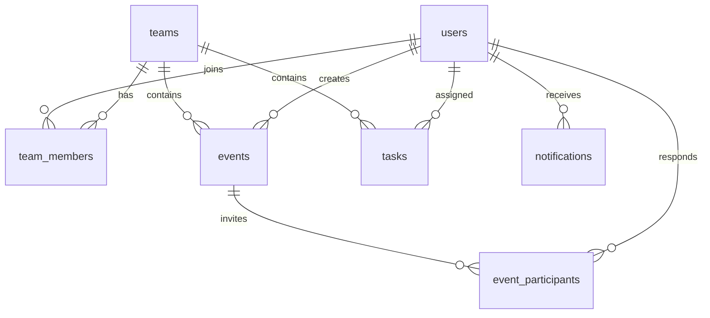

# TeamSync（同频）· 概要设计说明书

版本：v1.0-r2（2 人 + AI）  
日期：2026-10-27  
状态：已确认，作为编码与评审基线；2026-10-27 补成员移除/并发/活动开始结束
依据：[需求与设计框架 v1.0](00-需求与设计框架-v1.0.md)、[需求规格说明书](02-需求规格说明书.md)  
目标读者：项目组、AI 编码助手、验收人

---

## 1. 设计目标与约束

### 1.1 目标

1. 用**单体 + 单库**在 6 周内交付可演示、可验收的三端团队日程。
2. 把**权限、私密脱敏、时区、冲突、提醒去重**做成可测试的服务层规则，而不是散落在路由/组件里。
3. 前后端通过**冻结的 OpenAPI 契约**并行开发；AI 生成代码不改变契约。
4. 三端共用一套 React 构建；平台差异只放在 Electron/Capacitor 壳。

### 1.2 约束

- 单进程 FastAPI + 进程内 APScheduler + 内存 WS 连接表；`--workers 1`。
- SQLite（WAL）；不引入 Redis/Celery/消息队列。
- 不做离线写、不做服务端推送、不做多日历。
- 团队时区统一 `Asia/Shanghai`；用户级时区 P1。
- 所有时间存 UTC；API 用 ISO 8601 UTC；前端按团队时区显示。

### 1.3 设计原则

| 原则 | 落地 |
|---|---|
| 服务器权威 | 写操作先落库，成功再更新前端缓存 |
| HTTP 是唯一数据源 | WS 只通知“变了”，客户端重取 |
| 权限在服务层 | 路由只做参数校验，`require_member` 统一鉴权 |
| 脱敏在序列化层 | 不依赖前端隐藏；私密活动在输出前裁剪 |
| 失败可解释 | 统一错误码；冲突/权限/校验可区分 |
| 可测试 | 冲突、提醒、时区、脱敏都有纯函数/服务测试 |

---

## 2. 总体架构

### 2.1 组件图

```text
┌────────────────────────────────────────────────────┐
│ Web（React + Vite + TS）                            │
│  ├─ 页面/路由                                       │
│  ├─ TanStack Query（服务端状态）                     │
│  ├─ Zustand（当前团队/视图）                         │
│  ├─ API Client（packages/shared）                    │
│  └─ WS Client（packages/shared）                     │
└───────────────┬────────────────────────────────────┘
                │ HTTPS / WSS
┌───────────────▼────────────────────────────────────┐
│ FastAPI 单体                                        │
│  ├─ routers/   auth teams events tasks notifications │
│  ├─ services/  conflict availability reminder rsvp   │
│  ├─ core/      security deps config db logging       │
│  ├─ realtime/  WS manager                            │
│  └─ scheduler/ APScheduler jobs                      │
└───────────────┬────────────────────────────────────┘
                │ SQLAlchemy 2.0 / Alembic
┌───────────────▼────────────────────────────────────┐
│ SQLite（WAL）                                      │
└────────────────────────────────────────────────────┘

Electron 壳 ──加载同一 Web 构建──> Web
Capacitor 壳 ─加载同一 Web 构建──> Web
```

### 2.2 请求流

```text
浏览器/壳
  → API Client 附加 Bearer token
  → FastAPI 路由
  → require_user / require_team_member / require_role
  → service（业务规则）
  → SQLAlchemy → SQLite
  → Pydantic 序列化（含脱敏）
  → JSON 响应
  → TanStack Query 更新缓存
  → 触发通知时写 notifications + WS publish
```

### 2.3 目录结构

```text
team-scheduler/
├── server/
│   ├── app/
│   │   ├── main.py                 # 应用装配、CORS、生命周期
│   │   ├── config.py               # pydantic-settings
│   │   ├── db.py                   # engine/session/PRAGMA
│   │   ├── models.py               # SQLAlchemy ORM
│   │   ├── schemas.py              # Pydantic 请求/响应
│   │   ├── deps.py                 # current_user / require_member
│   │   ├── security.py             # bcrypt / JWT
│   │   ├── errors.py               # 统一错误体/异常
│   │   ├── routers/
│   │   │   ├── auth.py teams.py events.py availability.py
│   │   │   ├── tasks.py notifications.py ws.py health.py
│   │   ├── services/
│   │   │   ├── conflict.py availability.py reminders.py
│   │   │   ├── notifications.py rsvp.py permissions.py
│   │   ├── realtime/manager.py
│   │   └── scheduler/jobs.py
│   ├── migrations/versions/
│   ├── tests/
│   └── pyproject.toml
├── apps/web/
│   ├── src/{pages,components,api,lib,styles}/
│   ├── index.html
│   └── vite.config.ts
├── apps/desktop/
│   ├── src/{main,preload,tray,notify}.ts
│   └── electron-builder.yml
├── apps/mobile/
│   ├── capacitor.config.ts
│   └── android/
├── packages/shared/
│   └── src/{types,api,ws,date}/
├── scripts/{seed.py,bench.py,dev.sh}
├── docs/
├── Makefile
└── AGENTS.md
```

---

## 3. 后端模块设计

### 3.1 路由层

| 模块 | 职责 | 不做什么 |
|---|---|---|
| `auth` | 注册/登录/me/改密 | 不发邮件、不做找回密码 |
| `teams` | 团队 CRUD、邀请码、成员、角色 | 不做组织架构 |
| `events` | 活动 CRUD、邀请、RSVP 入口 | 不做重复活动（P1） |
| `availability` | 忙闲查询、脱敏 | 不做推荐（P1） |
| `tasks` | 任务 CRUD、完成/重开 | 不做子任务/评论 |
| `notifications` | 列表/已读 | 不做邮件 |
| `ws` | 握手、鉴权、心跳 | 不做业务写操作 |
| `health` | 健康检查 | 不做指标系统 |

### 3.2 服务层

| 服务 | 关键函数 | 说明 |
|---|---|---|
| `permissions` | `require_member`、`require_admin`、`require_owner`、`can_edit_event`、`can_edit_task` | 统一权限，路由不手写判断 |
| `conflict` | `find_conflicts(team_id, participant_ids, start, end, exclude_event_id)` | 返回冲突列表；纯查询 + 脱敏 |
| `availability` | `get_availability(team_id, viewer_id, from, to, user_ids)` | 忙闲块 + 私密脱敏 |
| `rsvp` | `respond(event_id, user_id, response)` | 状态机 + 通知 |
| `notifications` | `create_notification(...)`、`mark_read(...)` | `dedupe_key` 幂等 |
| `reminders` | `scan_event_reminders()`、`scan_task_reminders()`、`scan_overdue()` | 调度器调用 |
| `realtime` | `publish_to_user`、`publish_to_team` | 内存连接表 |

### 3.3 依赖注入

```python
# deps.py 伪代码
async def current_user(token = Depends(bearer)) -> User:
    payload = decode_jwt(token)
    user = db.get(User, payload["sub"])
    if not user: raise Unauthorized()
    return user

async def require_member(team_id: int, user = Depends(current_user)) -> TeamMember:
    member = db.query(TeamMember).filter_by(
        team_id=team_id, user_id=user.id, status="active"
    ).first()
    if not member:
        raise NotFound("TEAM_NOT_FOUND")  # 不暴露团队存在
    return member

async def require_admin(member = Depends(require_member)) -> TeamMember:
    if member.role not in ("owner", "admin"):
        raise Forbidden("FORBIDDEN")
    return member

async def require_owner(member = Depends(require_member)) -> TeamMember:
    if member.role != "owner":
        raise Forbidden("FORBIDDEN")
    return member
```

> 关键：非成员统一 404，避免用 403 枚举团队 id；已登录但角色不足才 403。

---

## 4. 数据设计

### 4.1 ER 图



### 4.2 DDL（SQLite）

```sql
PRAGMA foreign_keys = ON;
PRAGMA journal_mode = WAL;

CREATE TABLE users (
    id            INTEGER PRIMARY KEY AUTOINCREMENT,
    username      TEXT    NOT NULL UNIQUE,
    email         TEXT    UNIQUE,
    password_hash TEXT    NOT NULL,
    display_name  TEXT    NOT NULL,
    avatar_color  TEXT    NOT NULL DEFAULT '#4F46E5',
    timezone      TEXT    NOT NULL DEFAULT 'Asia/Shanghai',
    created_at    DATETIME NOT NULL,
    updated_at    DATETIME NOT NULL
);

CREATE TABLE teams (
    id          INTEGER PRIMARY KEY AUTOINCREMENT,
    name        TEXT    NOT NULL,
    description TEXT,
    invite_code TEXT    NOT NULL UNIQUE,
    owner_id    INTEGER NOT NULL REFERENCES users(id),
    timezone    TEXT    NOT NULL DEFAULT 'Asia/Shanghai',
    created_at  DATETIME NOT NULL,
    updated_at  DATETIME NOT NULL,
    deleted_at  DATETIME
);

CREATE TABLE team_members (
    id        INTEGER PRIMARY KEY AUTOINCREMENT,
    team_id   INTEGER NOT NULL REFERENCES teams(id) ON DELETE CASCADE,
    user_id   INTEGER NOT NULL REFERENCES users(id) ON DELETE CASCADE,
    role      TEXT    NOT NULL CHECK (role IN ('owner','admin','member')),
    status    TEXT    NOT NULL CHECK (status IN ('active','left')),
    joined_at DATETIME NOT NULL,
    UNIQUE (team_id, user_id)
);

CREATE TABLE events (
    id          INTEGER PRIMARY KEY AUTOINCREMENT,
    team_id     INTEGER NOT NULL REFERENCES teams(id) ON DELETE CASCADE,
    title       TEXT    NOT NULL,
    description TEXT,
    start_at    DATETIME NOT NULL,
    end_at      DATETIME NOT NULL,
    all_day     INTEGER NOT NULL DEFAULT 0 CHECK (all_day IN (0,1)),
    location    TEXT,
    color       TEXT,
    visibility  TEXT    NOT NULL CHECK (visibility IN ('team','private')),
    status      TEXT    NOT NULL DEFAULT 'confirmed'
                        CHECK (status IN ('confirmed','cancelled')),
    created_by  INTEGER NOT NULL REFERENCES users(id),
    created_at  DATETIME NOT NULL,
    updated_at  DATETIME NOT NULL,
    deleted_at  DATETIME,
    CHECK (start_at < end_at)
);

CREATE TABLE event_participants (
    id           INTEGER PRIMARY KEY AUTOINCREMENT,
    event_id     INTEGER NOT NULL REFERENCES events(id) ON DELETE CASCADE,
    user_id      INTEGER NOT NULL REFERENCES users(id) ON DELETE CASCADE,
    response     TEXT    NOT NULL DEFAULT 'pending'
                         CHECK (response IN ('pending','accepted','declined','tentative')),
    is_organizer INTEGER NOT NULL DEFAULT 0 CHECK (is_organizer IN (0,1)),
    invited_at   DATETIME NOT NULL,
    responded_at DATETIME,
    UNIQUE (event_id, user_id)
);

CREATE TABLE tasks (
    id           INTEGER PRIMARY KEY AUTOINCREMENT,
    team_id      INTEGER NOT NULL REFERENCES teams(id) ON DELETE CASCADE,
    title        TEXT    NOT NULL,
    description  TEXT,
    assignee_id  INTEGER REFERENCES users(id) ON DELETE SET NULL,
    created_by   INTEGER NOT NULL REFERENCES users(id),
    due_at       DATETIME NOT NULL,
    priority     TEXT    NOT NULL DEFAULT 'normal'
                         CHECK (priority IN ('low','normal','high')),
    status       TEXT    NOT NULL DEFAULT 'todo'
                         CHECK (status IN ('todo','doing','done')),
    completed_at DATETIME,
    created_at   DATETIME NOT NULL,
    updated_at   DATETIME NOT NULL,
    deleted_at   DATETIME
);

CREATE TABLE notifications (
    id           INTEGER PRIMARY KEY AUTOINCREMENT,
    user_id      INTEGER NOT NULL REFERENCES users(id) ON DELETE CASCADE,
    team_id      INTEGER REFERENCES teams(id) ON DELETE SET NULL,
    type         TEXT    NOT NULL,
    title        TEXT    NOT NULL,
    body         TEXT,
    payload_json TEXT,
    dedupe_key   TEXT    UNIQUE,
    read_at      DATETIME,
    created_at   DATETIME NOT NULL
);

CREATE INDEX idx_team_members_user
    ON team_members(user_id, status);
CREATE INDEX idx_events_team_start
    ON events(team_id, start_at);
CREATE INDEX idx_events_team_end
    ON events(team_id, end_at);
CREATE INDEX idx_participants_user
    ON event_participants(user_id);
CREATE INDEX idx_tasks_team_due
    ON tasks(team_id, due_at);
CREATE INDEX idx_tasks_team_assignee
    ON tasks(team_id, assignee_id, status);
CREATE INDEX idx_notifications_user
    ON notifications(user_id, read_at, created_at);
-- 每队仅一个活跃 Owner；每个活动仅一个组织者
CREATE UNIQUE INDEX idx_team_one_owner
    ON team_members(team_id) WHERE role = 'owner' AND status = 'active';
CREATE UNIQUE INDEX idx_event_one_organizer
    ON event_participants(event_id) WHERE is_organizer = 1;
```

### 4.3 约定

- SQLite 的 `DATETIME` 由 SQLAlchemy 以 ISO 文本存储；应用层统一用 UTC aware datetime。
- 枚举用 `TEXT + CHECK`，不用数据库原生 enum（SQLite 不支持）。
- `deleted_at` 为空表示未删除；所有列表/详情查询默认过滤。
- `dedupe_key` 为 `NULL` 时 SQLite 允许多行（唯一约束对 NULL 不生效），正好用于非去重通知。
- 创建活动必须在同一事务写 `events` 与组织者的 `event_participants` 行（`is_organizer=1, response=accepted`）；否则冲突检测和 RSVP 会漏。
- 创建团队必须在同一事务写 `teams` 与 Owner 的 `team_members` 行；`teams.owner_id` 与成员角色保持一致。
- 迁移只通过 Alembic；禁止手改线上表。

### 4.4 软删除与唯一约束

- `teams.invite_code` 唯一；软删除团队仍占用旧码 → 生成新码时随机重试，不复用。
- `team_members` 唯一 `(team_id,user_id)`；成员退出后 `status='left'`，重新加入更新为 `active`。
- `event_participants` 唯一 `(event_id,user_id)`；重复邀请做 upsert，不报错。
- 任务删除软删除；成员移除后 `assignee_id=NULL`，保留任务。

### 4.5 迁移策略

1. 每个功能分支只加一个迁移，命名 `YYYYMMDD_short_desc`。
2. 迁移必须能从空库跑到 head，也必须能从上一版升级。
3. 破坏性变更（删列/改类型）先加新列、回填、再删旧列，分两个版本。
4. 合并前在本地备份 DB 跑一遍升级。
5. CI 跑 `alembic upgrade head` + `pytest`。

---

## 5. 接口设计

### 5.1 约定

- Base：`/api/v1`
- 认证：`Authorization: Bearer <jwt>`
- 请求/响应：`application/json`，字段 `snake_case`
- 时间：ISO 8601 UTC，`2026-11-04T06:30:00Z`
- 分页：`limit`（默认 20，最大 100）、`offset`
- 列表：`{ "items": [], "total": 0 }`
- 错误：`{ "code": "...", "message": "...", "details": {} }`
- 事件查询必须带 `from`/`to`，跨度 ≤ 92 天；忙闲 ≤ 31 天。

### 5.2 认证

#### POST `/auth/register`

```json
{
  "username": "lin",
  "display_name": "林",
  "password": "********",
  "email": "lin@example.com"
}
```

`201`：

```json
{
  "access_token": "eyJ...",
  "token_type": "bearer",
  "user": {
    "id": 1,
    "username": "lin",
    "display_name": "林",
    "avatar_color": "#4F46E5"
  }
}
```

错误：`409 USERNAME_TAKEN`、`422 VALIDATION_ERROR`。

#### POST `/auth/login`

```json
{ "username": "lin", "password": "********" }
```

`200` 同注册；错误 `401 INVALID_CREDENTIALS`。

#### GET `/auth/me`

`200` 返回当前用户；`401` 未登录/过期。

### 5.3 团队

#### POST `/teams`

```json
{ "name": "软工大作业", "description": "6 周项目" }
```

`201`：

```json
{
  "id": 1,
  "name": "软工大作业",
  "description": "6 周项目",
  "invite_code": "AB12CD34",
  "owner_id": 1,
  "timezone": "Asia/Shanghai",
  "my_role": "owner",
  "member_count": 1
}
```

#### POST `/teams/join`

```json
{ "invite_code": "AB12CD34" }
```

`200` 返回团队 + `my_role`；错误 `409 INVITE_CODE_INVALID`。重复加入返回 200（幂等）。

#### GET `/teams/{team_id}/members`

```json
{
  "items": [
    { "user_id": 1, "display_name": "林", "role": "owner", "joined_at": "..." },
    { "user_id": 2, "display_name": "陈", "role": "member", "joined_at": "..." }
  ],
  "total": 2
}
```

#### PATCH `/teams/{team_id}/members/{user_id}`

```json
{ "role": "admin" }
```

仅 Owner；不能改 Owner；`403` 角色不足。

### 5.4 活动

#### GET `/teams/{team_id}/events?from=...&to=...&member_ids=1,2`

返回当前用户可见的活动（团队活动 + 自己组织/参与的私密活动），不含他人私密活动。

```json
{
  "items": [
    {
      "id": 12,
      "title": "小组会",
      "start_at": "2026-11-04T06:30:00Z",
      "end_at": "2026-11-04T08:00:00Z",
      "all_day": false,
      "location": "图书馆 3F",
      "color": "#2563EB",
      "visibility": "team",
      "status": "confirmed",
      "created_by": 1,
      "my_response": "accepted",
      "participants": [
        { "user_id": 1, "display_name": "林", "response": "accepted", "is_organizer": true },
        { "user_id": 2, "display_name": "陈", "response": "pending", "is_organizer": false }
      ]
    }
  ],
  "total": 1
}
```

#### POST `/teams/{team_id}/events`

```json
{
  "title": "小组会",
  "description": "讨论分工",
  "start_at": "2026-11-04T06:30:00Z",
  "end_at": "2026-11-04T08:00:00Z",
  "all_day": false,
  "location": "图书馆 3F",
  "color": "#2563EB",
  "visibility": "team",
  "participant_ids": [2, 3],
  "ignore_conflicts": false
}
```

`201` 返回活动详情。有冲突且 `ignore_conflicts=false` 时返回 `409`：

```json
{
  "code": "TIME_CONFLICT",
  "message": "有 1 位参与者在所选时间已有安排",
  "details": {
    "conflicts": [
      {
        "user_id": 2,
        "display_name": "陈",
        "start_at": "2026-11-04T07:00:00Z",
        "end_at": "2026-11-04T08:30:00Z",
        "all_day": false,
        "event_id": 9,
        "title": "课程实验",
        "visibility": "team"
      }
    ]
  }
}
```

> 私密冲突只返回 `event_id=null, title=null, visibility="private"`，只暴露时间段。
>
> 允许补录过去的活动，但不再生成提醒；活动一旦开始，不能再改开始/结束时间与地点。

#### PATCH `/events/{event_id}`

同创建字段（不含 `participant_ids`）；编辑时 `exclude_event_id` 自动排除自身。仅组织者/Admin；`403` 否则。

> PATCH 只改活动字段；参与者的增删用 `POST/DELETE /events/{id}/participants`，避免“传了 participant_ids 但语义不明”。改时间/地点会触发 RSVP-4 变更通知。
>
> 若活动已开始（`now >= start_at`）且请求修改 `start_at/end_at/location`，返回 `422 EVENT_ALREADY_STARTED`；取消/删除仍允许。活动已取消时 PATCH 返回 `409 EVENT_CANCELLED`。

#### DELETE `/events/{event_id}`

`204`；软删除 + `status=cancelled`；通知参与者。

#### POST `/events/{event_id}/participants`

```json
{ "user_ids": [2, 3] }
```

`200` 返回参与者列表；重复邀请幂等；非成员 422。活动已取消或已结束（`now >= end_at`）返回 `409 EVENT_CANCELLED` / `409 EVENT_ENDED`。

#### DELETE `/events/{event_id}/participants/{user_id}`

`204`；组织者/Admin 可移除；被移除者 `response=declined`（保留行），失去私密活动详情；通知被移除者。

#### PATCH `/events/{event_id}/rsvp`

```json
{ "response": "accepted" }
```

`200` 返回参与者状态；组织者拒绝返回 `422 ORGANIZER_CANNOT_DECLINE`；活动取消返回 `409 EVENT_CANCELLED`；活动结束返回 `409 EVENT_ENDED`。非参与者：私密活动 `404`，团队活动 `403`。

### 5.5 忙闲

#### GET `/teams/{team_id}/availability?from=...&to=...&user_ids=1,2`

```json
{
  "from": "2026-11-03T00:00:00Z",
  "to": "2026-11-10T00:00:00Z",
  "members": [
    {
      "user_id": 1,
      "display_name": "林",
      "blocks": [
        {
          "start_at": "2026-11-04T06:30:00Z",
          "end_at": "2026-11-04T08:00:00Z",
          "all_day": false,
          "busy": true,
          "event_id": 12,
          "title": "小组会",
          "visibility": "team"
        }
      ]
    },
    {
      "user_id": 2,
      "display_name": "陈",
      "blocks": [
        {
          "start_at": "2026-11-04T07:00:00Z",
          "end_at": "2026-11-04T08:30:00Z",
          "all_day": false,
          "busy": true,
          "event_id": null,
          "title": null,
          "visibility": "private"
        }
      ]
    }
  ]
}
```

规则：私密活动对非参与者只返回时间段与 `busy=true`；`event_id/title` 为 null；`description/location` 不返回。

### 5.6 任务

#### POST `/teams/{team_id}/tasks`

```json
{
  "title": "完成概要设计",
  "description": "含数据模型与接口",
  "assignee_id": 2,
  "due_at": "2026-11-08T10:00:00Z",
  "priority": "high"
}
```

`201` 返回任务；`422 INVALID_ASSIGNEE` 如果负责人不是活跃成员。

#### GET `/teams/{team_id}/tasks?status=todo&assignee_id=2&mine=false`

```json
{
  "items": [
    {
      "id": 5,
      "title": "完成概要设计",
      "assignee_id": 2,
      "assignee_name": "陈",
      "due_at": "2026-11-08T10:00:00Z",
      "priority": "high",
      "status": "todo",
      "overdue": false,
      "created_by": 1
    }
  ],
  "total": 1
}
```

#### POST `/tasks/{task_id}/complete`

`200` 返回任务；记录 `completed_at`。`POST /reopen` 清空 `completed_at`，状态回 `todo`。

### 5.7 通知

#### GET `/notifications?unread_only=true&limit=20&offset=0`

```json
{
  "items": [
    {
      "id": 100,
      "type": "event.invited",
      "title": "你被邀请参加「小组会」",
      "body": "11-04 14:30，图书馆 3F",
      "payload": { "team_id": 1, "event_id": 12 },
      "read_at": null,
      "created_at": "2026-11-03T10:00:00Z"
    }
  ],
  "total": 1,
  "unread_count": 1
}
```

`POST /notifications/{id}/read`、`POST /notifications/read-all` 返回 `204`。

### 5.8 错误码

| HTTP | code | 说明 |
|---|---|---|
| 400 | `VALIDATION_ERROR` | 参数格式错误 |
| 401 | `UNAUTHORIZED` | 未登录/token 无效 |
| 401 | `INVALID_CREDENTIALS` | 用户名或密码错误 |
| 403 | `FORBIDDEN` | 角色不足 |
| 404 | `NOT_FOUND` | 资源不存在或不可见 |
| 405 | `METHOD_NOT_ALLOWED` | 方法不允许 |
| 409 | `USERNAME_TAKEN` | 用户名重复 |
| 409 | `INVITE_CODE_INVALID` | 邀请码错误/失效 |
| 409 | `TIME_CONFLICT` | 活动时间冲突 |
| 409 | `EVENT_CANCELLED` | 活动已取消 |
| 409 | `EVENT_ENDED` | 活动已结束，不能再邀请/RSVP |
| 422 | `INVALID_TIME_RANGE` | 结束不晚于开始 |
| 422 | `EVENT_ALREADY_STARTED` | 活动已开始，不能再改时间/地点 |
| 422 | `INVALID_PARTICIPANT` | 参与者不是成员 |
| 422 | `INVALID_ASSIGNEE` | 负责人不是成员 |
| 422 | `ORGANIZER_CANNOT_DECLINE` | 组织者不能拒绝 |
| 429 | `RATE_LIMITED` | 登录限流 |
| 500 | `INTERNAL_ERROR` | 未捕获异常 |

---

## 6. 关键算法

### 6.1 冲突检测

```python
def find_conflicts(
    db, team_id: int, participant_ids: list[int],
    start_at: datetime, end_at: datetime,
    exclude_event_id: int | None = None,
) -> list[Conflict]:
    q = (
        db.query(Event, EventParticipant)
        .join(EventParticipant, EventParticipant.event_id == Event.id)
        .filter(
            Event.team_id == team_id,
            Event.status == "confirmed",
            Event.deleted_at.is_(None),
            EventParticipant.user_id.in_(participant_ids),
            EventParticipant.response != "declined",
            Event.start_at < end_at,
            Event.end_at > start_at,
        )
    )
    if exclude_event_id:
        q = q.filter(Event.id != exclude_event_id)
    rows = q.all()
    return [to_conflict(event, participant, viewer_id) for event, participant in rows]
```

要点：

- **只查参与者行**：团队活动如果没有邀请某人，不占用该人的时间。
- 组织者也有 `event_participants` 行（`is_organizer=true, response=accepted`），所以能被查到。
- `pending` / `tentative` 计入冲突；`declined` 排除。
- 全天活动也参与重叠判断；前端提示“与全天活动冲突”。
- 冲突结果对私密活动脱敏：非参与者只看到时间段。
- 创建时 `exclude_event_id=None`；编辑时传自身 id。

### 6.2 忙闲查询

```python
def get_availability(db, team_id, viewer_id, from_at, to_at, user_ids):
    members = active_members(db, team_id, user_ids)
    rows = (
        db.query(Event, EventParticipant)
        .join(EventParticipant, EventParticipant.event_id == Event.id)
        .filter(
            Event.team_id == team_id,
            Event.status == "confirmed",
            Event.deleted_at.is_(None),
            EventParticipant.user_id.in_([m.user_id for m in members]),
            EventParticipant.response != "declined",
            Event.start_at < to_at,
            Event.end_at > from_at,
        )
        .all()
    )
    participant_ids = group_participant_ids(rows)  # event_id -> {user_id}
    by_user = group_by_user(rows)                  # user_id -> [(event, p)]
    return [
        {
            "user_id": m.user_id,
            "display_name": m.display_name,
            "blocks": [
                serialize_block(e, participant_ids[e.id], viewer_id)
                for e, _ in by_user.get(m.user_id, [])
            ],
        }
        for m in members
    ]

def serialize_block(event, participant_ids, viewer_id):
    visible = (
        event.visibility == "team"
        or event.created_by == viewer_id
        or viewer_id in participant_ids
    )
    return {
        "start_at": event.start_at,
        "end_at": event.end_at,
        "all_day": event.all_day,
        "busy": True,
        "event_id": event.id if visible else None,
        "title": event.title if visible else None,
        "visibility": event.visibility,
    }
```

> 注意：可见性判断的是 **viewer 是否在该活动的参与者集合里**，不是“viewer 是否是当前这一行的成员”。两者语义不同：viewer 是参与者时，应能看到同一活动在所有成员行上的标题。实现时预取 `event_id -> {user_id}`，避免 N+1。
>
> 另外，`participant_ids` 必须按事件查**全量参与者**（或至少包含 viewer），不能只从当前 `user_ids` 筛选出的行推断；否则 viewer 是参与者但不在筛选名单时会被误脱敏。

### 6.3 提醒调度

```python
# scheduler/jobs.py 伪代码
async def scan_event_reminders(now: datetime):
    window_end = now + timedelta(minutes=15)
    events = query_events(start_at__gte=now, start_at__lte=window_end,
                          status="confirmed", deleted_at=None)
    for event in events:
        for p in event.participants:
            if p.response == "declined":
                continue
            await create_notification(
                user_id=p.user_id,
                type="event.reminder",
                title=f"15 分钟后：{event.title}",
                payload={"team_id": event.team_id, "event_id": event.id},
                dedupe_key=f"event.reminder:{event.id}:{p.user_id}:15m",
            )

async def scan_task_reminders(now: datetime):
    window_end = now + timedelta(hours=1)
    tasks = query_tasks(due_at__gte=now, due_at__lte=window_end,
                        status__in=["todo", "doing"], deleted_at=None)
    for task in tasks:
        if not task.assignee_id:
            continue
        await create_notification(
            user_id=task.assignee_id,
            type="task.due_soon",
            title=f"1 小时内截止：{task.title}",
            payload={"team_id": task.team_id, "task_id": task.id},
            dedupe_key=f"task.due_soon:{task.id}:{task.assignee_id}:1h",
        )

async def scan_overdue(now: datetime, local_date: str):
    tasks = query_tasks(due_at__lt=now, status__in=["todo", "doing"],
                        deleted_at=None)
    for task in tasks:
        for user_id in {task.assignee_id, task.created_by} - {None}:
            await create_notification(
                user_id=user_id,
                type="task.overdue",
                title=f"任务已逾期：{task.title}",
                payload={"team_id": task.team_id, "task_id": task.id},
                dedupe_key=f"task.overdue:{task.id}:{user_id}:{local_date}",
            )
```

调度配置：

```python
scheduler.add_job(scan_event_reminders, "interval", seconds=60,
                  max_instances=1, coalesce=True)
scheduler.add_job(scan_task_reminders, "interval", seconds=60,
                  max_instances=1, coalesce=True)
scheduler.add_job(scan_overdue, "cron", hour=9, minute=0,
                  timezone="Asia/Shanghai", max_instances=1, coalesce=True)
```

`create_notification` 用 `INSERT ... ON CONFLICT(dedupe_key) DO NOTHING` 或捕获 `IntegrityError`，保证幂等。

### 6.4 RSVP 状态机

```text
pending ──accept──> accepted
   │                  │
   ├──decline──> declined
   │                  │
   └──tentative──> tentative
```

- 任意状态可转到任意状态（用户改主意）。
- 组织者固定 `accepted`；拒绝返回 422。
- 活动 `cancelled` 后拒绝所有 RSVP 修改（409 `EVENT_CANCELLED`）。
- 活动已结束后拒绝 RSVP（409 `EVENT_ENDED`）；开始后仍可改，便于迟到/早退。
- 每次更新写 `responded_at`，并广播 `rsvp.updated`。

### 6.5 权限判定

| 操作 | 规则 |
|---|---|
| 读团队资源 | `require_member` |
| 编辑团队资料/成员/邀请码 | `require_admin` |
| 删除团队/转让 | `require_owner` |
| 编辑/删除活动 | `created_by == user.id` 或 `role in (owner, admin)`；组织者已离开时由 Admin/Owner 接管团队活动 |
| 查看私密活动 | 组织者或参与者；否则 404；组织者离开后私密活动已自动取消 |
| RSVP | 参与者本人；组织者不能拒绝；活动结束后不可改 |
| 编辑任务字段 | 创建者、Admin、Owner |
| 改任务状态 | 负责人、创建者、Admin、Owner |
| 读通知 | `notification.user_id == user.id` |

### 6.6 成员移除与数据归属

移除成员是一个**多表事务**，不能只改 `team_members.status`：

```python
def remove_member(team_id, user_id):
    with db.begin():
        member = require_active_member(team_id, user_id)
        if member.role == "owner":
            raise Forbidden("OWNER_CANNOT_BE_REMOVED")

        # 1) 未完成任务 -> 待重新指派
        db.query(Task).filter(
            Task.team_id == team_id,
            Task.assignee_id == user_id,
            Task.status != "done",
            Task.deleted_at.is_(None),
        ).update({Task.assignee_id: None})

        # 2) 该成员组织的私密活动 -> 取消并通知参与者
        private_events = db.query(Event).filter(
            Event.team_id == team_id,
            Event.created_by == user_id,
            Event.visibility == "private",
            Event.status == "confirmed",
            Event.deleted_at.is_(None),
        ).all()
        for event in private_events:
            event.status = "cancelled"
            notify_participants(event, type="event.cancelled")

        # 3) 该成员作为参与者的活动 -> declined，保留行
        db.query(EventParticipant).filter(
            EventParticipant.user_id == user_id,
            EventParticipant.event_id.in_(
                db.query(Event.id).filter(Event.team_id == team_id)
            ),
            EventParticipant.is_organizer == 0,
        ).update({EventParticipant.response: "declined"})

        # 4) 删除该团队未读通知
        db.query(Notification).filter(
            Notification.user_id == user_id,
            Notification.team_id == team_id,
            Notification.read_at.is_(None),
        ).delete()

        # 5) 成员置 left；团队活动保留，Admin/Owner 接管编辑
        member.status = "left"
```

规则汇总：

- 团队可见活动保留；`created_by` 不变；前端显示“已离开”；Admin/Owner 可编辑。
- 私密活动取消；参与者收到通知；不再展示。
- 任务置空；Admin/Owner 收到“待重新指派”通知。
- 参与者行保留为 `declined`，组织者能看到“已离开/拒绝”。
- 未读通知删除，避免点开 404。
- Owner 不能移除；Owner 退出必须先删除团队（转让 P1）。

### 6.7 并发编辑与一致性

- **策略**：MVP 最后写入生效（last-write-wins）；不合并字段、不返回 409（时间冲突除外）。
- **提示**：活动/任务响应带 `updated_at`；前端保存前比较本地基线，若服务端更新则提示“已被他人修改”，让用户刷新或覆盖。
- **事务边界**：创建团队、创建活动、移除成员、通知去重必须在单事务/单语句内完成。
- **唯一约束兜底**：`team_members`、`event_participants`、`notifications.dedupe_key` 冲突时捕获 `IntegrityError`，转幂等或 409。
- **WS 不保证顺序**：客户端只把 WS 当失效信号，收到后重取 HTTP；不依赖消息顺序。
- **扩展**：P1 可加 `ETag` / `If-Unmodified-Since`，不改现有表结构。

---

## 7. 实时通信设计

### 7.1 连接生命周期

```text
Client                          Server
  │  GET /api/v1/ws?token=JWT     │
  │ ────────────────────────────> │
  │                               │ decode; invalid -> close 4401
  │ <──────────────────────────── │ accept + register(user_id)
  │ <──── {"type":"connected"} ── │
  │ ───── {"type":"ping"} ──────> │
  │ <──── {"type":"pong"} ──────  │
  │ <──── event/task/notify ───── │
  │ ───── close / network ──────> │ unregister
```

- 连接表：`dict[int, set[WebSocket]]`，进程内；单 worker。
- 同一用户多端同时在线 → 全部推送。
- 断线：服务端 `finally` 清理；客户端指数退避重连。
- 心跳：客户端 30 秒 ping；服务端 60 秒未收到可关闭（可选）。
- 鉴权失败：close code `4401`；客户端跳登录页。

### 7.2 消息格式

```json
{ "type": "event.created", "payload": { "team_id": 1, "event_id": 12 }, "ts": "2026-11-03T10:00:00Z" }
```

| type | 接收者 | payload |
|---|---|---|
| `connected` | 当前连接 | `{user_id}` |
| `event.created` | 组织者 + 参与者 | `{team_id, event_id}` |
| `event.updated` | 组织者 + 参与者 | `{team_id, event_id}` |
| `event.cancelled` | 组织者 + 参与者 | `{team_id, event_id}` |
| `calendar.changed` | 团队全员 | `{team_id}` |
| `rsvp.updated` | 组织者 + 参与者 | `{team_id, event_id, user_id, response}` |
| `task.created` / `task.updated` | 团队全员 | `{team_id, task_id}` |
| `member.joined` / `member.left` | 团队全员 | `{team_id, user_id}` |
| `notification.created` | 指定用户 | `{notification_id}` |
| `error` | 当前连接 | `{code, message}` |

### 7.3 广播规则

```python
def publish_event_change(event, actor_id):
    recipients = {p.user_id for p in event.participants}
    publish_to_users(recipients, "event.updated", {...})
    # 私密活动不向非参与者泄露详情，只通知“日历变了”
    if event.visibility == "private":
        publish_to_team_except(event.team_id, recipients, "calendar.changed", {...})
    else:
        publish_to_team(event.team_id, "calendar.changed", {...})
```

> 客户端收到 `*.created/updated` 只做“失效 + 重取”，不直接拼装数据；避免 WS/HTTP 两套序列化不一致。

### 7.4 客户端重连

```ts
let attempt = 0;
function connect() {
  const ws = new WebSocket(`${WS_BASE}/ws?token=${token}`);
  ws.onopen = () => { attempt = 0; queryClient.invalidateQueries(); };
  ws.onclose = (e) => {
    if (e.code === 4401) return logout();
    const delay = Math.min(30000, 1000 * 2 ** attempt++);
    setTimeout(connect, delay);
  };
}
```

---

## 8. 前端设计

### 8.1 路由

```text
/login
/register
/app                         -> 团队选择
/app/teams/:teamId/calendar  -> 默认周视图
/app/teams/:teamId/events/:eventId
/app/teams/:teamId/tasks
/app/teams/:teamId/members
/app/teams/:teamId/settings
/app/notifications
/app/profile
```

路由守卫：无 token → `/login`；有 token 但 `/auth/me` 失败 → 清 token → `/login`。

### 8.2 页面与组件

| 页面 | 主要组件 |
|---|---|
| 登录/注册 | `AuthForm`、`FormField`、`ErrorBanner` |
| 团队选择 | `TeamList`、`CreateTeamDialog`、`JoinTeamDialog` |
| 日历 | `CalendarToolbar`、`MonthView`、`WeekView`、`DayView`、`EventChip`、`AvailabilityGrid`、`EventDialog`、`ConflictDialog` |
| 活动详情 | `EventDetail`、`ParticipantList`、`RsvpButtons`、`DangerZone` |
| 任务 | `TaskList`、`TaskFilters`、`TaskDialog`、`TaskStatusBadge` |
| 成员 | `MemberTable`、`InviteCodeCard`、`RoleSelect` |
| 设置 | `TeamForm`、`InviteCodeRotate`、`DeleteTeamDialog` |
| 通知 | `NotificationList`、`UnreadBadge` |
| 个人 | `ProfileForm`、`ChangePasswordForm` |

### 8.3 状态管理

| 状态 | 工具 | key/示例 |
|---|---|---|
| 服务端数据 | TanStack Query | `['me']`、`['teams']`、`['team', id]`、`['events', teamId, range, filters]`、`['availability', teamId, range, userIds]`、`['tasks', teamId, filters]`、`['notifications', unreadOnly]` |
| 当前团队/视图/筛选 | Zustand | `currentTeamId`、`calendarView`、`selectedDate`、`memberFilter` |
| 表单 | React Hook Form + Zod | 活动/任务/团队表单 |
| 通知 toast | 本地 context + Radix Toast | 成功/错误/冲突 |

失效策略：

- 收到 `event.*` / `rsvp.updated` → `invalidateQueries(['events', teamId])`、`['availability', teamId]`。
- 收到 `task.*` → `invalidateQueries(['tasks', teamId])`。
- 收到 `notification.created` → `invalidateQueries(['notifications'])`、`['me']`（未读数）。
- 重连成功 → 全部失效。

### 8.4 日历集成

- `react-big-calendar` + `date-fns/locale/zh-CN`。
- `localizer = dateFnsLocalizer({ format, parse, startOfWeek, getDay, locales })`。
- 视图：`month`、`week`、`day`；默认 `week`。
- 事件对象统一为 `{ id, title, start, end, allDay, resource }`；`resource` 放颜色/可见性。
- `eventPropGetter` 按颜色/逾期返回样式。
- 月视图：事件条 + 任务截止 chips。
- 周/日视图：`AvailabilityGrid` 作为背景层，事件在上层。
- 拖拽/缩放 P1；MVP 不做，避免时间计算 bug。
- 移动端：周视图横向滚动；提供“日程列表”切换。

### 8.5 忙闲视图

```text
       00 01 ... 08 09 10 11 ... 23
林      ░  ░      ░  ███ ███ ░
陈      ░  ░      ░  ░   ███ ███
王      ░  ░      ░  ░   ░   ░
```

- CSS Grid：列 = 24 小时（或 30 分钟粒度），行 = 成员。
- 忙碌块绝对定位；私密块无标题，只有“忙碌”。
- 点击空白 → 打开新建活动，预填成员/时间。
- 时间轴刻度按团队时区；全天活动单独一行。

### 8.6 API Client

```ts
// packages/shared/src/api/client.ts
export class ApiError extends Error {
  constructor(public status: number, public code: string, message: string, public details?: unknown) {
    super(message);
  }
}

export async function request<T>(path: string, init: RequestInit = {}): Promise<T> {
  const token = getToken();
  const res = await fetch(`${API_BASE}${path}`, {
    ...init,
    headers: {
      "Content-Type": "application/json",
      ...(token ? { Authorization: `Bearer ${token}` } : {}),
      ...init.headers,
    },
  });
  if (!res.ok) {
    const body = await res.json().catch(() => ({}));
    throw new ApiError(res.status, body.code ?? "UNKNOWN", body.message ?? res.statusText, body.details);
  }
  return res.status === 204 ? (undefined as T) : res.json();
}
```

### 8.7 错误与空状态

- 表单：字段级错误 + 顶部摘要；409 冲突走专用弹窗。
- 列表：加载骨架、空状态插画/文案、错误重试。
- 离线：全局连接状态条；写操作失败提示“网络不可用，请重试”。
- 权限：403 页面；404 资源不存在。

### 8.8 响应式与可访问性

- 断点：`sm 640`、`md 768`、`lg 1024`。
- 移动端底部导航：日历/任务/通知/我的；隐藏侧栏。
- 活动弹窗移动端全屏；日期选择用原生/日历组件。
- 所有输入有 `<label>`；图标按钮 `aria-label`；焦点可见；Esc 关闭弹窗；颜色对比 AA。

---

## 9. 三端设计

### 9.1 Electron

**进程结构**

```text
main.ts
  ├─ app.requestSingleInstanceLock()
  ├─ createWindow() -> BrowserWindow(webPreferences: preload, contextIsolation, sandbox)
  ├─ Tray(icon, menu: 显示/隐藏/退出)
  ├─ ipcMain.on('notify', ...) -> new Notification(...)
  ├─ ipcMain.on('open-path', ...) -> win.show(); win.webContents.send('navigate', path)
  └─ win.on('close', e => { if (!isQuitting) { e.preventDefault(); win.hide(); } })

preload.ts
  └─ contextBridge.exposeInMainWorld('desktop', {
       notify, onNavigate, getVersion, quit
     })
```

**渲染进程适配**

```ts
if (window.desktop) {
  ws.on("notification.created", (n) => window.desktop.notify(n));
  window.desktop.onNavigate((path) => router.navigate(path));
}
```

**安全**

- `contextIsolation: true`、`nodeIntegration: false`、`sandbox: true`。
- 只暴露白名单 IPC；不暴露 `ipcRenderer` 本体。
- 生产加载本地构建；开发加载 `http://localhost:5173`。
- CSP 禁止 `unsafe-eval`；不使用 `remote`。

**打包**

- `electron-builder`，Windows NSIS；产物 `apps/desktop/release/`。
- 图标、应用名、版本号；不自动更新（P1）。

**限制**：应用退出/未运行不提醒；无离线缓存。

### 9.2 Android（Capacitor）

**结构**

```text
capacitor.config.ts
  appId: com.teamsync.app
  appName: TeamSync
  webDir: ../web/dist
  server: { url: dev ? "http://<LAN-IP>:5173" : undefined, cleartext: true }

android/
  app/src/main/AndroidManifest.xml
  app/src/main/java/.../MainActivity.kt
```

**本地通知**

```ts
import { LocalNotifications } from "@capacitor/local-notifications";

async function reschedule(events, tasks) {
  const pending = await LocalNotifications.getPending();
  if (pending.notifications.length) {
    await LocalNotifications.cancel({ notifications: pending.notifications });
  }
  const items = [
    ...events.map(e => ({ id: hash(e.id), title: e.title, at: new Date(e.start_at).getTime() - 15*60*1000 })),
    ...tasks.map(t => ({ id: hash(t.id), title: t.title, at: new Date(t.due_at).getTime() - 60*60*1000 })),
  ].filter(x => x.at > Date.now() && x.at < Date.now() + 7*24*3600*1000);

  await LocalNotifications.schedule({
    notifications: items.map(x => ({
      id: x.id,
      title: "TeamSync 提醒",
      body: x.title,
      schedule: { at: new Date(x.at), allowWhileIdle: true },
    })),
  });
}
```

- 每次登录/数据刷新/事件变更后重排；只排未来 7 天。
- Android 13+ 请求 `POST_NOTIFICATIONS`；Android 12+ 精确闹钟需引导。
- 不使用前台服务；应用被杀后已排通知仍可触发，但服务端变更不会实时到达。
- 通知点击打开应用（默认启动页）；深链 P1。

**构建**

```bash
pnpm --filter web build
npx cap sync android
cd android && ./gradlew assembleDebug
# 产物：android/app/build/outputs/apk/debug/app-debug.apk
```

**限制**：无后台推送、无离线写；本地通知可能因系统省电策略延迟。

---

## 10. 安全设计

### 10.1 威胁与对策

| 威胁 | 场景 | 对策 |
|---|---|---|
| 越权访问团队 | 改 `team_id` 读别人团队 | `require_member`；跨团队测试；404 |
| IDOR | 改 `event_id` 读私密活动 | 序列化前校验参与者；404 |
| 私密泄露 | 忙闲接口返回标题 | 脱敏函数；测试断言不含 title/location/description |
| 暴力登录 | 撞库 | bcrypt + 限流（P1） |
| Token 泄露 | XSS/日志 | CSP、React 转义、日志脱敏、HTTPS |
| WS 劫持 | 伪造 token | 握手校验 JWT；失败 4401 |
| SQL 注入 | 搜索/筛选 | ORM 参数化；不拼 SQL |
| 垃圾注册 | 公网 | 课程环境接受；P1 邀请码注册/审核 |
| CSRF | 浏览器 | Bearer token 而非 cookie；CORS 白名单 |

### 10.2 认证

- 密码：bcrypt cost 12；不记录明文。
- JWT：HS256；payload `{sub, username, exp, iat}`；7 天；密钥来自 `SECRET_KEY`。
- 客户端存储：Web/Electron localStorage；Android Capacitor Preferences。XSS 风险用 CSP + 转义缓解；P1 可换 httpOnly cookie。
- 登出：客户端清除；MVP 不做 token 黑名单。

### 10.3 授权

- 统一依赖：`require_member` / `require_admin` / `require_owner`。
- 资源级：`can_edit_event`、`can_edit_task`、`can_view_event`。
- 所有列表查询强制 `team_id` 过滤；不接受客户端传入“任意团队”。
- 私密活动详情：非参与者 404；忙闲：脱敏。

### 10.4 输入与输出

- Pydantic 校验：长度、枚举、时间范围、ID 类型。
- 富文本不做；描述按纯文本渲染，前端转义。
- 错误信息不返回堆栈/SQL；日志带 request_id。
- 响应不包含 `password_hash`、`token`、内部字段。

### 10.5 传输与部署

- 生产 HTTPS/WSS；开发允许 HTTP。
- CORS 白名单：Web dev、Electron、Capacitor；生产同源。
- 安全响应头：`X-Content-Type-Options`、`X-Frame-Options`、`Referrer-Policy`、CSP（前端）。
- 依赖审计：`pip-audit` / `pnpm audit`（W5 跑一次）。

### 10.6 日志

- JSON 行：`ts, level, request_id, user_id, team_id, method, path, status, latency_ms`。
- 不打印：密码、token、Authorization、完整请求体。
- 错误日志带堆栈，但只在服务端。

---

## 11. 部署与运维

### 11.1 开发环境

```bash
# 后端
cd server
python -m venv .venv && source .venv/bin/activate
pip install -e ".[dev]"
alembic upgrade head
uvicorn app.main:app --reload --port 8000

# 前端
pnpm install
pnpm --filter web dev   # http://localhost:5173
```

根目录 `Makefile`：

```makefile
dev:        ## 同时起后端与前端（或分别起）
test:       ## pytest
check:      ## pytest + typecheck + lint
seed:       ## 种子数据
build:      ## 构建 web/desktop/android
```

### 11.2 演示/生产

**单机（推荐课程演示）**

```bash
pnpm --filter web build
# FastAPI 静态托管 apps/web/dist，或 Nginx
uvicorn app.main:app --host 0.0.0.0 --port 8000 --workers 1
```

- 局域网访问 `http://<host-ip>:8000`；防火墙放行。
- SQLite 文件放 `server/data/teamsync.db`；每日备份。
- 反向代理（可选）：Nginx/Caddy 提供 HTTPS 与静态资源。

**Docker Compose（可选）**

```yaml
services:
  api:
    build: ./server
    environment:
      SECRET_KEY: ${SECRET_KEY}
      DATABASE_URL: sqlite:////data/teamsync.db
      CORS_ORIGINS: https://demo.example.com
    volumes:
      - ./data:/data
    command: uvicorn app.main:app --host 0.0.0.0 --port 8000 --workers 1
  web:
    build: ./apps/web
    ports: ["80:80"]
```

> 课程环境不强制 Docker；能本地/局域网跑通即可。

### 11.3 环境变量

| 变量 | 必填 | 默认 | 说明 |
|---|---|---|---|
| `SECRET_KEY` | 是 | — | JWT 签名，≥ 32 字节随机 |
| `DATABASE_URL` | 否 | `sqlite:///./data/teamsync.db` | SQLAlchemy URL |
| `CORS_ORIGINS` | 否 | `http://localhost:5173` | 逗号分隔 |
| `TEAM_TIMEZONE` | 否 | `Asia/Shanghai` | 默认团队时区 |
| `ACCESS_TOKEN_EXPIRE_DAYS` | 否 | `7` | JWT 有效期 |
| `LOG_LEVEL` | 否 | `INFO` | 日志级别 |

`.env` 不入库；提供 `.env.example`。

### 11.4 迁移与启动

```bash
alembic upgrade head
uvicorn app.main:app --host 0.0.0.0 --port 8000 --workers 1
```

- 启动前迁移；失败则退出，不带着旧表启动。
- 单 worker；APScheduler 与 WS 在进程内。
- 健康检查：`GET /health` → `{"status":"ok","db":"ok"}`；DB 失败 503。

### 11.5 备份与恢复

```bash
# 备份（每日 cron）
sqlite3 server/data/teamsync.db ".backup 'backups/teamsync-$(date +%F).db'"
# 保留 7 天
find backups -name 'teamsync-*.db' -mtime +7 -delete
```

恢复：停服务 → 替换 DB → 起服务 → 冒烟。W5 演练一次并记录。

### 11.6 日志与排障

- 应用日志 stdout；演示环境重定向到文件。
- 请求 id 贯穿；错误响应带 `request_id`（可选字段）。
- 常见问题：CORS、token 过期、时区、SQLite 锁、Android 通知权限。

---

## 12. 测试设计

### 12.1 分层

| 层 | 工具 | 范围 |
|---|---|---|
| 单元 | pytest | 冲突、忙闲脱敏、RSVP、提醒去重、时区 |
| 接口 | pytest + httpx | 认证、团队、活动、任务、通知、权限 |
| 组件 | Vitest + RTL | 表单校验、RSVP 按钮、任务状态、冲突弹窗 |
| E2E | Playwright | 注册→建队→活动→RSVP→任务 |
| 契约 | OpenAPI 快照 | 路径/字段/错误码 |
| 手工 | 清单 | Electron/Android/响应式 |

### 12.2 测试数据库

- 每个测试用临时 SQLite 文件（或 `sqlite:///:memory:` + StaticPool）。
- `Base.metadata.create_all` 或跑 Alembic；迁移测试单独跑。
- 每个测试事务回滚；工厂函数创建用户/团队/活动。
- 时间注入：`now()` 可替换，避免 `sleep`。

### 12.3 必测用例

| 编号 | 用例 | 期望 |
|---|---|---|
| T-AUTH-01 | 重复用户名注册 | 409 |
| T-AUTH-02 | 错误密码登录 | 401 |
| T-TEAM-01 | 非成员读团队 | 404 |
| T-TEAM-02 | Admin 移除 Owner | 403 |
| T-TEAM-03 | 旧邀请码加入 | 409 |
| T-EVT-01 | 结束早于开始 | 422 |
| T-EVT-02 | 私密活动非参与者详情 | 404 |
| T-EVT-03 | 冲突创建 | 409 + conflicts |
| T-EVT-04 | 强制创建 | 201 |
| T-RSVP-01 | 四态切换 | 200 |
| T-RSVP-02 | 组织者拒绝 | 422 |
| T-AVAIL-01 | 私密忙闲脱敏 | 无 title/location/description |
| T-AVAIL-02 | 拒绝者不计冲突 | 无冲突 |
| T-TASK-01 | 非成员负责人 | 422 |
| T-TASK-02 | 移除成员后任务 | assignee=null |
| T-NOTI-01 | 重复提醒 | 只 1 条 |
| T-RT-01 | 无效 token WS | 4401 |
| T-TZ-01 | 23:30 跨天 | 日期正确 |

### 12.4 E2E 场景

1. 注册 A/B → A 建队 → B 加入 → A 建活动邀请 B → B 接受 → A 看到 accepted。
2. A 让 B 忙碌 → A 建冲突活动 → 弹窗 → 强制保存。
3. A 建任务指派 B → B 完成 → A 看到 done。

### 12.5 性能

- 种子：50 用户、1 团队、10,000 活动、5,000 任务。
- 计时：月视图查询、忙闲查询、任务列表；目标 p95 < 300ms（本地）。
- 若超：加索引/限制范围/减少 N+1；不引入缓存。

---

## 13. 性能与扩展

### 13.1 当前规模

- 单团队 ≤ 50 人、≤ 10,000 活动；单进程；SQLite WAL。
- 主要查询走索引：`(team_id, start_at)`、`(team_id, due_at)`、`(user_id, read_at, created_at)`。
- 日历查询按日期范围，禁止全表扫描。
- 忙闲查询批量取参与者，避免 N+1。

### 13.2 扩展路径（不在 MVP）

| 需求 | 方案 |
|---|---|
| 多实例 | PostgreSQL + Redis Pub/Sub；WS 改 Redis adapter；调度改分布式锁 |
| 多日历 | 加 `calendars` 表与 `events.calendar_id` |
| 离线写 | 本地库 + 变更日志 + 冲突合并（CRDT/最后一次写入） |
| 搜索 | SQLite FTS5 或 Postgres full-text |
| 推送 | FCM/APNs 或自建 Android 前台服务 |

### 13.3 设计取舍

- 不引入缓存：课程规模下，SQLite + 索引足够；缓存增加失效复杂度。
- 不做分页游标：`limit/offset` 足够；日历按范围查询。
- 不做微服务：单体更容易部署、调试、答辩。

---

## 14. 风险与应对

| 风险 | 设计应对 |
|---|---|
| 日历库时区错 | 统一 UTC + date-fns localizer；边界测试 |
| 私密泄露 | 序列化层脱敏 + 测试断言 + 两人 review |
| WS 断线 | 重连 + 全量刷新；HTTP 唯一数据源 |
| 提醒重复 | `dedupe_key` 唯一 + 捕获冲突 |
| SQLite 锁 | WAL、busy_timeout、单 worker、短事务 |
| 三端打包 | W1 空壳、W4 只加通知、W5 出包 |
| 迁移出错 | 备份 + 空库/升级双向测试 |
| 2 人评审瓶颈/单点依赖 | 关键路径两人 review；AI 初筛；每两周换人演练；文档/脚本可复现 |

---

## 15. 附录

### 15.1 活动状态

```text
confirmed ──cancel──> cancelled
    │
    └──delete（软删）──> deleted_at
```

### 15.2 任务状态

```text
todo ──start──> doing ──complete──> done
  │               │                  │
  └────complete───┘                  └──reopen──> todo
```

### 15.3 关键配置

```python
# config.py 伪代码
class Settings(BaseSettings):
    secret_key: str
    database_url: str = "sqlite:///./data/teamsync.db"
    cors_origins: str = "http://localhost:5173"
    team_timezone: str = "Asia/Shanghai"
    access_token_expire_days: int = 7
    log_level: str = "INFO"
```

### 15.4 与参考项目 Maid 的复用

| 复用 | 调整 |
|---|---|
| FastAPI + SQLAlchemy + Alembic 目录 | 去掉设备/提醒点多通道 |
| JWT + bcrypt | 加团队角色与多租户 |
| WebSocket 连接管理 | 加团队广播、私密事件 `calendar.changed` |
| pytest/httpx 测试结构 | 加跨团队、脱敏、时区用例 |
| React + Vite + TS | 加日历库、TanStack Query、Tailwind |
| Electron 托盘/通知 | 去掉本地 SQLite/离线同步 |
| Capacitor 壳 | 去掉前台服务，改本地通知 |

### 15.5 代码评审必看

- [ ] 每个团队查询都有 `require_member`。
- [ ] 私密活动序列化有脱敏分支。
- [ ] 时间全部 UTC；前端按团队时区显示。
- [ ] 冲突查询排除 `declined`、排除自身。
- [ ] 通知写入有 `dedupe_key`。
- [ ] 迁移可从空库/旧库跑通。
- [ ] 错误码与本文一致。
- [ ] 没有把 token/密码写进日志。
