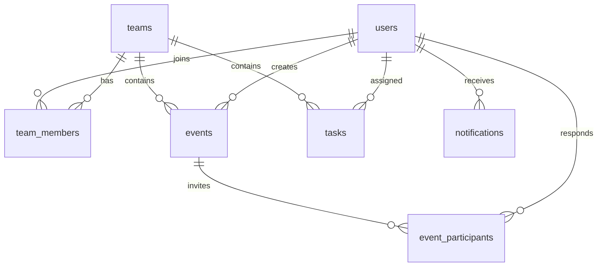

# TeamSync（同频）· 概要设计说明书

版本：v1.4（2 人 + AI；2026-11-12 CR-002 个人日历 DDL/API）  
日期：2026-11-12  
状态：已确认，作为编码与评审基线；2026-10-27 补成员移除/并发/活动开始结束；2026-11-11 更新三端/CR-009、W5 静态托管与 CAL-6 颜色语义（CR-010）；2026-11-12 新增个人日历（CR-002），技术形态差异见 [ADR-003](changes/ADR-003-实现现状与冻结基线差异.md)
依据：[需求与设计框架 v1.0](00-需求与设计框架-v1.0.md)、[需求规格说明书](02-需求规格说明书.md)  
目标读者：项目组、AI 编码助手、验收人

---

## 1. 设计目标与约束

### 1.1 目标

1. 用**单体 + 单库**在 6 周内交付可演示、可验收的三端团队日程。
2. 把**权限、私密脱敏、时区、冲突、提醒去重**做成可测试的服务层规则，而不是散落在路由/组件里。
3. 前后端通过**冻结的 OpenAPI 契约**并行开发；AI 生成代码不改变契约。
4. 三端共用一套 React 构建；平台差异只放在 Electron/Android 原生壳。

### 1.2 约束

- 单进程 FastAPI + 进程内 asyncio 定时扫描（每 60 秒）+ 内存 WS 连接表；`--workers 1`。
- SQLite（WAL）；不引入 Redis/Celery/消息队列。
- 不做离线写、不做服务端推送、不做多日历。
- 团队时区统一 `Asia/Shanghai`；用户级时区 P1。
- 所有时间存 UTC；API 用 ISO 8601 UTC；前端按团队时区显示。

### 1.3 设计原则

| 原则 | 落地 |
|---|---|
| 服务器权威 | 写操作先落库，成功再更新前端缓存 |
| HTTP 是唯一数据源 | WS 只通知“变了”，客户端重取 |
| 权限在服务层 | 路由只做参数校验，`require_member` 统一鉴权 |
| 脱敏在序列化层 | 不依赖前端隐藏；私密活动在输出前裁剪 |
| 失败可解释 | 统一错误码；冲突/权限/校验可区分 |
| 可测试 | 冲突、提醒、时区、脱敏都有纯函数/服务测试 |

---

## 2. 总体架构

### 2.1 组件图

```text
┌────────────────────────────────────────────────────┐
│ Web（React + Vite + TS）                            │
│  ├─ 页面/路由                                       │
│  ├─ TanStack Query（服务端状态）                     │
│  ├─ 路由 + 组件内状态（当前团队/视图）               │
│  ├─ API Client（packages/shared）                    │
│  └─ WS Client（packages/shared）                     │
└───────────────┬────────────────────────────────────┘
                │ HTTPS / WSS
┌───────────────▼────────────────────────────────────┐
│ FastAPI 单体                                        │
│  ├─ routers/   auth teams events tasks notifications │
│  ├─ services/  conflict availability reminder rsvp   │
│  ├─ core/      security deps config db logging       │
│  ├─ realtime/  WS manager                            │
│  └─ scheduler/ asyncio 定时任务（每 60 秒）          │
└───────────────┬────────────────────────────────────┘
                │ SQLAlchemy 2.0 / Alembic
┌───────────────▼────────────────────────────────────┐
│ SQLite（WAL）                                      │
└────────────────────────────────────────────────────┘

Electron 壳 ──加载同一 Web 构建──> Web
Android 原生壳 ─加载同一 Web 构建──> Web
```

### 2.2 请求流

```text
浏览器/壳
  → API Client 附加 Bearer token
  → FastAPI 路由
  → require_user / require_team_member / require_role
  → service（业务规则）
  → SQLAlchemy → SQLite
  → Pydantic 序列化（含脱敏）
  → JSON 响应
  → TanStack Query 更新缓存
  → 触发通知时写 notifications + WS publish
```

### 2.3 目录结构

```text
team-scheduler/
├── server/
│   ├── app/
│   │   ├── main.py                 # 应用装配、CORS、生命周期
│   │   ├── config.py               # pydantic-settings
│   │   ├── db.py                   # engine/session/PRAGMA
│   │   ├── models.py               # SQLAlchemy ORM
│   │   ├── schemas.py              # Pydantic 请求/响应
│   │   ├── deps.py                 # current_user / require_member
│   │   ├── security.py             # bcrypt / JWT
│   │   ├── errors.py               # 统一错误体/异常
│   │   ├── routers/
│   │   │   ├── auth.py teams.py events.py availability.py
│   │   │   ├── tasks.py notifications.py ws.py health.py
│   │   ├── services/
│   │   │   ├── conflict.py availability.py reminders.py
│   │   │   ├── notifications.py rsvp.py permissions.py
│   │   ├── realtime/manager.py
│   │   ├── scheduler/jobs.py
│   │   └── seed.py                 # make seed 演示数据（3 用户 + 1 团队）
│   ├── migrations/versions/
│   ├── tests/
│   └── pyproject.toml
├── apps/web/
│   ├── src/{pages,components,api,lib,styles}/
│   ├── index.html
│   └── vite.config.ts
├── apps/desktop/
│   ├── src/{main,preload,tray,notify}.ts
│   └── electron-builder.yml
├── apps/mobile/
│   ├── capacitor.config.ts
│   └── android/
├── packages/shared/
│   └── src/{types,api,ws,date}/
├── scripts/{bench.py,dev.sh}
├── docs/
├── Makefile
└── AGENTS.md
```

---

## 3. 后端模块设计

### 3.1 路由层

| 模块 | 职责 | 不做什么 |
|---|---|---|
| `auth` | 注册/登录/me/改密 | 不发邮件、不做找回密码 |
| `teams` | 团队 CRUD、邀请码、成员、角色 | 不做组织架构 |
| `events` | 活动 CRUD、邀请、RSVP 入口 | 不做重复活动（P1） |
| `availability` | 忙闲查询、脱敏 | 不做推荐（P1） |
| `tasks` | 任务 CRUD、完成/重开 | 不做子任务/评论 |
| `notifications` | 列表/已读 | 不做邮件 |
| `ws` | 握手、鉴权、心跳 | 不做业务写操作 |
| `health` | 健康检查 | 不做指标系统 |

### 3.2 服务层

| 服务 | 关键函数 | 说明 |
|---|---|---|
| `permissions` | `require_member`、`require_admin`、`require_owner`、`can_edit_event`、`can_edit_task` | 统一权限，路由不手写判断 |
| `conflict` | `find_conflicts(team_id, participant_ids, start, end, exclude_event_id)` | 返回冲突列表；纯查询 + 脱敏 |
| `availability` | `get_availability(team_id, viewer_id, from, to, user_ids)` | 忙闲块 + 私密脱敏 |
| `rsvp` | `respond(event_id, user_id, response)` | 状态机 + 通知 |
| `notifications` | `create_notification(...)`、`mark_read(...)` | `dedupe_key` 幂等 |
| `reminders` | `scan_event_reminders()`、`scan_task_reminders()`、`scan_overdue()` | 调度器调用 |
| `realtime` | `publish_to_user`、`publish_to_team` | 内存连接表 |

### 3.3 依赖注入

```python
# deps.py 伪代码
async def current_user(token = Depends(bearer)) -> User:
    payload = decode_jwt(token)
    user = db.get(User, payload["sub"])
    if not user: raise Unauthorized()
    return user

async def require_member(team_id: int, user = Depends(current_user)) -> TeamMember:
    member = db.query(TeamMember).filter_by(
        team_id=team_id, user_id=user.id, status="active"
    ).first()
    if not member:
        raise NotFound("TEAM_NOT_FOUND")  # 不暴露团队存在
    return member

async def require_admin(member = Depends(require_member)) -> TeamMember:
    if member.role not in ("owner", "admin"):
        raise Forbidden("FORBIDDEN")
    return member

async def require_owner(member = Depends(require_member)) -> TeamMember:
    if member.role != "owner":
        raise Forbidden("FORBIDDEN")
    return member
```

> 关键：非成员统一 404，避免用 403 枚举团队 id；已登录但角色不足才 403。

---

## 4. 数据设计

### 4.1 ER 图



### 4.2 DDL（SQLite）

```sql
PRAGMA foreign_keys = ON;
PRAGMA journal_mode = WAL;

CREATE TABLE users (
    id            INTEGER PRIMARY KEY AUTOINCREMENT,
    username      TEXT    NOT NULL UNIQUE,
    email         TEXT    UNIQUE,
    password_hash TEXT    NOT NULL,
    display_name  TEXT    NOT NULL,
    avatar_color  TEXT    NOT NULL DEFAULT '#4F46E5',
    timezone      TEXT    NOT NULL DEFAULT 'Asia/Shanghai',
    created_at    DATETIME NOT NULL,
    updated_at    DATETIME NOT NULL
);

CREATE TABLE teams (
    id          INTEGER PRIMARY KEY AUTOINCREMENT,
    name        TEXT    NOT NULL,
    description TEXT,
    invite_code TEXT    NOT NULL UNIQUE,
    owner_id    INTEGER NOT NULL REFERENCES users(id),
    timezone    TEXT    NOT NULL DEFAULT 'Asia/Shanghai',
    created_at  DATETIME NOT NULL,
    updated_at  DATETIME NOT NULL,
    deleted_at  DATETIME
);

CREATE TABLE team_members (
    id        INTEGER PRIMARY KEY AUTOINCREMENT,
    team_id   INTEGER NOT NULL REFERENCES teams(id) ON DELETE CASCADE,
    user_id   INTEGER NOT NULL REFERENCES users(id) ON DELETE CASCADE,
    role      TEXT    NOT NULL CHECK (role IN ('owner','admin','member')),
    status    TEXT    NOT NULL CHECK (status IN ('active','left')),
    joined_at DATETIME NOT NULL,
    UNIQUE (team_id, user_id)
);

CREATE TABLE events (
    id          INTEGER PRIMARY KEY AUTOINCREMENT,
    team_id     INTEGER NOT NULL REFERENCES teams(id) ON DELETE CASCADE,
    title       TEXT    NOT NULL,
    description TEXT,
    start_at    DATETIME NOT NULL,
    end_at      DATETIME NOT NULL,
    all_day     INTEGER NOT NULL DEFAULT 0 CHECK (all_day IN (0,1)),
    location    TEXT,
    color       TEXT,
    visibility  TEXT    NOT NULL CHECK (visibility IN ('team','private')),
    status      TEXT    NOT NULL DEFAULT 'confirmed'
                        CHECK (status IN ('confirmed','cancelled')),
    created_by  INTEGER NOT NULL REFERENCES users(id),
    created_at  DATETIME NOT NULL,
    updated_at  DATETIME NOT NULL,
    deleted_at  DATETIME,
    CHECK (start_at < end_at)
);

-- CR-002 / CAL-9：用户级个人日历；仅 owner 可见详情，默认参与团队忙闲
CREATE TABLE personal_events (
    id          INTEGER PRIMARY KEY AUTOINCREMENT,
    user_id     INTEGER NOT NULL REFERENCES users(id) ON DELETE CASCADE,
    title       TEXT    NOT NULL,
    description TEXT,
    start_at    DATETIME NOT NULL,
    end_at      DATETIME NOT NULL,
    all_day     INTEGER NOT NULL DEFAULT 0 CHECK (all_day IN (0,1)),
    location    TEXT,
    color       TEXT,
    share_busy  INTEGER NOT NULL DEFAULT 1 CHECK (share_busy IN (0,1)),
    created_at  DATETIME NOT NULL,
    updated_at  DATETIME NOT NULL,
    deleted_at  DATETIME,
    CHECK (start_at < end_at)
);
CREATE INDEX ix_personal_events_user_start ON personal_events(user_id, start_at);

CREATE TABLE event_participants (
    id           INTEGER PRIMARY KEY AUTOINCREMENT,
    event_id     INTEGER NOT NULL REFERENCES events(id) ON DELETE CASCADE,
    user_id      INTEGER NOT NULL REFERENCES users(id) ON DELETE CASCADE,
    response     TEXT    NOT NULL DEFAULT 'pending'
                         CHECK (response IN ('pending','accepted','declined','tentative')),
    is_organizer INTEGER NOT NULL DEFAULT 0 CHECK (is_organizer IN (0,1)),
    invited_at   DATETIME NOT NULL,
    responded_at DATETIME,
    UNIQUE (event_id, user_id)
);

CREATE TABLE tasks (
    id           INTEGER PRIMARY KEY AUTOINCREMENT,
    team_id      INTEGER NOT NULL REFERENCES teams(id) ON DELETE CASCADE,
    title        TEXT    NOT NULL,
    description  TEXT,
    assignee_id  INTEGER REFERENCES users(id) ON DELETE SET NULL,
    created_by   INTEGER NOT NULL REFERENCES users(id),
    due_at       DATETIME NOT NULL,
    priority     TEXT    NOT NULL DEFAULT 'normal'
                         CHECK (priority IN ('low','normal','high')),
    status       TEXT    NOT NULL DEFAULT 'todo'
                         CHECK (status IN ('todo','doing','done')),
    completed_at DATETIME,
    created_at   DATETIME NOT NULL,
    updated_at   DATETIME NOT NULL,
    deleted_at   DATETIME
);

CREATE TABLE notifications (
    id           INTEGER PRIMARY KEY AUTOINCREMENT,
    user_id      INTEGER NOT NULL REFERENCES users(id) ON DELETE CASCADE,
    team_id      INTEGER REFERENCES teams(id) ON DELETE SET NULL,
    type         TEXT    NOT NULL,
    title        TEXT    NOT NULL,
    body         TEXT,
    payload_json TEXT,
    dedupe_key   TEXT    UNIQUE,
    read_at      DATETIME,
    created_at   DATETIME NOT NULL
);

CREATE INDEX idx_team_members_user
    ON team_members(user_id, status);
CREATE INDEX idx_events_team_start
    ON events(team_id, start_at);
CREATE INDEX idx_events_team_end
    ON events(team_id, end_at);
CREATE INDEX idx_participants_user
    ON event_participants(user_id);
CREATE INDEX idx_tasks_team_due
    ON tasks(team_id, due_at);
CREATE INDEX idx_tasks_team_assignee
    ON tasks(team_id, assignee_id, status);
CREATE INDEX idx_notifications_user
    ON notifications(user_id, read_at, created_at);
-- 每队仅一个活跃 Owner；每个活动仅一个组织者
CREATE UNIQUE INDEX idx_team_one_owner
    ON team_members(team_id) WHERE role = 'owner' AND status = 'active';
CREATE UNIQUE INDEX idx_event_one_organizer
    ON event_participants(event_id) WHERE is_organizer = 1;
```

### 4.3 约定

- SQLite 的 `DATETIME` 由 SQLAlchemy 以 ISO 文本存储；应用层统一用 UTC aware datetime。
- 枚举用 `TEXT + CHECK`，不用数据库原生 enum（SQLite 不支持）。
- `deleted_at` 为空表示未删除；所有列表/详情查询默认过滤。
- `dedupe_key` 为 `NULL` 时 SQLite 允许多行（唯一约束对 NULL 不生效），正好用于非去重通知。
- 创建活动必须在同一事务写 `events` 与组织者的 `event_participants` 行（`is_organizer=1, response=accepted`）；否则冲突检测和 RSVP 会漏。
- 创建团队必须在同一事务写 `teams` 与 Owner 的 `team_members` 行；`teams.owner_id` 与成员角色保持一致。
- 迁移只通过 Alembic；禁止手改线上表。

### 4.4 软删除与唯一约束

- `teams.invite_code` 唯一；软删除团队仍占用旧码 → 生成新码时随机重试，不复用。
- `team_members` 唯一 `(team_id,user_id)`；成员退出后 `status='left'`，重新加入更新为 `active`。
- `event_participants` 唯一 `(event_id,user_id)`；重复邀请做 upsert，不报错。
- 任务删除软删除；成员移除后 `assignee_id=NULL`，保留任务。

### 4.5 迁移策略

1. 每个功能分支只加一个迁移，命名 `YYYYMMDD_short_desc`。
2. 迁移必须能从空库跑到 head，也必须能从上一版升级。
3. 破坏性变更（删列/改类型）先加新列、回填、再删旧列，分两个版本。
4. 合并前在本地备份 DB 跑一遍升级。
5. CI 跑 `alembic upgrade head` + `pytest`。

---

## 5. 接口设计

> **W1-10 冻结（2026-11-02）**：本节是 P0 HTTP API 的唯一权威清单。路径、方法、字段名、错误码、分页与时间格式自本日起冻结；变更必须走 CR（[变更控制](ai/04-变更控制与追踪.md)），同步更新本节、[接口与数据契约](ai/02-接口与数据契约.md) 与 `server/tests/test_api_contract.py`。冻结测试会解析 5.1.1 与 5.8 的表格，文档与实现不一致时 CI 直接失败。
>
> WebSocket 消息类型不在 W1-10 冻结范围，按 [接口与数据契约](ai/02-接口与数据契约.md) 在 W3 冻结。

### 5.1 约定

- **Base**：`/api/v1`；仅 `GET /health` 不在 Base 下。
- **认证**：业务端点要求 `Authorization: Bearer <jwt>`；缺失、格式错误、过期、用户已删除统一 `401 UNAUTHORIZED`，并带 `WWW-Authenticate: Bearer`。
- **内容**：请求/响应 `application/json`，字段 `snake_case`；`204` 无响应体。
- **时间**：请求时间必须是带时区偏移的 ISO 8601（如 `2026-11-04T14:30:00+08:00`），无时区返回 `400 VALIDATION_ERROR`。DB/API 一律 UTC；响应格式为 `YYYY-MM-DDTHH:MM:SS[.ffffff]Z`（UTC、`Z` 后缀；仅当数据库值含微秒时才带 6 位小数）。
- **全天活动**：`start_at` 为团队时区当天 00:00、`end_at` 为次日 00:00 对应的 UTC 时刻；不满足返回 `422 INVALID_TIME_RANGE`。
- **分页**：列表端点统一 `limit`（默认 20，范围 1–100）与 `offset`（默认 0，≥0）；响应统一 `{ "items": [], "total": 0 }`。通知列表额外返回 `unread_count`。
- **范围查询**：事件 `from`/`to` 必填，跨度 ≤ 92 天；忙闲跨度 ≤ 31 天；`to <= from` 或超限返回 `422 INVALID_TIME_RANGE`。
- **错误体**：统一 `{ "code": "...", "message": "...", "details": {} }`；`details` 至少为空对象，不省略。`GET /health` 豁免统一错误体（200/503 均为 `{status, db}`）。
- **多租户**：非团队成员、团队已删除、资源不属于该团队统一 `404 NOT_FOUND`；成员角色不足 `403 FORBIDDEN`。
- **私密脱敏**：私密活动详情只对组织者/当前参与者可见；忙闲与冲突对非参与者只返回时间段、`visibility="private"` 与 `busy=true`，`event_id/title` 为 `null`。
- **字段稳定性**：响应中文档列出的字段始终存在，空值用 `null`；客户端不得依赖未写入本节或 [接口与数据契约](ai/02-接口与数据契约.md) 的字段。

#### 5.1.1 冻结端点总表

<!-- api-contract:start -->
| # | 方法 | 路径（相对 Base） | 认证 | 成功 | 说明 |
|---|---|---|---|---|---|
| 1 | GET | `/health` | 否 | 200 | 健康检查，Base 之外 |
| 2 | POST | `/auth/register` | 否 | 201 | 注册并返回 token |
| 3 | POST | `/auth/login` | 否 | 200 | 登录 |
| 4 | GET | `/auth/me` | 是 | 200 | 当前用户 |
| 5 | PATCH | `/auth/me` | 是 | 200 | 修改昵称/头像色 |
| 6 | GET | `/teams` | 是 | 200 | 我加入的团队（分页） |
| 7 | POST | `/teams` | 是 | 201 | 创建团队 |
| 8 | POST | `/teams/join` | 是 | 200 | 邀请码加入 |
| 9 | GET | `/teams/{team_id}` | 是 | 200 | 团队详情 |
| 10 | DELETE | `/teams/{team_id}` | 是 | 204 | 删除团队（Owner） |
| 11 | GET | `/teams/{team_id}/members` | 是 | 200 | 成员列表（分页） |
| 12 | PATCH | `/teams/{team_id}/members/{user_id}` | 是 | 200 | 设置/取消 Admin（Owner） |
| 13 | DELETE | `/teams/{team_id}/members/{user_id}` | 是 | 204 | 移除成员（Owner/Admin） |
| 14 | POST | `/teams/{team_id}/leave` | 是 | 204 | 退出团队 |
| 15 | POST | `/teams/{team_id}/invite-code/rotate` | 是 | 200 | 轮换邀请码（Owner/Admin） |
| 16 | GET | `/teams/{team_id}/events` | 是 | 200 | 事件范围查询（分页） |
| 17 | POST | `/teams/{team_id}/events` | 是 | 201 | 创建活动 |
| 18 | GET | `/events/{event_id}` | 是 | 200 | 活动详情 |
| 19 | PATCH | `/events/{event_id}` | 是 | 200 | 编辑/取消活动 |
| 20 | DELETE | `/events/{event_id}` | 是 | 204 | 删除活动 |
| 21 | POST | `/events/{event_id}/participants` | 是 | 200 | 邀请参与者 |
| 22 | DELETE | `/events/{event_id}/participants/{user_id}` | 是 | 204 | 移除参与者 |
| 23 | PATCH | `/events/{event_id}/rsvp` | 是 | 200 | RSVP |
| 24 | GET | `/teams/{team_id}/availability` | 是 | 200 | 忙闲 |
| 25 | GET | `/teams/{team_id}/tasks` | 是 | 200 | 任务列表（分页） |
| 26 | POST | `/teams/{team_id}/tasks` | 是 | 201 | 创建任务 |
| 27 | PATCH | `/tasks/{task_id}` | 是 | 200 | 编辑任务 |
| 28 | DELETE | `/tasks/{task_id}` | 是 | 204 | 删除任务 |
| 29 | POST | `/tasks/{task_id}/complete` | 是 | 200 | 标记完成 |
| 30 | POST | `/tasks/{task_id}/reopen` | 是 | 200 | 重新打开 |
| 31 | GET | `/notifications` | 是 | 200 | 通知列表（分页） |
| 32 | POST | `/notifications/read-all` | 是 | 204 | 全部已读 |
| 33 | POST | `/notifications/{notification_id}/read` | 是 | 204 | 单条已读 |
| 34 | GET | `/teams/{team_id}/availability/suggestions` | 智能推荐（CR-009 / AVAIL-6） |
| 35 | GET | `/teams/{team_id}/tasks/dependency-graph` | 任务依赖图（CR-009 / TASK-11） |
| 36 | GET | `/me/calendar` | 是 | 200 | 我的个人日历（`from/to` 必填，≤92 天） |
| 37 | POST | `/me/events` | 是 | 201 | 新建个人事件 |
| 38 | PATCH | `/me/events/{event_id}` | 是 | 200 | 编辑个人事件（仅 owner） |
| 39 | DELETE | `/me/events/{event_id}` | 是 | 204 | 软删除个人事件（仅 owner） |
| 40 | GET | `/me/team-events` | 是 | 200 | 跨团队“我参加/待回应”的团队活动只读视图（CR-011） |

<!-- api-contract:end -->

> P1 端点（`PATCH /teams/{team_id}` TEAM-9、`POST /auth/change-password` AUTH-5）**不属于**本表；实现时须先走 CR 并扩充本表与契约测试。

**个人日历（CR-002 / CAL-9）**

| 方法 | 路径 | 说明 |
|---|---|---|
| GET | `/me/calendar?from&to` | 个人事件范围查询；`from/to` 必填、带时区、跨度 ≤ 92 天；返回 `{items,total}` |
| POST | `/me/events` | 新建；`title` 必填，`share_busy` 默认 true |
| PATCH | `/me/events/{event_id}` | 部分更新；未传字段不改；他人 404 |
| DELETE | `/me/events/{event_id}` | 软删除；他人 404 |
| GET | `/me/team-events?from&to` | CR-011：当前用户在各团队中 accepted/tentative（`attending`）与 pending（`invites`）的活动；只读、不复制、不含他人私密信息；跨度 ≤92 天 |

- 请求体时间必须带时区；全天事件按 `users.timezone` 解释为 00:00→次日 00:00，否则 422。
- 个人事件不出现在 `/teams/{team_id}/events`；团队忙闲只合并 `share_busy=1` 的忙碌块（`event_id/title=null`）。
- 个人变更只向 owner 发 `personal.changed`，不触发团队广播。

### 5.2 认证

#### POST `/auth/register`

```json
{
  "username": "lin",
  "display_name": "林",
  "password": "********",
  "email": "lin@example.com"
}
```

- `username`、`display_name` 去首尾空格后 1–50 字；`password` ≥ 8 字且 UTF-8 ≤ 72 字节；`email` 可选，≤ 255 字。
- `201`：

```json
{
  "access_token": "eyJ...",
  "token_type": "bearer",
  "user": {
    "id": 1,
    "username": "lin",
    "display_name": "林",
    "avatar_color": "#4F46E5"
  }
}
```

- 错误：`409 USERNAME_TAKEN`；邮箱重复 `409 CONFLICT`（`details.field="email"`，不新增 `EMAIL_TAKEN`）；`422 INVALID_PASSWORD`；字段缺失/类型错误 `400 VALIDATION_ERROR`。

#### POST `/auth/login`

```json
{ "username": "lin", "password": "********" }
```

`200` 返回与注册相同的 `AuthResponse`；错误 `401 INVALID_CREDENTIALS`（用户不存在与密码错误返回同一 code/message）。

#### GET `/auth/me`

`200` 返回 `UserOut`；`401 UNAUTHORIZED` 表示未登录/token 无效/过期。

#### PATCH `/auth/me`

```json
{ "display_name": "林同学", "avatar_color": "#16A34A" }
```

- `200` 返回更新后的 `UserOut`；`display_name` 1–50 字，`avatar_color` 为 `#RRGGBB`。
- 错误：`400 VALIDATION_ERROR`（空字符串/格式不合法）、`401 UNAUTHORIZED`。

### 5.3 团队

#### TeamOut（多个端点共用）

```json
{
  "id": 1,
  "name": "软工大作业",
  "description": "6 周项目",
  "invite_code": "AB12CD34",
  "owner_id": 1,
  "timezone": "Asia/Shanghai",
  "my_role": "owner",
  "member_count": 2
}
```

`my_role` ∈ `owner/admin/member`；`member_count` 只计 `active` 成员。

#### GET `/teams?limit&offset`

只返回当前用户仍是活跃成员的团队（TEAM-8）；已删除团队、已退出团队不出现。按加入时间排序，`total` 为过滤后的总数。

#### POST `/teams`

```json
{ "name": "软工大作业", "description": "6 周项目" }
```

- `201` 返回 `TeamOut`，`my_role="owner"`。
- 创建者与 Owner 成员行在同一事务写入；邀请码为 8 位大写字母+数字且全局唯一。
- 名称去空格后 1–50 字、描述 ≤ 2000 字，否则 `422 UNPROCESSABLE_ENTITY`；每人最多加入 20 个团队，超限 `422 UNPROCESSABLE_ENTITY`；并发冲突 `409 CONFLICT`。

#### POST `/teams/join`

```json
{ "invite_code": "AB12CD34" }
```

- `200` 返回 `TeamOut`；邀请码去空格并转大写。
- 重复加入幂等返回 200；曾退出的成员重新加入恢复 `active`。
- 错误：`409 INVITE_CODE_INVALID`（错误/已轮换/团队已删除）；团队满 50 人 `422 UNPROCESSABLE_ENTITY`。

#### GET `/teams/{team_id}`

仅活跃成员可读；非成员/团队已删除 `404 NOT_FOUND`。`200` 返回 `TeamOut`。

#### DELETE `/teams/{team_id}`

仅 Owner；`204` 无响应体；软删除团队并清理未读通知，之后所有成员访问均 `404 NOT_FOUND`。非 Owner `403 FORBIDDEN`。

#### GET `/teams/{team_id}/members?limit&offset`

仅成员可读；按 `owner → admin → member` 排序，同角色按加入时间、`id` 升序。

```json
{
  "items": [
    { "user_id": 2, "display_name": "陈", "role": "member", "joined_at": "2026-11-04T07:00:00Z" }
  ],
  "total": 2
}
```

#### PATCH `/teams/{team_id}/members/{user_id}`

```json
{ "role": "admin" }
```

- 仅 Owner；`role` ∈ `admin/member`；`200` 返回更新后的成员对象（字段同成员列表项）。
- 目标不存在/非活跃 `404 NOT_FOUND`；目标为 Owner `403 FORBIDDEN`（Owner 唯一，不能降级自己）；非 Owner 操作 `403 FORBIDDEN`。

#### DELETE `/teams/{team_id}/members/{user_id}`

- Owner/Admin；`204`。不能移除 Owner（`403 FORBIDDEN`）；目标非活跃 `404 NOT_FOUND`。
- 清理规则（BR-13）：未完成任务负责人置空并通知其他管理员；移除其私密活动参与身份/未读通知；保留历史行。

#### POST `/teams/{team_id}/leave`

- 活跃成员退出团队，`204`；Owner 必须先删除团队，否则 `403 FORBIDDEN`。
- 退出后该团队从 `GET /teams` 消失，再访问 `404 NOT_FOUND`。

#### POST `/teams/{team_id}/invite-code/rotate`

- Owner/Admin；`200` 返回 `{ "invite_code": "NEWCODE1" }`；旧码立即失效，用旧码加入返回 `409 INVITE_CODE_INVALID`。

### 5.4 活动

#### EventOut（详情/列表/创建/编辑共用）

```json
{
  "id": 12,
  "team_id": 1,
  "title": "小组会",
  "description": "讨论分工",
  "start_at": "2026-11-04T06:30:00Z",
  "end_at": "2026-11-04T08:00:00Z",
  "all_day": false,
  "location": "图书馆 3F",
  "color": "#2563EB",
  "visibility": "team",
  "status": "confirmed",
  "created_by": 1,
  "updated_at": "2026-11-03T10:00:00Z",
  "my_response": "accepted",
  "participants": [
    { "user_id": 1, "display_name": "林", "response": "accepted", "is_organizer": true },
    { "user_id": 2, "display_name": "陈", "response": "pending", "is_organizer": false }
  ]
}
```

`visibility` ∈ `team/private`；`status` ∈ `confirmed/cancelled`；`my_response` ∈ `accepted/declined/tentative` 或 `null`。`color` 字段保留兼容，但 CAL-6 调整后前端不再提供自定义颜色，日历按参与/任务语义着色（见 [CR-010](changes/CR-010-calendar-semantic-colors-and-tutorial.md)）。

#### GET `/teams/{team_id}/events?from&to&member_ids&limit&offset`

- `from`/`to` 必填且带时区，跨度 ≤ 92 天；`member_ids` 为逗号分隔用户 id，省略表示不按成员过滤。
- 只返回当前用户可见的活动：团队活动 + 自己组织/参与的私密活动；`member_ids` 进一步筛选参与者集合（组织者也算参与者）。
- `200`：`{ "items": [EventOut], "total": N }`，按 `start_at`、`id` 升序；`total` 为过滤后的可见总数。
- 错误：`422 INVALID_TIME_RANGE`；`400 VALIDATION_ERROR`（无时区、`member_ids` 非整数）。

#### POST `/teams/{team_id}/events`

```json
{
  "title": "小组会",
  "description": "讨论分工",
  "start_at": "2026-11-04T14:30:00+08:00",
  "end_at": "2026-11-04T16:00:00+08:00",
  "all_day": false,
  "location": "图书馆 3F",
  "color": "#2563EB",
  "visibility": "team",
  "participant_ids": [2, 3],
  "ignore_conflicts": false
}
```

- `201` 返回 `EventOut`；组织者自动成为参与者且 `response="accepted"`，其余受邀者 `pending`。
- 参与者必须是团队活跃成员，否则 `422 INVALID_PARTICIPANT`。
- 冲突：参与者在所选时间已有未拒绝活动时返回 `409 TIME_CONFLICT`，`details.conflicts` 为数组；`ignore_conflicts=true` 强制保存。

```json
{
  "code": "TIME_CONFLICT",
  "message": "所选成员已有安排",
  "details": {
    "conflicts": [
      {
        "user_id": 2,
        "display_name": "陈",
        "start_at": "2026-11-04T07:00:00Z",
        "end_at": "2026-11-04T08:30:00Z",
        "all_day": false,
        "event_id": 9,
        "title": "课程实验",
        "visibility": "team"
      }
    ]
  }
}
```

> 私密冲突只返回 `event_id=null, title=null, visibility="private"`，只暴露时间段。
>
> 允许补录过去的活动，但不再生成提醒；活动开始后不能再改时间/地点。

#### GET `/events/{event_id}`

`200` 返回 `EventOut`；资源不存在/已删除/不属于当前团队 `404 NOT_FOUND`；私密活动对非参与者 `404 NOT_FOUND`。

#### PATCH `/events/{event_id}`

- 可改 `title/description/start_at/end_at/all_day/location/color/visibility/status`；`status` 只接受 `cancelled`（取消活动）。不含 `participant_ids`，参与者增删走 5.4 的 participants 端点。
- 仅组织者/Admin，否则 `403 FORBIDDEN`。
- 已取消活动 `409 EVENT_CANCELLED`；活动已开始且修改 `start_at/end_at/location` 返回 `422 EVENT_ALREADY_STARTED`；取消/删除仍允许。
- 冲突检测自动排除自身；有冲突且 `ignore_conflicts=false` 返回 `409 TIME_CONFLICT`。
- 必填字段传 `null` 返回 `400 VALIDATION_ERROR`；时间无时区 `400 VALIDATION_ERROR`；结束不晚于开始 `422 INVALID_TIME_RANGE`。
- 改时间/地点会触发 RSVP-4 变更通知；取消会通知参与者。

#### DELETE `/events/{event_id}`

组织者/Admin；`204`；软删除 + `status="cancelled"`，通知参与者。非组织者 Member `403 FORBIDDEN`。

#### POST `/events/{event_id}/participants`

```json
{ "user_ids": [2, 3] }
```

- 组织者/Admin；`200` 返回 `{ "items": [participant], "total": N }`（字段同 EventOut 的参与者项）。
- 重复邀请幂等；非团队成员 `422 INVALID_PARTICIPANT`。
- 活动已取消 `409 EVENT_CANCELLED`；活动已结束（`now >= end_at`）`409 EVENT_ENDED`。

#### DELETE `/events/{event_id}/participants/{user_id}`

- 组织者/Admin；`204`；被移除者保留 `declined` 行（无 `responded_at`），失去私密活动详情访问，并收到通知。
- 不能移除组织者 `422 ORGANIZER_CANNOT_DECLINE`；参与者不存在 `404 NOT_FOUND`。

#### PATCH `/events/{event_id}/rsvp`

```json
{ "response": "accepted" }
```

- `response` ∈ `accepted/declined/tentative`；`200` 返回参与者对象 `{user_id, display_name, response, is_organizer}`。
- 组织者拒绝返回 `422 ORGANIZER_CANNOT_DECLINE`；活动取消 `409 EVENT_CANCELLED`；活动结束 `409 EVENT_ENDED`。
- 非参与者：私密活动 `404 NOT_FOUND`，团队活动 `403 FORBIDDEN`；被组织者移除者同样不可回应。

### 5.5 忙闲

#### GET `/teams/{team_id}/availability?from&to&user_ids`

- `from`/`to` 必填且带时区，跨度 ≤ 31 天；`user_ids` 为逗号分隔用户 id，省略表示团队全部活跃成员。
- 仅统计未删除、`status="confirmed"` 的活动；`declined` 参与者不计忙碌。
- `200`：

```json
{
  "from": "2026-11-03T00:00:00Z",
  "to": "2026-11-10T00:00:00Z",
  "members": [
    {
      "user_id": 1,
      "display_name": "林",
      "blocks": [
        {
          "start_at": "2026-11-04T06:30:00Z",
          "end_at": "2026-11-04T08:00:00Z",
          "all_day": false,
          "busy": true,
          "event_id": 12,
          "title": "小组会",
          "visibility": "team"
        }
      ]
    }
  ]
}
```

- 私密活动对非参与者只返回时间段、`busy=true`、`visibility="private"`；`event_id/title` 为 `null`，不返回 `description/location`。
- 错误：`422 INVALID_TIME_RANGE`；`422 INVALID_PARTICIPANT`（`user_ids` 含非活跃成员）。

### 5.6 任务

#### TaskOut（列表/创建/编辑/完成共用）

```json
{
  "id": 5,
  "team_id": 1,
  "title": "完成概要设计",
  "description": "含数据模型与接口",
  "assignee_id": 2,
  "assignee_name": "陈",
  "due_at": "2026-11-08T10:00:00Z",
  "priority": "high",
  "status": "todo",
  "overdue": false,
  "created_by": 1,
  "completed_at": null,
  "updated_at": "2026-11-03T10:00:00Z"
}
```

`priority` ∈ `low/normal/high`；`status` ∈ `todo/doing/done`；`overdue` 由服务端按 `due_at < now` 且未完成计算。

#### GET `/teams/{team_id}/tasks?status&assignee_id&mine&limit&offset`

- `status` 可选 `todo/doing/done`；`assignee_id` 按负责人过滤；`mine=true` 时按当前用户过滤并覆盖 `assignee_id`。
- `200`：`{ "items": [TaskOut], "total": N }`，按 `due_at`、`id` 升序；`total` 为过滤后总数。

#### POST `/teams/{team_id}/tasks`

```json
{
  "title": "完成概要设计",
  "description": "含数据模型与接口",
  "assignee_id": 2,
  "due_at": "2026-11-08T18:00:00+08:00",
  "priority": "high"
}
```

- `201` 返回 `TaskOut`；`priority` 默认 `normal`；指派后通知负责人。
- 负责人必须是团队活跃成员，否则 `422 INVALID_ASSIGNEE`；标题去空格后 1–100 字、描述 ≤ 2000 字、截止时间必须带时区，否则 `422 UNPROCESSABLE_ENTITY` 或 `400 VALIDATION_ERROR`。

#### PATCH `/tasks/{task_id}`

- 可改 `title/description/assignee_id/due_at/priority/status`。
- 修改状态以外字段需要组织者/Admin；仅修改 `status` 时负责人本人也可操作。无权限 `403 FORBIDDEN`。
- 改为 `done` 记录 `completed_at`，改回其他状态清空；重新指派通知新负责人。
- 必填字段传 `null` `422 UNPROCESSABLE_ENTITY`；新负责人非成员 `422 INVALID_ASSIGNEE`；资源不可见 `404 NOT_FOUND`。

#### POST `/tasks/{task_id}/complete` 与 POST `/tasks/{task_id}/reopen`

- 分别等价于 `PATCH {"status":"done"}` / `{"status":"todo"}`；`200` 返回 `TaskOut`；权限与错误同上。

#### DELETE `/tasks/{task_id}`

组织者/Admin；`204`；软删除，列表/日历不再出现。无权限 `403 FORBIDDEN`，不可见 `404 NOT_FOUND`。

### 5.7 通知

#### GET `/notifications?unread_only&limit&offset`

- 只返回当前用户的通知，按 `created_at`、`id` 倒序；`unread_only=true` 只返回未读。
- `200`：

```json
{
  "items": [
    {
      "id": 100,
      "type": "event.invited",
      "title": "你被邀请参加「小组会」",
      "body": "11-04 14:30，图书馆 3F",
      "payload": { "team_id": 1, "event_id": 12 },
      "read_at": null,
      "created_at": "2026-11-03T10:00:00Z"
    }
  ],
  "total": 1,
  "unread_count": 1
}
```

- `payload` 始终为对象；`read_at` 未读时为 `null`。`total` 在 `unread_only` 下为未读总数；`unread_count` 始终为全部未读数。

#### POST `/notifications/{notification_id}/read`

- `204`；已读重复调用幂等；不存在或不属于当前用户 `404 NOT_FOUND`。

#### POST `/notifications/read-all`

- `204`；把当前用户全部未读标记为已读。

### 5.8 错误码

<!-- api-contract:error-start -->
| HTTP | code | 说明 |
|---|---|---|
| 400 | `VALIDATION_ERROR` | 请求无法解析、字段缺失、类型/枚举不匹配、时间无时区 |
| 401 | `UNAUTHORIZED` | 未登录/token 无效或过期 |
| 401 | `INVALID_CREDENTIALS` | 用户名或密码错误 |
| 403 | `FORBIDDEN` | 角色不足或无权操作 |
| 404 | `NOT_FOUND` | 资源不存在、已删除或不可见 |
| 405 | `METHOD_NOT_ALLOWED` | 方法不允许 |
| 409 | `CONFLICT` | 通用冲突兜底（业务错误请用具体 code） |
| 409 | `USERNAME_TAKEN` | 用户名重复 |
| 409 | `INVITE_CODE_INVALID` | 邀请码错误/失效 |
| 409 | `TIME_CONFLICT` | 活动时间冲突 |
| 409 | `EVENT_CANCELLED` | 活动已取消 |
| 409 | `EVENT_ENDED` | 活动已结束，不能再邀请/RSVP |
| 422 | `UNPROCESSABLE_ENTITY` | 通用业务校验兜底（有具体 code 时用具体 code） |
| 422 | `INVALID_PASSWORD` | 密码不满足强度要求 |
| 422 | `INVALID_TIME_RANGE` | 结束不晚于开始、范围超限或全天边界不合法 |
| 422 | `EVENT_ALREADY_STARTED` | 活动已开始，不能再改时间/地点 |
| 422 | `INVALID_PARTICIPANT` | 参与者不是团队活跃成员 |
| 422 | `INVALID_ASSIGNEE` | 负责人不是团队活跃成员 |
| 422 | `ORGANIZER_CANNOT_DECLINE` | 组织者不能拒绝或被移除 |
| 429 | `RATE_LIMITED` | 登录限流（AUTH-7 P1 预留；当前仅映射，不主动返回） |
| 500 | `INTERNAL_ERROR` | 未捕获异常 |
| 422 | `INVALID_RECURRENCE` | 重复规则、范围或本地时刻不合法 |
| 422 | `INVALID_DEPENDENCY` | 前置任务无效或跨团队 |
| 422 | `DEPENDENCY_CYCLE` | 自依赖或循环依赖 |
| 409 | `TASK_BLOCKED` | 前置未完成，禁止执行状态变更 |
| 409 | `DEPENDENCY_IN_USE` | 下游任务仍在使用此前置 |

<!-- api-contract:error-end -->

> **400 vs 422**：400 只用于请求无法解析/字段缺失/类型或枚举不匹配；业务规则（密码长度、时间范围、成员资格）用 422，优先具体 code，未定义时用 `UNPROCESSABLE_ENTITY`。业务错误必须抛 `ApiError`，不要用裸 `HTTPException`。
>
> **授权口径**：非成员一律 404（不泄露团队/资源存在性）；已是成员但角色不足 403。禁止用 403 代替 404。

## 6. 关键算法

### 6.1 冲突检测

```python
def find_conflicts(
    db, team_id: int, participant_ids: list[int],
    start_at: datetime, end_at: datetime,
    exclude_event_id: int | None = None,
) -> list[Conflict]:
    q = (
        db.query(Event, EventParticipant)
        .join(EventParticipant, EventParticipant.event_id == Event.id)
        .filter(
            Event.team_id == team_id,
            Event.status == "confirmed",
            Event.deleted_at.is_(None),
            EventParticipant.user_id.in_(participant_ids),
            EventParticipant.response != "declined",
            Event.start_at < end_at,
            Event.end_at > start_at,
        )
    )
    if exclude_event_id:
        q = q.filter(Event.id != exclude_event_id)
    rows = q.all()
    return [to_conflict(event, participant, viewer_id) for event, participant in rows]
```

要点：

- **只查参与者行**：团队活动如果没有邀请某人，不占用该人的时间。
- 组织者也有 `event_participants` 行（`is_organizer=true, response=accepted`），所以能被查到。
- `pending` / `tentative` 计入冲突；`declined` 排除。
- 全天活动也参与重叠判断；前端提示“与全天活动冲突”。
- 冲突结果对私密活动脱敏：非参与者只看到时间段。
- 创建时 `exclude_event_id=None`；编辑时传自身 id。

### 6.2 忙闲查询

```python
def get_availability(db, team_id, viewer_id, from_at, to_at, user_ids):
    members = active_members(db, team_id, user_ids)
    rows = (
        db.query(Event, EventParticipant)
        .join(EventParticipant, EventParticipant.event_id == Event.id)
        .filter(
            Event.team_id == team_id,
            Event.status == "confirmed",
            Event.deleted_at.is_(None),
            EventParticipant.user_id.in_([m.user_id for m in members]),
            EventParticipant.response != "declined",
            Event.start_at < to_at,
            Event.end_at > from_at,
        )
        .all()
    )
    participant_ids = group_participant_ids(rows)  # event_id -> {user_id}
    # CR-002：再并入该成员 share_busy=1 的个人事件，只返回时间段 + busy=true
    personal_rows = personal_busy_blocks(db, team_id, {m.user_id for m in members}, from_at, to_at)
    by_user = group_by_user(rows)                  # user_id -> [(event, p)]
    return [
        {
            "user_id": m.user_id,
            "display_name": m.display_name,
            "blocks": [
                serialize_block(e, participant_ids[e.id], viewer_id)
                for e, _ in by_user.get(m.user_id, [])
            ],
        }
        for m in members
    ]

def serialize_block(event, participant_ids, viewer_id):
    visible = (
        event.visibility == "team"
        or event.created_by == viewer_id
        or viewer_id in participant_ids
    )
    return {
        "start_at": event.start_at,
        "end_at": event.end_at,
        "all_day": event.all_day,
        "busy": True,
        "event_id": event.id if visible else None,
        "title": event.title if visible else None,
        "visibility": event.visibility,
    }
```

> 注意：可见性判断的是 **viewer 是否在该活动的参与者集合里**，不是“viewer 是否是当前这一行的成员”。两者语义不同：viewer 是参与者时，应能看到同一活动在所有成员行上的标题。实现时预取 `event_id -> {user_id}`，避免 N+1。
>
> 另外，`participant_ids` 必须按事件查**全量参与者**（或至少包含 viewer），不能只从当前 `user_ids` 筛选出的行推断；否则 viewer 是参与者但不在筛选名单时会被误脱敏。

### 6.3 提醒调度

```python
# scheduler/jobs.py 伪代码
async def scan_event_reminders(now: datetime):
    window_end = now + timedelta(minutes=15)
    events = query_events(start_at__gte=now, start_at__lte=window_end,
                          status="confirmed", deleted_at=None)
    for event in events:
        for p in event.participants:
            if p.response == "declined":
                continue
            await create_notification(
                user_id=p.user_id,
                type="event.reminder",
                title=f"15 分钟后：{event.title}",
                payload={"team_id": event.team_id, "event_id": event.id},
                dedupe_key=f"event.reminder:{event.id}:{p.user_id}:15m",
            )

async def scan_task_reminders(now: datetime):
    window_end = now + timedelta(hours=1)
    tasks = query_tasks(due_at__gte=now, due_at__lte=window_end,
                        status__in=["todo", "doing"], deleted_at=None)
    for task in tasks:
        if not task.assignee_id:
            continue
        await create_notification(
            user_id=task.assignee_id,
            type="task.due_soon",
            title=f"1 小时内截止：{task.title}",
            payload={"team_id": task.team_id, "task_id": task.id},
            dedupe_key=f"task.due_soon:{task.id}:{task.assignee_id}:1h",
        )

async def scan_overdue(now: datetime, local_date: str):
    tasks = query_tasks(due_at__lt=now, status__in=["todo", "doing"],
                        deleted_at=None)
    for task in tasks:
        for user_id in {task.assignee_id, task.created_by} - {None}:
            await create_notification(
                user_id=user_id,
                type="task.overdue",
                title=f"任务已逾期：{task.title}",
                payload={"team_id": task.team_id, "task_id": task.id},
                dedupe_key=f"task.overdue:{task.id}:{user_id}:{local_date}",
            )
```

调度配置：

```python
scheduler.add_job(scan_event_reminders, "interval", seconds=60,
                  max_instances=1, coalesce=True)
scheduler.add_job(scan_task_reminders, "interval", seconds=60,
                  max_instances=1, coalesce=True)
scheduler.add_job(scan_overdue, "cron", hour=9, minute=0,
                  timezone="Asia/Shanghai", max_instances=1, coalesce=True)
```

`create_notification` 用 `INSERT ... ON CONFLICT(dedupe_key) DO NOTHING` 或捕获 `IntegrityError`，保证幂等。

### 6.4 RSVP 状态机

```text
pending ──accept──> accepted
   │                  │
   ├──decline──> declined
   │                  │
   └──tentative──> tentative
```

- 任意状态可转到任意状态（用户改主意）。
- 组织者固定 `accepted`；拒绝返回 422。
- 活动 `cancelled` 后拒绝所有 RSVP 修改（409 `EVENT_CANCELLED`）。
- 活动已结束后拒绝 RSVP（409 `EVENT_ENDED`）；开始后仍可改，便于迟到/早退。
- 每次更新写 `responded_at`，并广播 `rsvp.updated`。

### 6.5 权限判定

| 操作 | 规则 |
|---|---|
| 读团队资源 | `require_member` |
| 编辑团队资料/成员/邀请码 | `require_admin` |
| 删除团队/转让 | `require_owner` |
| 编辑/删除活动 | `created_by == user.id` 或 `role in (owner, admin)`；组织者已离开时由 Admin/Owner 接管团队活动 |
| 查看私密活动 | 组织者或参与者；否则 404；组织者离开后私密活动已自动取消 |
| RSVP | 参与者本人；组织者不能拒绝；活动结束后不可改 |
| 编辑任务字段 | 创建者、Admin、Owner |
| 改任务状态 | 负责人、创建者、Admin、Owner |
| 读通知 | `notification.user_id == user.id` |

### 6.6 成员移除与数据归属

移除成员是一个**多表事务**，不能只改 `team_members.status`：

```python
def remove_member(team_id, user_id):
    with db.begin():
        member = require_active_member(team_id, user_id)
        if member.role == "owner":
            raise Forbidden("OWNER_CANNOT_BE_REMOVED")

        # 1) 未完成任务 -> 待重新指派
        db.query(Task).filter(
            Task.team_id == team_id,
            Task.assignee_id == user_id,
            Task.status != "done",
            Task.deleted_at.is_(None),
        ).update({Task.assignee_id: None})

        # 2) 该成员组织的私密活动 -> 取消并通知参与者
        private_events = db.query(Event).filter(
            Event.team_id == team_id,
            Event.created_by == user_id,
            Event.visibility == "private",
            Event.status == "confirmed",
            Event.deleted_at.is_(None),
        ).all()
        for event in private_events:
            event.status = "cancelled"
            notify_participants(event, type="event.cancelled")

        # 3) 该成员作为参与者的活动 -> declined，保留行
        db.query(EventParticipant).filter(
            EventParticipant.user_id == user_id,
            EventParticipant.event_id.in_(
                db.query(Event.id).filter(Event.team_id == team_id)
            ),
            EventParticipant.is_organizer == 0,
        ).update({EventParticipant.response: "declined"})

        # 4) 删除该团队未读通知
        db.query(Notification).filter(
            Notification.user_id == user_id,
            Notification.team_id == team_id,
            Notification.read_at.is_(None),
        ).delete()

        # 5) 成员置 left；团队活动保留，Admin/Owner 接管编辑
        member.status = "left"
```

规则汇总：

- 团队可见活动保留；`created_by` 不变；前端显示“已离开”；Admin/Owner 可编辑。
- 私密活动取消；参与者收到通知；不再展示。
- 任务置空；Admin/Owner 收到“待重新指派”通知。
- 参与者行保留为 `declined`，组织者能看到“已离开/拒绝”。
- 未读通知删除，避免点开 404。
- Owner 不能移除；Owner 退出必须先删除团队（转让 P1）。

### 6.7 并发编辑与一致性

- **策略**：MVP 最后写入生效（last-write-wins）；不合并字段、不返回 409（时间冲突除外）。
- **提示**：活动/任务响应带 `updated_at`；前端保存前比较本地基线，若服务端更新则提示“已被他人修改”，让用户刷新或覆盖。
- **事务边界**：创建团队、创建活动、移除成员、通知去重必须在单事务/单语句内完成。
- **唯一约束兜底**：`team_members`、`event_participants`、`notifications.dedupe_key` 冲突时捕获 `IntegrityError`，转幂等或 409。
- **WS 不保证顺序**：客户端只把 WS 当失效信号，收到后重取 HTTP；不依赖消息顺序。
- **扩展**：P1 可加 `ETag` / `If-Unmodified-Since`，不改现有表结构。

---

## 7. 实时通信设计

### 7.1 连接生命周期

```text
Client                          Server
  │  GET /api/v1/ws?token=JWT     │
  │ ────────────────────────────> │
  │                               │ decode; invalid -> close 4401
  │ <──────────────────────────── │ accept + register(user_id)
  │ <──── {"type":"connected"} ── │
  │ ───── {"type":"ping"} ──────> │
  │ <──── {"type":"pong"} ──────  │
  │ <──── event/task/notify ───── │
  │ ───── close / network ──────> │ unregister
```

- 连接表：`dict[int, set[WebSocket]]`，进程内；单 worker。
- 同一用户多端同时在线 → 全部推送。
- 断线：服务端 `finally` 清理；客户端指数退避重连。
- 心跳：客户端 30 秒 ping；服务端 60 秒未收到可关闭（可选）。
- 鉴权失败：close code `4401`；客户端跳登录页。

### 7.2 消息格式

```json
{ "type": "event.created", "payload": { "team_id": 1, "event_id": 12 }, "ts": "2026-11-03T10:00:00Z" }
```

| type | 接收者 | payload |
|---|---|---|
| `connected` | 当前连接 | `{user_id}` |
| `event.created` | 组织者 + 参与者 | `{team_id, event_id}` |
| `event.updated` | 组织者 + 参与者 | `{team_id, event_id}` |
| `event.cancelled` | 组织者 + 参与者 | `{team_id, event_id}` |
| `calendar.changed` | 团队全员 | `{team_id}` |
| `rsvp.updated` | 组织者 + 参与者 | `{team_id, event_id, user_id, response}` |
| `task.created` / `task.updated` | 团队全员 | `{team_id, task_id}` |
| `member.joined` / `member.left` | 团队全员 | `{team_id, user_id}` |
| `notification.created` | 指定用户 | `{notification_id}` |
| `error` | 当前连接 | `{code, message}` |

### 7.3 广播规则

```python
def publish_event_change(event, actor_id):
    recipients = {p.user_id for p in event.participants}
    publish_to_users(recipients, "event.updated", {...})
    # 私密活动不向非参与者泄露详情，只通知“日历变了”
    if event.visibility == "private":
        publish_to_team_except(event.team_id, recipients, "calendar.changed", {...})
    else:
        publish_to_team(event.team_id, "calendar.changed", {...})
```

> 客户端收到 `*.created/updated` 只做“失效 + 重取”，不直接拼装数据；避免 WS/HTTP 两套序列化不一致。

### 7.4 客户端重连

```ts
let attempt = 0;
function connect() {
  const ws = new WebSocket(`${WS_BASE}/ws?token=${token}`);
  ws.onopen = () => { attempt = 0; queryClient.invalidateQueries(); };
  ws.onclose = (e) => {
    if (e.code === 4401) return logout();
    const delay = Math.min(30000, 1000 * 2 ** attempt++);
    setTimeout(connect, delay);
  };
}
```

---

## 8. 前端设计

### 8.1 路由

```text
/login
/register
/app                         -> 团队选择
/app/teams/:teamId/calendar  -> 默认周视图
/app/teams/:teamId/events/:eventId
/app/teams/:teamId/tasks
/app/teams/:teamId/members
/app/teams/:teamId/settings
/app/notifications
/app/profile
```

路由守卫：无 token → `/login`；有 token 但 `/auth/me` 失败 → 清 token → `/login`。

### 8.2 页面与组件

| 页面 | 主要组件 |
|---|---|
| 登录/注册 | `AuthForm`、`FormField`、`ErrorBanner` |
| 团队选择 | `TeamList`、`CreateTeamDialog`、`JoinTeamDialog` |
| 日历 | `CalendarToolbar`、`MonthView`、`WeekView`、`DayView`、`EventChip`、`AvailabilityGrid`、`EventDialog`、`ConflictDialog` |
| 活动详情 | `EventDetail`、`ParticipantList`、`RsvpButtons`、`DangerZone` |
| 任务 | `TaskList`、`TaskFilters`、`TaskDialog`、`TaskStatusBadge` |
| 成员 | `MemberTable`、`InviteCodeCard`、`RoleSelect` |
| 设置 | `TeamForm`、`InviteCodeRotate`、`DeleteTeamDialog` |
| 通知 | `NotificationList`、`UnreadBadge` |
| 个人 | `ProfileForm`、`ChangePasswordForm` |

> 上表是设计目标组件名；实际文件以 `apps/web/src` 为准（如 `CreateTeamForm`、`EventEditor`、`MembersPage`）。密码修改（`ChangePasswordForm`）仍为 P1，未实现。

### 8.3 状态管理

| 状态 | 工具 | key/示例 |
|---|---|---|
| 服务端数据 | TanStack Query | `['me']`、`['teams']`、`['team', id]`、`['events', teamId, range, filters]`、`['availability', teamId, range, userIds]`、`['tasks', teamId, filters]`、`['notifications', unreadOnly]` |
| 当前团队/视图/筛选 | React Router URL + 组件内 `useState` | `:teamId`、`calendarView`、`selectedDate`、`memberFilter` |
| 表单 | 组件内状态 + `FormData` + 本地/服务端校验 | 活动/任务/团队表单 |
| 通知 toast | 本地状态（`LiveStatus`） | 站内通知 toast；页面错误仍用内联 `role="alert"` |

> W2 已落地 React Router + TanStack Query + `react-big-calendar`。实际**未引入** Zustand、React Hook Form、Zod、Radix：当前团队由 URL `:teamId` 承载，日历视图/筛选用组件内 `useState`，活动表单用 `FormData` + 服务端校验。`docs/00` 的技术栈表仍是目标基线；若后续要引入这些库，按 [AGENTS.md §5](../AGENTS.md) 先确认，再更新本节与依赖。

失效策略：

- 收到 `event.*` / `rsvp.updated` → `invalidateQueries(['events', teamId])`、`['availability', teamId]`。
- 收到 `task.*` → `invalidateQueries(['tasks', teamId])`。
- 收到 `notification.created` → `invalidateQueries(['notifications'])`、`['me']`（未读数）。
- 重连成功 → 全部失效。

### 8.4 日历集成

- `react-big-calendar` + `date-fns/locale/zh-CN`。
- `localizer = dateFnsLocalizer({ format, parse, startOfWeek, getDay, locales })`。
- 视图：`month`、`week`、`day`；默认 `week`。
- 事件对象统一为 `{ id, title, start, end, allDay, resource }`；颜色不直接取 `event.color`，由 `eventColor(event)` 计算：需要参加=蓝、不需要=绿、`isPrivateForViewer`（私密且我看不到详情）才用灰。
- 任务截止颜色由 `taskColor(task)` 计算：逾期/24h 内=红、3 天内=黄、正常/完成=白。
- 月/周/日统一为“浅色底 + 深色文字 `#111827` + 左侧 3px 语义色边框”；`eventPropGetter` 设置背景/边框，时间轴用 `--event-text/--event-border`，白/黄色块边界用灰/深色保证可见。
- 颜色含义不另设图例，写入新手教程 `/app/tutorial` 与用户手册。
- 月视图：事件条 + 任务截止 chips。
- 周/日视图：`AvailabilityGrid` 作为背景层，事件在上层。
- 拖拽/缩放 P1；MVP 不做，避免时间计算 bug。
- 移动端：周视图横向滚动；提供“日程列表”切换。

### 8.5 忙闲视图

```text
       00 01 ... 08 09 10 11 ... 23
林      ░  ░      ░  ███ ███ ░
陈      ░  ░      ░  ░   ███ ███
王      ░  ░      ░  ░   ░   ░
```

- CSS Grid：列 = 24 小时（或 30 分钟粒度），行 = 成员。
- 忙碌块绝对定位；私密块无标题，只有“忙碌”。
- 点击空白 → 打开新建活动，预填成员/时间。
- 时间轴刻度按团队时区；全天活动单独一行。

### 8.6 API Client

```ts
// packages/shared/src/api/client.ts（节选）
export const UNAUTHORIZED_EVENT = "teamsync:unauthorized";

export interface RequestOptions {
  base?: string;
  timeoutMs?: number;
}

export async function request<T>(
  path: string,
  init: RequestInit = {},
  options: RequestOptions = {},
): Promise<T> {
  const { base = "/api/v1", timeoutMs = 15_000 } = options;
  const response = await fetchWithTimeout(`${base}${path}`, init, timeoutMs);

  if (!response.ok) {
    const body = await response.json().catch(() => ({}));
    if (response.status === 401) {
      setToken(null);
      window.dispatchEvent(new Event(UNAUTHORIZED_EVENT));
    }
    throw new ApiError(response.status, body.code ?? "UNKNOWN", body.message ?? response.statusText, body.details);
  }

  return response.status === 204 ? (undefined as T) : ((await response.json()) as T);
}
```

- 只有 `body` 是字符串时才自动加 `Content-Type: application/json`；GET 不带 JSON 头。
- 默认 15 秒超时；`fetchHealth()` 传 4 秒。超时/网络失败抛 `ApiError(status=0, code="TIMEOUT"|"NETWORK_ERROR")`。
- 已有 token 时收到 401：清 token 并派发 `teamsync:unauthorized`，由路由层（W1-07）跳登录页；登录失败（本来无 token）不派发。

### 8.7 错误与空状态

- 表单：字段级错误 + 顶部摘要；409 冲突走专用弹窗。
- 列表：加载骨架、空状态插画/文案、错误重试。
- 离线：全局连接状态条；写操作失败提示“网络不可用，请重试”。
- 权限：403 页面；404 资源不存在。

### 8.8 响应式与可访问性

- 断点：`sm 640`、`md 768`、`lg 1024`。
- 移动端底部导航：日历/任务/通知/我的；隐藏侧栏。
- 活动弹窗移动端全屏；日期选择用原生/日历组件。
- 所有输入有 `<label>`；图标按钮 `aria-label`；焦点可见；Esc 关闭弹窗；颜色对比 AA。

---

## 9. 三端设计

### 9.1 Electron

**进程结构**

```text
main.ts
  ├─ app.requestSingleInstanceLock()
  ├─ createWindow() -> BrowserWindow(preload, contextIsolation, sandbox)
  ├─ Tray(assets/tray.png, menu: 显示/隐藏/退出)
  ├─ ipcMain.on('teamsync:notify') -> 校验来自主窗口 -> new Notification
  ├─ Notification.on('click') -> showWindow() + webContents.send('teamsync:navigate')
  └─ win.on('close') -> if (!isQuitting) { preventDefault(); hide(); }

preload.ts
  └─ contextBridge.exposeInMainWorld('desktop', {
       notify, onNavigate, getVersion, platform
     })
```

**渲染进程适配**

`LiveStatus` 在收到新的未读提醒（`event.reminder` / `task.due_soon` / `task.overdue`）时调用
`window.desktop.notify({ title, body, teamId, eventId, taskId })`；点击系统通知后主进程发
`teamsync:navigate`，渲染进程按 target 打开 `/app/teams/{id}/events/{id}` 或
`/app/teams/{id}/tasks?task={id}`。邀请、改期等普通通知仍只走站内 toast。

**安全**

- `contextIsolation: true`、`nodeIntegration: false`、`sandbox: true`。
- 只暴露白名单 IPC；不暴露 `ipcRenderer` 本体。
- 只接受主窗口 `webContents` 的 `teamsync:notify`；标题/正文截断，id 只接受正整数。
- 系统通知 API 不支持时静默跳过，不影响站内通知。
- 生产加载 `app://teamsync` 本地构建；开发用 `TEAMSYNC_WEB_URL`。

**打包**

- 当前：`tsc` 构建 `dist/`，`electron .` 运行；托盘图标在 `apps/desktop/assets/tray.png`。
- `electron-builder`/NSIS 尚未接入（W5/W6）；打包时需把 `assets/` 一起带上。

**验证**：`electron . --disable-gpu --smoke-test --smoke-notify` 输出 `tray=true`、
`bridge={"notify":"function","navigate":"function"}`、`NOTIFY_IPC`、`NAVIGATE_OK=true`、
`trayToggleHidden=true`、`trayToggleShown=true`。

**限制**：应用退出/未运行不提醒；无离线缓存。

### 9.2 Android（原生 WebView 壳）

> 当前实现是 `apps/mobile/todolist` 的原生 Kotlin WebView，不是 `docs/00` 基线里的 Capacitor。
> 差异已记录在 [ADR-003](changes/ADR-003-实现现状与冻结基线差异.md)（Proposed，待 A/B 批准）；W4 按现有壳补齐本地通知，若要回到 Capacitor 需整体替换，不能两套并存。

**结构**

```text
apps/mobile/todolist/app/src/main/
  ├─ AndroidManifest.xml            POST_NOTIFICATIONS / SCHEDULE_EXACT_ALARM / BOOT
  ├─ java/com/qba/todolist/
  │   ├─ MainActivity.kt            WebView + TeamSyncAndroid JS bridge + 深链
  │   ├─ NotificationScheduler.kt   AlarmManager 排程/取消/SharedPreferences
  │   ├─ NotificationReceiver.kt    到点展示本地通知
  │   ├─ BootReceiver.kt            重启后重排未来 7 天
  │   └─ ScheduledNotification.kt   Web 传入 JSON 的校验
  └─ res/                           现有图标/主题
```

**桥接契约**

```ts
// Web 只在原生壳存在时调用；普通浏览器零开销
window.TeamSyncAndroid?.schedule(teamId, "events" | "tasks", JSON.stringify(items));
window.TeamSyncAndroid?.cancel(teamId);
window.TeamSyncAndroid?.permission();        // granted / prompt / denied
window.TeamSyncAndroid?.requestPermission();
```

`items` 每项：`{ id, title, body, at, path, teamId, kind: "event" | "task" }`。
提醒策略在 Web 侧 `apps/web/src/lib/androidNotifications.ts` 计算，原生只做校验/排程：

- 活动开始前 15 分钟；只看 `confirmed` 且本人未拒绝的活动；
- 任务截止前 1 小时；只看未完成且负责人是自己的任务；
- 只排未来 7 天，已过去的时间点不补发；
- 每次按 `teamId + kind` 整批替换，改期/完成后旧闹钟被取消；
- id 含开始/截止时间，改期后 id 变化，便于排查。

**原生排程**

- `AlarmManager.setExactAndAllowWhileIdle`；无精确闹钟权限时降级 `setAndAllowWhileIdle`。
- 排程内容写 SharedPreferences，`BootReceiver` 在开机后恢复未来项。
- 通知频道 `teamsync-reminders`，高重要性；点击带 `path` 回到对应活动/任务。
- 通知内容不落服务端；不改变 WS/HTTP 契约。

**权限**

- Android 13+：`POST_NOTIFICATIONS`，首次进入团队由桥接请求；拒绝后 Web 仍可用。
- Android 12+：`SCHEDULE_EXACT_ALARM`；未授权时退化为非精确提醒。
- `RECEIVE_BOOT_COMPLETED`：重启后重排。

**构建**

```bash
cd apps/mobile/todolist
./gradlew :app:assembleDebug
# 产物：app/build/outputs/apk/debug/app-debug.apk
# 模拟器访问本机 Web：adb reverse tcp:5173 tcp:5173
```

**验证边界**：当前 Linux 环境没有 JDK/Android SDK，W4 未执行 `assembleDebug` 与真机安装；
Web 排程策略有 Vitest 覆盖，Kotlin 侧只做静态审查。真机项仍需按 `docs/ai/05` §6.3 打勾。

**限制**：无后台推送、无离线写；本地通知可能因系统省电策略延迟。

---

## 10. 安全设计

### 10.1 威胁与对策

| 威胁 | 场景 | 对策 |
|---|---|---|
| 越权访问团队 | 改 `team_id` 读别人团队 | `require_member`；跨团队测试；404 |
| IDOR | 改 `event_id` 读私密活动 | 序列化前校验参与者；404 |
| 私密泄露 | 忙闲接口返回标题 | 脱敏函数；测试断言不含 title/location/description |
| 暴力登录 | 撞库 | bcrypt + 限流（P1） |
| Token 泄露 | XSS/日志 | CSP、React 转义、日志脱敏、HTTPS |
| WS 劫持 | 伪造 token | 握手校验 JWT；失败 4401 |
| SQL 注入 | 搜索/筛选 | ORM 参数化；不拼 SQL |
| 垃圾注册 | 公网 | 课程环境接受；P1 邀请码注册/审核 |
| CSRF | 浏览器 | Bearer token 而非 cookie；CORS 白名单 |

### 10.2 认证

- 密码：bcrypt cost 12；不记录明文。
- JWT：HS256；payload `{sub, username, exp, iat}`；7 天；密钥来自 `SECRET_KEY`。
- 客户端存储：Web/Electron/Android WebView localStorage。XSS 风险用 CSP + 转义缓解；P1 可换 httpOnly cookie。
- 登出：客户端清除；MVP 不做 token 黑名单。

### 10.3 授权

- 统一依赖：`require_member` / `require_admin` / `require_owner`。
- 资源级：`can_edit_event`、`can_edit_task`、`can_view_event`。
- 所有列表查询强制 `team_id` 过滤；不接受客户端传入“任意团队”。
- 私密活动详情：非参与者 404；忙闲：脱敏。

### 10.4 输入与输出

- Pydantic 校验：长度、枚举、时间范围、ID 类型。
- 富文本不做；描述按纯文本渲染，前端转义。
- 错误信息不返回堆栈/SQL；日志带 request_id。
- 响应不包含 `password_hash`、`token`、内部字段。

### 10.5 传输与部署

- 生产 HTTPS/WSS；开发允许 HTTP。
- CORS 白名单：Web dev、Electron 开发地址、Android 局域网调试地址；生产同源。
- 安全响应头（API 响应全局添加）：`X-Content-Type-Options: nosniff`、`X-Frame-Options: DENY`、`Referrer-Policy: no-referrer`、`Content-Security-Policy: default-src 'none'; frame-ancestors 'none'; base-uri 'none'; form-action 'none'`。`/docs`、`/docs/oauth2-redirect`、`/redoc`、`/openapi.json` 豁免 CSP（Swagger 需要外部脚本），但仍带 nosniff/Referrer-Policy/X-Frame-Options。
- JWT 存 localStorage 是当前取舍：用 CSP + React 转义缓解 XSS；P1 再评估 httpOnly cookie。安全头不能替代服务端鉴权。
- 前端页面由 Vite/静态托管提供，生产网关需配置同等 CSP/安全响应头；当前仓库只保证 FastAPI 响应头。
- 依赖审计：`pip-audit` / `pnpm audit`（W5 跑一次）。

### 10.6 日志

- JSON 行：`ts, level, request_id, user_id, team_id, method, path, status, latency_ms`。
- 不打印：密码、token、Authorization、完整请求体。
- 错误日志带堆栈，但只在服务端。

---

## 11. 部署与运维

### 11.1 开发环境

```bash
# 后端
cd server
python -m venv .venv && source .venv/bin/activate
pip install -e ".[dev]"
alembic upgrade head
uvicorn app.main:app --reload --port 8000

# 前端
pnpm install
pnpm --filter @teamsync/web dev   # http://localhost:5173
```

根目录 `Makefile`：

```makefile
dev:        ## 同时起后端与前端（或分别起）
test:       ## pytest
check:      ## pytest + typecheck + lint
seed:       ## 种子数据
build:      ## 构建 Web（desktop/android 用 pnpm script）
```

### 11.2 演示/生产

**单机（推荐课程演示）**

**方式 A（推荐课程演示）：FastAPI 单进程同时托管 Web + API + WS**

```bash
pnpm --filter @teamsync/web build
# Windows: $env:SERVE_WEB="1"；Linux: SERVE_WEB=1
SERVE_WEB=1 uvicorn app.main:app --host 0.0.0.0 --port 8000 --workers 1
```

- `SERVE_WEB=1` 时 FastAPI 托管 `apps/web/dist`（见 `server/app/main.py` 的 `_mount_web`），SPA 回退与 `/assets` 同源；WebSocket 走 `ws://<host>:8000/api/v1/ws`。
- 局域网访问 `http://<host-ip>:8000`；只调 API 时可用 `/health`。防火墙放行 8000。
- 生产 HTTPS 由前置 Nginx/Caddy 终止，或继续用反向代理；`docs/部署文档.md` 有完整步骤。

**方式 B：Nginx 托管静态文件**：`SERVE_WEB=0`，Nginx 指向 `apps/web/dist`，把 `/api` 与 `/api/v1/ws`（含 WebSocket upgrade）反代到 8000。

- SQLite 文件放 `server/data/teamsync.db`；每日备份。

**Docker Compose（可选）**

```yaml
services:
  api:
    build: ./server
    environment:
      SECRET_KEY: ${SECRET_KEY}
      DATABASE_URL: sqlite:////data/teamsync.db
      CORS_ORIGINS: https://demo.example.com
    volumes:
      - ./data:/data
    command: uvicorn app.main:app --host 0.0.0.0 --port 8000 --workers 1
  web:
    build: ./apps/web
    ports: ["80:80"]
```

> 课程环境不强制 Docker；能本地/局域网跑通即可。

### 11.3 环境变量

| 变量 | 必填 | 默认 | 说明 |
|---|---|---|---|
| `SECRET_KEY` | 是 | — | JWT 签名，≥ 32 字节随机 |
| `DATABASE_URL` | 否 | `sqlite:///./data/teamsync.db` | SQLAlchemy URL；相对 SQLite 路径按 `server/` 解析，与启动目录无关 |
| `CORS_ORIGINS` | 否 | `http://localhost:5173` | 逗号分隔 |
| `TEAM_TIMEZONE` | 否 | `Asia/Shanghai` | 默认团队时区 |
| `ACCESS_TOKEN_EXPIRE_DAYS` | 否 | `7` | JWT 有效期 |
| `LOG_LEVEL` | 否 | `INFO` | 日志级别 |
| `SERVE_WEB` | 否 | `false` | `1/true` 时由 FastAPI 托管 `apps/web/dist` |
| `WEB_DIST` | 否 | `<repo>/apps/web/dist` | Web 构建目录；相对路径按仓库根解析 |

`.env` 不入库；提供 `.env.example`。

### 11.4 迁移与启动

```bash
alembic upgrade head
SERVE_WEB=1 uvicorn app.main:app --host 0.0.0.0 --port 8000 --workers 1
```

- 启动前迁移；失败则退出，不带着旧表启动。
- 单 worker；asyncio 定时扫描与 WS 在进程内。
- 健康检查：`GET /health` → `{"status":"ok","db":"ok"}`；DB 失败返回 503 `{"status":"error","db":"error"}`。health 是基础设施接口，**豁免统一错误体**（`code/message/details`）。

### 11.5 备份与恢复

```bash
# 备份（每日 cron）
sqlite3 server/data/teamsync.db ".backup 'backups/teamsync-$(date +%F).db'"
# 保留 7 天
find backups -name 'teamsync-*.db' -mtime +7 -delete
```

恢复：停服务 → 替换 DB → 起服务 → 冒烟。W5 演练一次并记录。

### 11.6 日志与排障

- 应用日志 stdout；演示环境重定向到文件。
- 请求 id 贯穿；错误响应带 `request_id`（可选字段）。
- 常见问题：CORS、token 过期、时区、SQLite 锁、Android 通知权限。

---

## 12. 测试设计

### 12.1 分层

| 层 | 工具 | 范围 |
|---|---|---|
| 单元 | pytest | 冲突、忙闲脱敏、RSVP、提醒去重、时区 |
| 接口 | pytest + httpx | 认证、团队、活动、任务、通知、权限 |
| 组件 | Vitest + RTL | 表单校验、RSVP 按钮、任务状态、冲突弹窗 |
| E2E | Playwright | 注册→建队→活动→RSVP→任务 |
| 契约 | OpenAPI 快照 | 路径/字段/错误码 |
| 手工 | 清单 | Electron/Android/响应式 |

### 12.2 测试数据库

- 每个测试用临时 SQLite 文件（或 `sqlite:///:memory:` + StaticPool）。
- `Base.metadata.create_all` 或跑 Alembic；迁移测试单独跑。
- 每个测试事务回滚；工厂函数创建用户/团队/活动。
- 时间注入：`now()` 可替换，避免 `sleep`。

### 12.3 必测用例

| 编号 | 用例 | 期望 |
|---|---|---|
| T-AUTH-01 | 重复用户名注册 | 409 |
| T-AUTH-02 | 错误密码登录 | 401 |
| T-TEAM-01 | 非成员读团队 | 404 |
| T-TEAM-02 | Admin 移除 Owner | 403 |
| T-TEAM-03 | 旧邀请码加入 | 409 |
| T-EVT-01 | 结束早于开始 | 422 |
| T-EVT-02 | 私密活动非参与者详情 | 404 |
| T-EVT-03 | 冲突创建 | 409 + conflicts |
| T-EVT-04 | 强制创建 | 201 |
| T-RSVP-01 | 四态切换 | 200 |
| T-RSVP-02 | 组织者拒绝 | 422 |
| T-AVAIL-01 | 私密忙闲脱敏 | 无 title/location/description |
| T-AVAIL-02 | 拒绝者不计冲突 | 无冲突 |
| T-TASK-01 | 非成员负责人 | 422 |
| T-TASK-02 | 移除成员后任务 | assignee=null |
| T-NOTI-01 | 重复提醒 | 只 1 条 |
| T-RT-01 | 无效 token WS | 4401 |
| T-TZ-01 | 23:30 跨天 | 日期正确 |

### 12.4 E2E 场景

1. 注册 A/B → A 建队 → B 加入 → A 建活动邀请 B → B 接受 → A 看到 accepted。
2. A 让 B 忙碌 → A 建冲突活动 → 弹窗 → 强制保存。
3. A 建任务指派 B → B 完成 → A 看到 done。

### 12.5 性能

- 种子：50 用户、1 团队、10,000 活动、5,000 任务。
- 计时：月视图查询、忙闲查询、任务列表；目标 p95 < 300ms（本地）。
- 若超：加索引/限制范围/减少 N+1；不引入缓存。

---

## 13. 性能与扩展

### 13.1 当前规模

- 单团队 ≤ 50 人、≤ 10,000 活动；单进程；SQLite WAL。
- 主要查询走索引：`(team_id, start_at)`、`(team_id, due_at)`、`(user_id, read_at, created_at)`。
- 日历查询按日期范围，禁止全表扫描。
- 忙闲查询批量取参与者，避免 N+1。

### 13.2 扩展路径（不在 MVP）

| 需求 | 方案 |
|---|---|
| 多实例 | PostgreSQL + Redis Pub/Sub；WS 改 Redis adapter；调度改分布式锁 |
| 多日历 | 加 `calendars` 表与 `events.calendar_id` |
| 离线写 | 本地库 + 变更日志 + 冲突合并（CRDT/最后一次写入） |
| 搜索 | SQLite FTS5 或 Postgres full-text |
| 推送 | FCM/APNs 或自建 Android 前台服务 |

### 13.3 设计取舍

- 不引入缓存：课程规模下，SQLite + 索引足够；缓存增加失效复杂度。
- 不做分页游标：`limit/offset` 足够；日历按范围查询。
- 不做微服务：单体更容易部署、调试、答辩。

---

## 14. 风险与应对

| 风险 | 设计应对 |
|---|---|
| 日历库时区错 | 统一 UTC + date-fns localizer；边界测试 |
| 私密泄露 | 序列化层脱敏 + 测试断言 + 两人 review |
| WS 断线 | 重连 + 全量刷新；HTTP 唯一数据源 |
| 提醒重复 | `dedupe_key` 唯一 + 捕获冲突 |
| SQLite 锁 | WAL、busy_timeout、单 worker、短事务 |
| 三端打包 | W1 空壳、W4 只加通知、W5 出包 |
| 迁移出错 | 备份 + 空库/升级双向测试 |
| 2 人评审瓶颈/单点依赖 | 关键路径两人 review；AI 初筛；每两周换人演练；文档/脚本可复现 |

---

## 15. 附录

### 15.1 活动状态

```text
confirmed ──cancel──> cancelled
    │
    └──delete（软删）──> deleted_at
```

### 15.2 任务状态

```text
todo ──start──> doing ──complete──> done
  │               │                  │
  └────complete───┘                  └──reopen──> todo
```

### 15.3 关键配置

```python
# config.py 伪代码
class Settings(BaseSettings):
    secret_key: str
    database_url: str = "sqlite:///./data/teamsync.db"
    cors_origins: str = "http://localhost:5173"
    team_timezone: str = "Asia/Shanghai"
    access_token_expire_days: int = 7
    log_level: str = "INFO"
```

### 15.4 与参考项目 Maid 的复用

| 复用 | 调整 |
|---|---|
| FastAPI + SQLAlchemy + Alembic 目录 | 去掉设备/提醒点多通道 |
| JWT + bcrypt | 加团队角色与多租户 |
| WebSocket 连接管理 | 加团队广播、私密事件 `calendar.changed` |
| pytest/httpx 测试结构 | 加跨团队、脱敏、时区用例 |
| React + Vite + TS | 加日历库、TanStack Query、Tailwind |
| Electron 托盘/通知 | 去掉本地 SQLite/离线同步 |
| Capacitor 壳 | 去掉前台服务，改本地通知 |

### 15.5 代码评审必看

- [ ] 每个团队查询都有 `require_member`。
- [ ] 私密活动序列化有脱敏分支。
- [ ] 时间全部 UTC；前端按团队时区显示。
- [ ] 冲突查询排除 `declined`、排除自身。
- [ ] 通知写入有 `dedupe_key`。
- [ ] 迁移可从空库/旧库跑通。
- [ ] 错误码与本文一致。
- [ ] 没有把 token/密码写进日志。


## 2026-11-02 实现接线记录

在不改变已有端点和七表设计的前提下补齐 server/Web。迁移为 `e01de950f6a1`；具体范围、验证命令和未验证部分见 [实现记录](dev/04-server-web验证-2026-11-02.md)。

- 活动取消：`PATCH /events/{id}` 发送 `{"status":"cancelled"}`；常规删除仍为 DELETE 204。
- 任务 PATCH 支持既定字段及三态状态，complete/reopen 记录/清空 completed_at。
- 调度使用标准库 asyncio 每 60 秒扫描，替代未引入的 APScheduler，保持单进程及去重语义。
- HTTP 请求日志包含 request_id/user_id/team_id，返回 X-Request-ID；WS 查询 token 在 uvicorn 日志中过滤。
- 备份路径为 DB 同目录 backups，每日一份保留七份；升级前仍应先备份。
- 截至 2026-11-02，本次不启用 P1；团队资料编辑和密码修改仍未实现。2026-11-09 已排期 CR-006/007/002（见 [六周计划](01-六周项目计划.md)），落地前仍按“未实现”理解。


## 2026-11-09 四项拓展契约（CR-009 / ADR-002）

授权、替代方案和完整业务语义见 [CR-009](changes/CR-009-four-extensions.md)，本节作为当前API/数据设计增量。

### 新增表与列

- `event_series`：id/team_id/frequency/interval_weeks/until/count/timezone/created_by/created_at/updated_at/deleted_at；frequency=weekly|biweekly，count为1–52。每个实例仍物化为events行。
- `events.series_id` 外键到event_series；`original_start`保存初始UTC定位，不随单次修改变化；索引(series_id,original_start)。
- `event_participants.needs_confirmation` 布尔非空，默认false；只对已接受/待定且确实改期的非组织者置true，回应后清除。
- `task_dependencies`：task_id/depends_on_id复合主键，均外键tasks，CHECK不自依赖；depends_on_id有反向索引。团队隔离和DAG校验在服务层。
- 迁移 `98643d74e9bb` 从 `e01de950f6a1` 升级；SQLite内联新增可空外键列避免重建events父表造成参与者级联删除。有旧数据保留回归。

### 智能找空闲

GET `/teams/{team_id}/availability/suggestions`：from/to、duration_minutes必填；member_ids默认全队，required_ids默认全部参与成员。work_start/work_end默认09:00/18:00；buffer_minutes默认0，include_weekend默认false。校验与输出详见CR-006；当前实现15分钟网格、每成员忙碌区间合并，必到为硬约束，可选按出席率评分。返回{from,to,duration_minutes,working_hours,suggestions}，至多3个互不重叠候选，候选包含start_at/end_at/score/required_free/available_member_ids/missing_optional_ids/reasons。不披露busy来源。没有候选为200空数组。

### 重复活动 / 重新确认

POST events可选recurrence={frequency:weekly|biweekly,count:整数}或{frequency,until:YYYY-MM-DD}。二选一、最多52次且跨度≤365天。返回首实例详情及series_count；普通活动不受影响，活动响应增加series_id/original_start/my_needs_confirmation，参与者增加needs_confirmation。

PATCH events增加scope=this|future|all，默认this；DELETE同名查询参数。this编辑单实例，future/all只影响该系列未开始、confirmed、未删除实例（future按original_start定位）；历史/取消/删除实例保留。时间以选中实例新旧团队本地时差应用到目标实例，夏令时歧义/缺失拒绝。批量校验与通知同一事务，冲突409整批回滚，显式ignore_conflicts可强制。

真实时间/地点变动时，accepted/tentative回pending并清responded_at、needs_confirmation=true；pending/declined及组织者不重复通知。复用event.updated，标题明确需重新确认；回应/取消清标记。单进程写锁覆盖系列操作及RSVP，避免相同并发PATCH重复通知。

### 任务依赖

TaskCreate/Patch增加dependency_ids，创建默认[]，PATCH不传保留，[]解除全部；负责人只能改状态，依赖仍要求创建者或管理员。响应增加dependency_ids/blocked/blocked_by/dependency_warnings。

GET `/teams/{team_id}/tasks/dependency-graph` 返回{nodes,edges}，边为{from:前置ID,to:后续ID}，只含当前团队未删除任务。前置未完成禁止doing/done；仍被doing/done下游依赖的done前置不可重开；有有效下游的前置不可删除。截止早于前置以warning展示。依赖更新与状态流转在单worker写锁内刷新状态、检查、提交，避免并发创建环；不引入新运行依赖。
