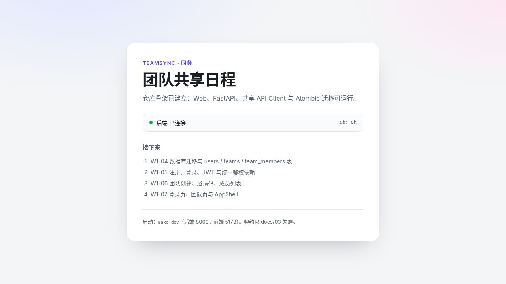
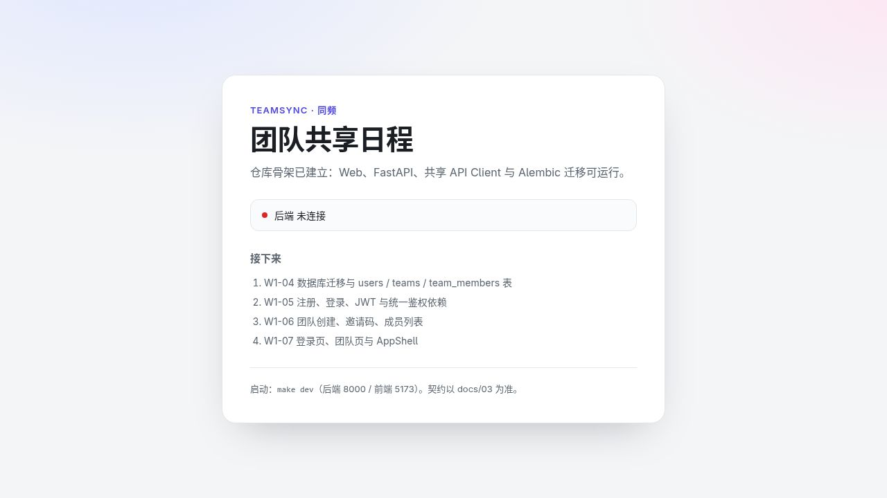
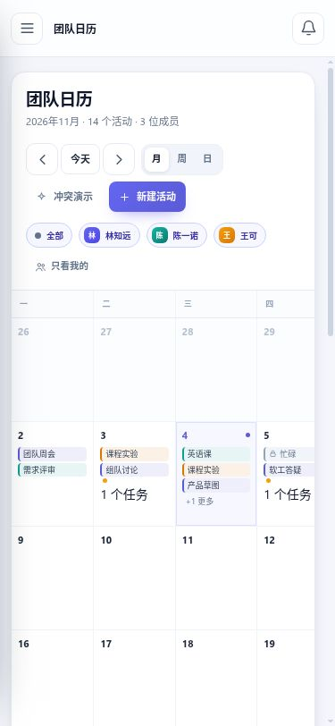
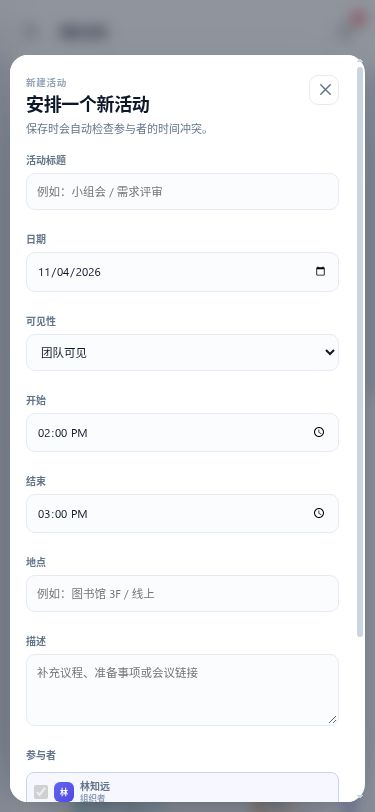

# TeamSync 测试报告 · 2026-10-29

## 1. 测试范围与结论

本次按用户要求，仅测试 `src/team-scheduler`，未修改其应用源码、依赖定义、锁文件、数据库模型或接口契约。开始时 `git status --short` 为空，测试基线提交为 `13d6ebf`（`chore: 初始化仓库骨架`）。本次新增内容仅为本报告和测试证据。

**现有工程骨架可运行，基础自动检查均成功；当前版本仍是“工程骨架 + 静态原型”，不能作为完整团队日程系统进行最终验收。** 正式后端只有 `/health`，正式前端只展示骨架与后端连接状态。注册、登录、团队、活动、任务、通知、WebSocket 等业务尚未接入。

当前组员仓库实际采用 FastAPI + SQLite，与此前 Flask 方案不同；本次按现有项目测试，没有替换框架。

以下结果是测试证据，不代替项目成员的人工验收与签字。

## 2. 环境与隔离

| 项目 | 本次环境 |
| --- | --- |
| 操作系统 | Linux |
| Python | 用户指定的 mamba `python-3.12` 环境，Python 3.12.13 |
| Python 路径 | `/home/qba/miniforge3/envs/python-3.12/bin/python` |
| 主要后端依赖 | FastAPI 0.162.0、Starlette 1.10.0、SQLAlchemy 2.0.55、Alembic 1.20.1、pytest 9.2.0、Ruff 0.17.3 |
| Node | v26.12.1 |
| pnpm | 12.11.2，与现有 CI 一致；通过 `npm exec` 临时调用 |
| 前端依赖 | 使用原有 `pnpm-lock.yaml`，执行 `install --frozen-lockfile` |
| 浏览器 | 应用内浏览器，桌面默认尺寸与 375 × 812 移动视口 |
| 数据 | pytest 自带临时库；探针和浏览器后端均另外使用 `/tmp` 下临时 SQLite 数据库 |

测试密钥在进程内随机生成；没有读取或覆盖原有 `.env`。原型交互仅改变浏览器内存中的虚构数据。后端依赖按现有 `server/pyproject.toml` 安装到指定环境，未新增依赖定义；前端安装生成的 `node_modules`、构建生成的 `dist` 均为忽略项。

沙箱内首次 pytest 卡在 TestClient 第一个用例，沙箱外同一组测试 0.32 秒完成，归类为测试环境限制。临时服务只绑定 `127.0.0.1`。测试期间原型静态服务曾退出并导致浏览器 502；重启服务并新建测试标签后恢复，该次 502 不作为产品缺陷。

## 3. 工程自动检查

以下命令在相应目录运行。`PY` 为上表的 Python 绝对路径；`PNPM` 表示 `npm exec --yes --package=pnpm@12.11.2 -- pnpm`。

| 检查 | 目录及命令 | 实际结果 |
| --- | --- | --- |
| 后端现有测试 | `server/`：`timeout 30 "$PY" -m pytest -v -o faulthandler_timeout=10` | `4 passed, 2 warnings in 0.32s` |
| 后端静态检查 | `server/`：`"$PY" -m ruff check .` | `All checks passed!` |
| 前端与共享包类型检查 | 仓库根：`$PNPM -r typecheck` | 退出码 0，两个包的 `tsc --noEmit` 成功 |
| 前端 lint | 仓库根：`$PNPM -r lint` | 退出码 0，ESLint 成功 |
| 正式 Web 构建 | 仓库根：`$PNPM --filter @teamsync/web build` | 退出码 0，20 个模块，Vite 构建成功 |
| 迁移升级 | 临时数据库，`server/`：`"$PY" -m alembic upgrade head` | 到达 `0001_initial` |
| 迁移回滚再升级 | `alembic downgrade base` → `alembic upgrade head` | 均退出码 0 |
| 模型／迁移一致性 | `"$PY" -m alembic check` | `No new upgrade operations detected.` |
| SQLite 运行配置 | 使用应用自身 SQLAlchemy 引擎查询 PRAGMA | `foreign_keys=1`、`journal_mode=wal`、`busy_timeout=5000` |

没有直接运行 `make check`：现有 Makefile 默认使用 `server/.venv`，本次按用户要求使用 mamba，且系统没有全局 pnpm；执行的是对应的 pytest、Ruff、typecheck、lint 命令。

迁移成功只证明**空基线迁移可执行**。迁移后的数据库仅有 `alembic_version`，`app.models` 中也只有 Base，没有业务表，不表示用户、团队和活动的数据模型已实现。

测试警告：

- AnyIO pytest 插件引用的 `CallSpec2` 将在 pytest 10 移除。
- Starlette TestClient 提示当前 httpx 接入将弃用，建议后续依赖维护时处理；本次未自行增加 httpx2。

## 4. 服务端接口与异常测试

探针位于 [api_probe.py](test-evidence-2026-10-29/api_probe.py)，实际输出见 [api-probe-output.txt](test-evidence-2026-10-29/api-probe-output.txt)。

复现命令（在仓库根目录）：

```bash
/home/qba/miniforge3/envs/python-3.12/bin/python docs/dev/test-evidence-2026-10-29/api_probe.py
```

探针自行创建临时数据库和临时密钥，并在子进程中执行迁移。它打印观测值，**不把缺失的业务接口或已知缺陷断言为成功**。

| 场景 | 实际响应／观察 | 结论 |
| --- | --- | --- |
| `GET /health` | 200，`{"status":"ok","db":"ok"}` | 正常 |
| `POST /health` | 405，统一 `{code,message,details}` 错误体 | 错误体正常；缺少 `Allow` 头，见 F-01 |
| 不存在的业务路径 | 404，`NOT_FOUND` | 兜底错误体正常 |
| 查询 OpenAPI | `paths` 仅 `['/health']` | 当前没有业务路由 |
| DB 查询故障 | 覆盖 `get_db`，让 `execute` 抛 SQLAlchemy `OperationalError`；返回 503，`{"status":"error","db":"error"}` | 健康检查故障分支正常；这不是数据库断电实测 |
| 401 带认证挑战头 | 在独立探针 App 中使用现有错误处理器，抛出带 `WWW-Authenticate` 的 HTTPException | 错误体正确，但响应头丢失，见 F-01 |
| 429 带重试头 | 同上，抛出带 `Retry-After: 60` 的 HTTPException | 错误体正确，但响应头丢失，见 F-01 |
| 未捕获异常 | 独立探针路由抛出合成 ValueError，关闭 TestClient 自动重抛 | 500，统一中文错误体，响应不包含合成异常详情 |

实际请求的注册、登录、团队、活动、任务、通知路径全部返回 404，包括：

```text
POST /api/v1/auth/register
POST /api/v1/auth/login
GET  /api/v1/teams
GET  /api/v1/teams/1/events
GET  /api/v1/teams/1/tasks
GET  /api/v1/notifications
```

这些是**当前版本未实现的功能**，不是已经实现功能的回归故障。不能用这些 404 来证明身份验证或团队隔离有效。

## 5. 浏览器检查

### 5.1 正式应用 `apps/web`

- 后端启动时，访问 Vite 的 `5173` 页面，实际显示“后端 已连接 db: ok”，验证了共享 API Client、Vite `/health` 代理和后端健康检查连通。
- 停止测试用后端后刷新页面，实际显示“后端 未连接”，页面仍能渲染。
- 页面明确列出数据库、认证、团队和登录页面为后续工作，没有可操作的业务页面。
- 未测试生产静态资源托管、生产环境 API 代理或上线部署；构建成功不等于已完成部署。





### 5.2 静态原型 `demo`

以下仅证明**原型本地交互**，不涉及服务端持久化或多用户同步。

| 操作 | 实际观察 |
| --- | --- |
| 周→月→日视图 | 正常切换，标题与活动区域随视图变化 |
| 私密安排详情 | “忙碌”，仅显示陈一诺的占用时间；未显示私密标题、地点、描述 |
| 搜索私密标题关键词“医院” | 显示无结果 |
| 搜索公开关键词“需求” | 返回需求评审、需求冻结；可打开详情 |
| 冲突演示→创建活动 | 提示王可与课程实验有 1 个时间冲突 |
| 冲突弹窗→调整时间 | 返回原表单，已填信息保留 |
| 冲突弹窗→仍然创建 | 活动数量由 13 变 14，日历出现“临时讨论” |
| 接受“迭代评审”邀请 | 待回应数量由 2 变 1 |
| “需求评审”选待定，再改拒绝 | 详情状态更新，待回应数量变 0 |
| 完成“确认演示账号” | 未完成任务由 6 变 5，日历当日全天截止项消失 |
| 通知中心→全部已读 | 未读由 3 变 0，导航与铃铛角标同步清除 |
| 成员页和设置页 | 能打开；成员卡、角色权限表、设置表单正常展示 |
| 375px 移动端 | 抽屉和遮罩可展开，选导航后收起；活动表单以底部弹层打开 |
| 375px 页面宽度 | 实测 `documentElement.scrollWidth=375`、`body.scrollWidth=375`，页面整体无横向溢出 |
| 最后一次原型控制台检查 | 查询 error/warn 日志返回空列表；不代表所有未测路径都无异常 |





未把以下内容记为已测试：真实邀请码入队、真实通知发送、刷新持久化、多端同步、后台提醒、注册／登录 E2E、系统剪贴板写入、真机手势和 Android／Electron 行为。

## 6. 复现问题

### F-01：统一 HTTP 异常处理器丢失必要响应头（中）

位置：`server/app/errors.py:68–71`。

复现：`POST /health` 返回 405，但没有 `Allow: GET`。独立探针 App 复用同一处理器，抛出 `HTTPException(401, headers={"WWW-Authenticate":"Bearer"})` 和 `HTTPException(429, headers={"Retry-After":"60"})`，对应的头也都消失。

原因：处理器重建 JSONResponse 时没有透传 `exc.headers`。建议在后续修复中保留异常头，并给 405、401、429 添加回归断言。本次仅报告，不改实现。

这是对 2026-10-28 审查报告 R-04 的再次动态确认，额外验证了 401 和 429 分支；401／429 是合成路由测试，不表示当前已有认证或限流接口。

### F-02：原型拒绝邀请后仍计入忙闲（中，原型交互）

位置：`demo/app.js:274–276`、`demo/app.js:601–612`。

复现步骤：

1. 新开原型页面，初始总忙碌为 `35.0h`。
2. 在待回应邀请中拒绝“迭代评审”（11 月 6 日 09:30–11:00）。
3. 待回应数量从 2 变 1，证明 RSVP 状态已更新。
4. 右侧总忙碌仍为 `35.0h`，林知远 11 月 6 日的忙闲单元仍显示 `3.0 小时`。

该活动是林知远当天不重叠的 1.5 小时安排，拒绝后按未拒绝占用的口径，应从他的忙闲中移除；本例对应总计 `33.5h`、当天 `1.5 小时`。

原因：`busyHoursOnDay()` 仅检查 `isParticipant()`，后者只检查是否有参与者行，不检查 RSVP 状态。建议统一忙闲与冲突对拒绝状态的处理。本问题在静态原型中复现，不能据此声称正式后端存在同一缺陷。

### F-03：原型可保存但不显示 08:00 前的活动（中，原型边界）

位置：`demo/app.js:8–9`、`demo/app.js:362–368`。

复现步骤：

1. 在默认周新建标题“清晨边界测试”的活动，日期 2026-11-04，时间 07:00–07:30，仅组织者参与。
2. 页面提示“活动已创建”，活动总数变 14。
3. 周视图的 `.event-block` 文本列表不包含该标题，时间轴仅显示 08:00–20:00。
4. 全局搜索能找到该活动并显示 07:00，证明保存成功。

原因：`eventBlock()` 将活动裁剪到固定显示区间，区间外直接返回空字符串；表单允许输入该时段，却没有显示范围提示。PRD `CAL-2` 要求 24 小时网格，正式实现不能直接沿用该限制。建议覆盖完整时间范围或提供明确可调整的显示范围，避免安排看似丢失。本次没有额外验证 20:00 后、跨日和全天新建。

### F-04：文档中的校验状态码仍有矛盾（契约待定）

静态核对：`docs/02` 注册验收要求短密码返回 422，`docs/03:401` 列出 `422 VALIDATION_ERROR`；同一文档错误表和 `docs/ai/02` 则写 `400 VALIDATION_ERROR`。现有通用 Pydantic 错误处理器实际返回 400，已有测试也断言 400。

当前没有注册路由，不能把这一项写成“注册短密码测试失败”。建议组员在实现认证前明确格式校验与业务校验的状态码，再同步文档和测试；本次没有修改契约。

## 7. 未实现与未验证项

| 项目 | 当前原因 |
| --- | --- |
| 登录、建队、入队、活动邀请、RSVP、任务的正式 E2E | 对应路由和页面未实现 |
| 多租户隔离、真实私密数据脱敏 | 缺少业务模型与鉴权依赖；原型隐藏字段不是服务端安全证明 |
| UTC／团队时区、跨日、跨月、全天语义 | 共享日期工具及正式业务尚未实现 |
| 服务端冲突检测与提醒去重 | services、scheduler 目录为占位 |
| WebSocket 和多端同步 | realtime 目录为占位 |
| Electron／Android 系统通知 | 对应应用目录未建立，无真机／安装包 |
| 核心服务覆盖率 ≥70% | 未统计覆盖率，当前也没有可衡量的核心业务服务 |
| 375px 真机横滑、768px／1440px 完整矩阵 | 仅做 375px 浏览器模拟与默认桌面尺寸，不代替真机 |
| 性能指标、生产 CORS／HTTPS、备份恢复 | 本次未开展压测和生产部署验证 |
| 前端单元／E2E 自动化套件 | 当前 package scripts 未建立对应 test／test:e2e 命令 |

## 8. 本次改动与后续建议

新增：

- 本报告：记录范围、命令、实际结果、可复现问题及未验证项。
- `test-evidence-2026-10-29/api_probe.py`：可重复运行的独立观测脚本。
- `test-evidence-2026-10-29/api-probe-output.txt`：探针输出。
- `test-evidence-2026-10-29/*.jpg`：本次浏览器测试截图。

未改动组员应用源码、测试源码、依赖文件、锁文件与既有历史审查记录。`git diff --stat` 对已跟踪文件无输出；`git status --short` 仅列出本报告和新证据目录。

建议先由项目组确认这是预期的 W1 骨架快照，再处理 F-01 与校验契约，按现有计划实现账号／团队／数据模型并补对应测试。F-02、F-03 应在将原型迁移到正式页面前修正。完整产品的验收需待业务实现后重新执行，不依据本次基础检查结果签署通过。

测试结束后，已停止本次启动的后端、Vite 和静态服务，并恢复浏览器默认视口。临时数据库仅位于 `/tmp`，没有覆盖现有数据。
